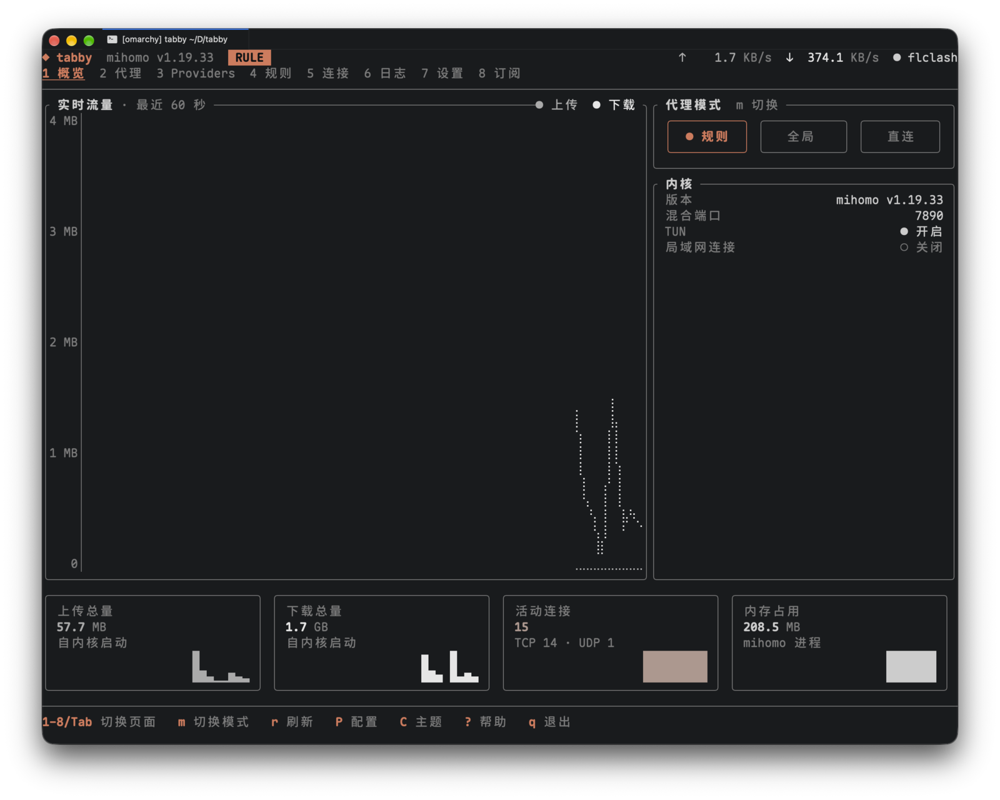

# tabby

终端里的 [mihomo](https://github.com/MetaCubeX/mihomo)（Clash.Meta）控制台。

基于 [ratatui](https://ratatui.rs)，通过 External Controller 的 REST 与 WebSocket 接口工作：实时流量、代理切换与测速、规则、连接、日志、内核设置，无需浏览器。也能自己托管内核：下载、订阅、TUN、系统代理。界面为中文，键盘与鼠标均可操作。



代理页：

```text
◆ tabby  mihomo v1.19.33   RULE             ↑      0 B/s   ↓      0 B/s   ● test
1  2  3  4  5  6  7  8
────────────────────────────────────────────────────────────────────────────────
▾ 节点选择  SEL  → 自动选择
╭ 节点选择  Selector · 13 个节点 · 默认顺序 ─────────────────────── 1–12 / 13 ▾╮
│╭────────────────────────╮╭────────────────────────╮╭────────────────────────╮│
││自动选择               ✓││故障转移                ││负载均衡                ││
││URLTest · UDP          —││Fallback · UDP         —││LoadBalance · UDP      —││
│╰────────────────────────╯╰────────────────────────╯╰────────────────────────╯│
│╭────────────────────────╮╭────────────────────────╮╭────────────────────────╮│
││直连 A                  ││直连 B                  ││香港 01                 ││
││Direct · UDP      250 ms││Direct · UDP      252 ms││Direct · UDP           —││
│╰━━━━━━━━━━━━────────────╯╰━━━━━━━━━━━━────────────╯╰────────────────────────╯│
╰──────────────────────────────────────────────────────────────────────────────╯
────────────────────────────────────────────────────────────────────────────────
Enter 选组   t 测速   T 整组测速   s 排序   / 过滤   …   ? 帮助   q 退出
```

## 特性

- **八个页面**：概览、代理、Providers、规则、连接、日志、设置、订阅
- **实时**：流量、内存、连接、日志走 WebSocket，断线退避重连
- **托管内核**（可选）：自动下载 mihomo，管理订阅，一键 TUN、登录启动、系统代理
- **多配置**：一键切换多个控制器
- **主题**：内置 7 套，支持自定义与逐色覆盖，实时预览
- **响应式**：50×15 以上任意终端尺寸可用
- **单一二进制**：纯 Rust，rustls，无 OpenSSL

## 安装

**发布包**（Linux x86_64 / aarch64，glibc ≥ 2.35；macOS 12 及以上，Apple Silicon / Intel）：从 [Releases](https://github.com/VOD-Studio/tabby/releases) 下载。`-with-mihomo` 包另带一份固定版本的 mihomo。

```sh
sha256sum --check --ignore-missing SHA256SUMS
tar -xzf tabby-*-x86_64-unknown-linux-gnu-with-mihomo.tar.gz -C ~/.local --strip-components=1
```

macOS 上浏览器下载的文件带 quarantine 属性，解压前先去掉（或用下面的 Homebrew）：

```sh
shasum -a 256 --check --ignore-missing SHA256SUMS
xattr -d com.apple.quarantine tabby-*-aarch64-apple-darwin-with-mihomo.tar.gz
tar -xzf tabby-*-aarch64-apple-darwin-with-mihomo.tar.gz -C ~/.local --strip-components=1
```

**Homebrew**（macOS / Linux）：从源码构建，包名 `tabby-mihomo`。不附带内核：tabby 首次启动时下载，或用 `brew install mihomo` 装的那份，由 Homebrew 更新。

```sh
brew install vod-studio/tabby/tabby-mihomo
```

**Arch Linux**：用仓库里的 `packaging/arch/PKGBUILD` 从发布源码构建，包名 `tabby-mihomo`（AUR 上的 `tabby` 是 Tabby 终端，二者都占用 `/usr/bin/tabby`，不能共存）。不附带内核：可另装 `mihomo`，由 pacman 更新。

```sh
cd packaging/arch && makepkg -si
```

**源码**（Rust ≥ 1.95，Linux 与 macOS）：

```sh
cargo install --path .
```

## 使用

```sh
tabby                                              # http://127.0.0.1:9090
tabby --url http://192.168.1.1:9090 --secret xxx
tabby --profile router                             # config.toml 里的 [profiles.router]
```

| 选项        | 环境变量        | 说明                                |
| ----------- | --------------- | ----------------------------------- |
| `--profile` | `TABBY_PROFILE` | `config.toml` 中的 profile 名       |
| `--url`     | `TABBY_URL`     | 控制器地址，默认 `http://127.0.0.1:9090` |
| `--secret`  | `TABBY_SECRET`  | 控制器 secret                       |
| `--theme`   | `TABBY_THEME`   | 主题名或主题文件路径                |

优先级：命令行 > 环境变量 > `config.toml` > 默认值。命令行参数会出现在进程列表里，secret 建议走环境变量或配置文件。tabby 访问控制器时忽略 `HTTP_PROXY` 等变量。

## 配置

`$XDG_CONFIG_HOME/tabby/config.toml`（默认 `~/.config/tabby/`；macOS 上默认 `~/Library/Application Support/tabby/`，设置了 `XDG_CONFIG_HOME` 时同 Linux）。不存在则用默认值；内容非法时在进入全屏前报错退出并指出出错的键。

```toml
default = "local"            # 启动使用的 profile
theme = "terminal"           # 内置主题名、themes/ 中的主题名，或文件路径
icons = "unicode"            # unicode | nerd
mouse = true                 # false 则保留终端原生选择

[delay]                      # 测速（默认值）
url = "https://www.gstatic.com/generate_204"
timeout_ms = 5000

[profiles.local]
url = "http://127.0.0.1:9090"
secret = "your-secret"       # 明文保存

[profiles.router]
url = "http://192.168.1.1:9090"

[theme_overrides]            # 覆盖当前主题的单个颜色
accent = "#7aa2f7"
```

`P` 打开 profile 弹窗并重新连接；页面、排序、日志级别、主题保持不变。

### 主题

`terminal`（默认，跟随终端 16 色）、`tokyo-night`、`catppuccin-mocha`、`catppuccin-latte`（浅色）、`gruvbox-dark`、`nord`、`dracula`、`clay-dark`、`clay-light`（浅色；按 [Clay 设计规范](https://github.com/DefectingCat/clay.nvim) 取色，灰阶为底，Clay 只用于焦点）。`C` 打开主题弹窗，移动即预览，`Enter` 写回 `theme`（保留注释）。

自定义主题放在 `themes/<name>.toml`：

```toml
extends = "tokyo-night"      # 可选，默认 terminal

[colors]
accent = "#ff9e64"
bg = "#16161e"
```

优先级：内置 < 主题文件 `[colors]` < `[theme_overrides]`。颜色键：`fg` `muted` `bg` `surface` `stripe` `accent` `success` `warning` `error` `c1`–`c4`；值为 `#rrggbb`、16 色 ANSI 名（`light-green`）或 `reset`。

`icons = "nerd"` 需要 Nerd Font v3，推荐 Mono 变体；错位时改回 `unicode`。

## 托管内核

在 `config.toml` 加一段 `[core]`，`P` 弹窗里就会出现“托管内核”；`default = "core"` 则启动即用。

```toml
default = "core"             # 可选
[core]
binary = "/usr/bin/mihomo"   # 可选，不写则按下面的顺序找
```

**内核来源**，依次：`[core].binary` → 数据目录里的 `bin/mihomo`（下载的，或由随包内核复制）→ 随包内核 `<前缀>/lib/tabby/mihomo` → `PATH` 里的 `mihomo` → 询问后从 GitHub 下载（校验 sha256）。`binary` 与 `PATH` 里的内核由你自己管理，tabby 不升级。

**数据目录** `$XDG_DATA_HOME/tabby/core/`（macOS 默认 `~/Library/Application Support/tabby/core/`）：内核、`home/config.yaml`、订阅 `profiles/`、`subscriptions.toml`、`settings.toml`、`state.toml`。含敏感信息的文件权限 0600。`config.yaml` 每次从订阅与设置重新生成，不要手改。

**进程**：有 systemd 用户实例时作为临时单元 `tabby-mihomo-*` 运行，崩溃自动拉起；macOS 上有图形会话时作为 launchd 任务 `gui/<uid>/tabby-mihomo-*` 运行，同样崩溃自动拉起，日志在 `core.log`；都没有时作为独立进程，日志在 `core.log`，`r` 重启。`q` 只退出 tabby，内核继续运行，设置页“停止内核”才停。

**订阅**（第 8 页）：`a` 导入 URL 或文件，`Enter` 切换，`u` / `U` 更新，`t` 自动更新（默认 24 小时，`i` 改间隔），`e` 改名，`K` 更换 age 私钥，`d` 删除。支持 Clash YAML、分享链接列表、age 加密订阅（X25519）。订阅不会被重新序列化，tabby 只替换自己接管的顶层键（端口、控制器、`secret`、`tun` 等）并追加覆盖块；导入前用 `mihomo -t` 检查。下载方式（直连 / 经托管内核 / 经代理）在设置页切换，网络错误与 5xx 自动重试两次。

**设置页**：内核升级、登录时启动、系统代理、DNS 覆盖（11 个键，改前先 `mihomo -t`）、订阅下载方式、停止内核。托管内核只开一个 Mixed 端口（默认 7890）。

**TUN**：用 `setcap` 授予 `CAP_NET_ADMIN` / `CAP_NET_BIND_SERVICE`，不以 root 运行。先试 `pkexec`，没有图形认证代理时临时退出全屏，在终端里 `sudo setcap`。内核所在分区为 `nosuid` 时无效，会提前报错，请用 `[core].binary` 指向别处。升级内核后能力丢失，需重新授权。

macOS 没有文件能力，TUN 需要 root：授权会把内核改为 root 所有并加上 setuid 位（`chown root:wheel` + `chmod 4755`），先弹系统的管理员密码框，没有图形会话时在终端里 `sudo`。**此后本机任何用户运行这个内核文件都有 root 权限**，请只在自己独用的电脑上开启。外置盘默认 `noowners`，setuid 无效，会提前报错。升级内核同样需要重新授权。

**登录时启动**：写入并 `enable` `~/.config/systemd/user/tabby-mihomo-*.service`，登录后由 systemd 拉起，无需 tabby 在运行。不是开机启动，不执行 `enable-linger`。macOS 上写入 `~/Library/LaunchAgents/tabby-mihomo-*.plist`，系统会提示“已添加后台项目”，可在“系统设置 › 通用 › 登录项”里管理。

**系统代理**：把桌面代理指向 `127.0.0.1:<Mixed 端口>`，关闭或停止内核时还原。支持 GNOME / MATE / Cinnamon（`gsettings`）、KDE（`kwriteconfig`）与 macOS（`networksetup`，设置每个启用的网络服务）；其他桌面置灰。

**已知局限**

- 内核在 tabby 之外退出时，系统代理仍指向已关闭的端口，下次启动会提示，在设置页关闭即可。
- 不要让托管内核与 FlClash 等其他内核同时开 TUN auto-route，也不要共用 7890。
- age 私钥明文存放在 `subscriptions.toml`；不支持口令加密和 SSH 密钥。
- 已验证：systemd 单元、登录单元、订阅导入与更新、age 解密、`gsettings`（内存后端）、`kwriteconfig6`。**未验证**：真实 `pkexec` / `sudo setcap`、TUN 设备与路由、注销再登录、真实 GNOME / KDE 桌面。macOS 的 launchd、登录项、`networksetup` 与 setuid 授权只有单元测试，尚未在真机上验证。

## 页面与按键

`?` 打开当前页面的帮助。弹窗打开时按键只作用于弹窗，`Esc` 关闭；输入框内所有按键都是文字；`Ctrl+C` 随时退出。

| 页面 | 内容 | 主要按键 |
| ---- | ---- | -------- |
| 1 概览 | 60 秒流量图、模式、内核信息、统计卡片 | |
| 2 代理 | 代理组与节点网格 | `Enter` 选择 · `h` `l` 移动 · `t` 测速 · `T` 整组测速 · `s` 排序 |
| 3 Providers | 代理集合与规则集合 | `u` 更新 · `U` 全部更新 · `h` 健康检查 |
| 4 规则 | 规则列表 | |
| 5 连接 | 实时连接表 | `Enter` 详情 · `x` 关闭 · `X` 全部关闭 · `s` `S` 排序 · `p` 暂停 |
| 6 日志 | 内核日志（保留 2000 条） | `Enter` 详情 · `y` 复制（OSC 52；tmux 需 `set -g set-clipboard on`） · `l` 级别 · `p` 暂停 · `c` 清空 |
| 7 设置 | 模式、端口、TUN、重载、GeoData、重启与升级内核等 | `Enter` / `Space` 切换 · `y` `n` 确认 |
| 8 订阅 | 托管内核的订阅 | 见上 |

| 全局 | |
| ---- | ---- |
| `1`–`8` `Tab` `Shift+Tab` | 跳转 / 切换页面 |
| `r` | 刷新，出错时重试 |
| `m` | 切换模式 rule → global → direct |
| `P` `C` | 切换配置 / 主题 |
| `j` `k` `gg` `G` `Ctrl+d` `Ctrl+u` | 列表移动（`gg` 顶部、`G` 底部，同 vim） |
| `/` | 过滤（`Enter` 保留，`Esc` 清除；有过滤时 `U` `X` 只作用于匹配项） |
| `q` | 退出 |

**鼠标**：单击选中 / 跳转标签 / 点表头排序，双击等同 `Enter`，滚轮滚动指针下的列表；列表放不下时右边框上有滚动条，点击或拖动它跳到对应位置。

控制器不可达时顶部出现重连横幅，`r` 立即重试，`P` 换配置。

## 内核兼容

mihomo 全部功能可用。原版 Clash 只支持通用功能，mihomo 独有项（TUN、内存、规则集合、整组测速、FakeIP、GeoData、重启与升级）置灰或提示“需要 mihomo”，不发请求；内核类型由 `GET /version` 的 `meta` 判断。Clash 的行为只由样本与单元测试覆盖，未连接真实实例验证。

## 终端尺寸

| 条件 | 变化 |
| ---- | ---- |
| 宽 < 100 | 代理组折叠为顶部选择行，标签栏只显示数字 |
| 宽 < 70 | 连接表隐藏“进程”“总量”列 |
| 高 < 28 | 概览页隐藏统计卡片 |
| 宽 < 50 或高 < 15 | 仅提示“终端尺寸过小” |

## 日志

tabby 自身日志（含 panic）写入 `$XDG_STATE_HOME/tabby/tabby.log`（macOS 默认在数据目录 `~/Library/Application Support/tabby/`），级别由 `RUST_LOG` 控制，默认 `info`。与“日志”页不同，后者显示内核日志。

```sh
RUST_LOG=tabby=debug tabby
```

## 开发

```sh
make check     # fmt + clippy -D warnings + test（测试在临时 XDG 目录下运行）
make help      # 全部目标：dist、audit、cut-release …
```

- 设计与决策：[`docs/plans/2026-11-05-tabby-tui.md`](docs/plans/2026-11-05-tabby-tui.md)、[`docs/plans/2026-11-06-managed-core.md`](docs/plans/2026-11-06-managed-core.md)
- 贡献约定：[`AGENTS.md`](AGENTS.md)
- 发布：`make cut-release VERSION=x.y.z` 提交并打标签，推送标签后由 GitHub Actions 构建、签发来源证明并创建 Release；版本遵循 [SemVer](https://semver.org/lang/zh-CN/)，`CHANGELOG.md` 由 [git-cliff](https://git-cliff.org) 从 Conventional Commits 生成

## 许可证

[MIT](LICENSE)。mihomo 是独立程序，遵循 GPL-3.0；`with-mihomo` 发布包里的那份未经修改，许可证与源码说明在 `share/licenses/tabby/mihomo/`。Rust 依赖的许可证见 `share/licenses/tabby/THIRD-PARTY-LICENSES`。
