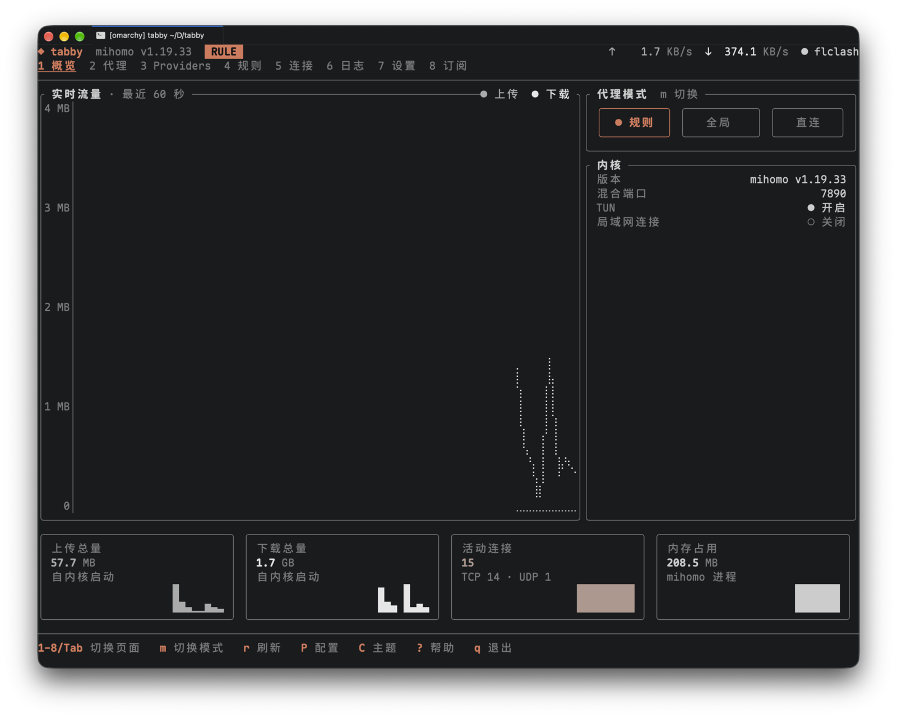

# tabby

<p align="center">
  
</p>

终端里的 [mihomo](https://github.com/MetaCubeX/mihomo)（Clash.Meta）中文控制台。支持 Linux 与 macOS，可连接现有内核，也可托管 mihomo。



## 特性

- **代理管理**：节点切换与测速、Providers 更新、规则查询、连接管理。
- **实时监控**：流量、内存与内核日志，断线自动重连。
- **内核托管**：下载与升级、订阅管理、TUN、登录启动、系统代理。
- **终端交互**：键盘与鼠标操作、多控制器切换、内置与自定义主题。

## 安装

支持 Linux x86_64 / aarch64（glibc ≥ 2.35）与 macOS 12+（Apple Silicon / Intel）。

| 方式 | 安装 |
| ---- | ---- |
| 发布包 | 从 [Releases](https://github.com/VOD-Studio/tabby/releases) 下载；`-with-mihomo` 包附带内核 |
| Homebrew | `brew install vod-studio/tabby/tabby-mihomo` |
| Arch Linux | 使用 [`PKGBUILD`](packaging/arch/PKGBUILD)：`cd packaging/arch && makepkg -si` |
| 源码 | Rust ≥ 1.95，克隆仓库后执行 `cargo install --path .` |

Homebrew 与 Arch 包不附带内核，可由 tabby 下载或另行安装 `mihomo`。Arch 包与 Tabby 终端共用 `/usr/bin/tabby`，不能共存。

<details>
<summary>发布包校验与解压</summary>

同时下载 `SHA256SUMS`，将下列文件名替换为所下载的包。确保 `~/.local/bin` 在 `PATH` 中。

```sh
# Linux x86_64
sha256sum --check --ignore-missing SHA256SUMS
mkdir -p ~/.local
tar -xzf tabby-*-x86_64-unknown-linux-gnu-with-mihomo.tar.gz -C ~/.local --strip-components=1
```

macOS 用 `shasum -a 256 --check --ignore-missing SHA256SUMS` 校验；浏览器下载的压缩包需在解压前执行 `xattr -d com.apple.quarantine <文件名>`，再用同样的 `tar` 命令解压。

</details>

## 快速开始

```sh
tabby                                              # 首次无配置时连接 http://127.0.0.1:9090
TABBY_SECRET=your-secret tabby --url http://192.168.1.1:9090
```

用 `--profile` 选择配置、`--theme` 指定主题，完整参数见 `tabby --help`。命令行参数优先于对应的 `TABBY_*` 环境变量。未指定控制器参数时，启动会优先恢复上次在 `P` 菜单确认切换的控制器，再使用配置文件的 `default` 或内置地址。

命令行中的 `--secret` 会暴露在进程列表中，建议使用环境变量或配置文件。连接控制器时忽略 `HTTP_PROXY` 等代理变量。

## 配置

配置文件为 `$XDG_CONFIG_HOME/tabby/config.toml`，Linux 默认 `~/.config/tabby/config.toml`，macOS 默认 `~/Library/Application Support/tabby/config.toml`。文件不存在时使用默认值。

```toml
default = "local"
theme = "terminal"

[profiles.local]
url = "http://127.0.0.1:9090"
secret = "your-secret"       # 明文保存
```

添加多个 `[profiles.<名称>]` 可连接不同控制器。按 `P` 并回车切换后，tabby 在状态目录的 `last-controller.toml` 中记住选项。下次启动会读取该选项当前的地址与密钥。对应的配置已删除或改名时，回退到 `default` 或内置地址。`P` 菜单里的「启动参数指定」仅用于当前会话。

<details>
<summary>主题与交互配置</summary>

内置终端配色、Tokyo Night、Catppuccin、Gruvbox、Nord、Dracula 与 Clay 等主题，按 `C` 预览并保存。

自定义主题放在配置目录的 `themes/<名称>.toml`：

```toml
extends = "tokyo-night"

[colors]
accent = "#ff9e64"
bg = "#16161e"
```

颜色支持 `#rrggbb`、ANSI 16 色名称或 `reset`。配置文件中的 `[theme_overrides]` 可覆盖当前主题的颜色。

在配置文件顶层设置 `icons = "nerd"` 可启用 Nerd Font v3 图标（默认 `unicode`）；`mouse = false` 可关闭鼠标操作，保留终端原生选择。

</details>

## 托管内核

使用以下最小配置，启动后在“订阅”页按 `a` 导入 URL 或文件、`Enter` 切换订阅。支持 Clash YAML、分享链接列表与 age 加密订阅。

```toml
default = "core"

[core]
# binary = "/usr/bin/mihomo"  # 可选，指定自行管理的内核
```

未指定内核时，依次使用数据目录、随包内核与 `PATH` 中的 mihomo，均不存在则询问后下载。设置页可管理内核升级、TUN、DNS、登录启动与系统代理。

**退出 tabby 不会停止内核**；请在设置页选择“停止内核”。不要与其他客户端共用端口（默认 Mixed 端口为 7890），或同时开启 TUN auto-route。

<details>
<summary>运行机制与安全须知</summary>

- **运行与数据**：优先使用 systemd 用户单元或 macOS launchd，否则以独立进程运行。数据位于 `$XDG_DATA_HOME/tabby/core/`（Linux 默认 `~/.local/share/tabby/core/`，macOS 默认 `~/Library/Application Support/tabby/core/`）。`home/config.yaml` 自动生成，不要手改；自行指定或从 `PATH` 找到的内核不由 tabby 升级。
- **订阅与密钥**：支持自动更新；age 仅支持 X25519，私钥明文保存在 `subscriptions.toml`。含敏感信息的文件权限为 0600。
- **Linux TUN**：通过 `pkexec` 或 `sudo setcap` 授权，不以 root 运行；`nosuid` 分区不支持，升级内核后需重新授权。
- **macOS TUN**：将内核改为 root 所有并设置 setuid，**此后本机任何用户运行该文件均获得 root 权限**，仅建议在个人独用设备开启。`noowners` 外置盘不支持，升级后需重新授权。
- **系统代理**：支持 GNOME / MATE / Cinnamon、KDE 与 macOS，关闭代理或停止内核时还原。内核在 tabby 外退出时代理不会自动还原，需在设置页关闭。
- **验证范围**：真实 TUN、提权、桌面代理及注销后登录尚未验证；macOS 系统集成功能目前仅有单元测试。

</details>

## 操作

| 按键 | 操作 |
| ---- | ---- |
| `1`–`8` / `Tab` / `Shift+Tab` | 切换页面 |
| `j` `k` / `gg` `G` / `Ctrl+d` `Ctrl+u` | 列表移动、首尾跳转、翻页 |
| `Enter` / `/` | 选择或查看详情 / 过滤列表 |
| `P` / `C` | 切换控制器 / 主题 |
| `r` / `m` | 刷新或重试 / 切换代理模式 |
| `?` / `Esc` | 当前页面帮助 / 关闭弹窗 |
| `q` / `Ctrl+C` | 退出 |

鼠标支持单击选择、双击确认、滚轮滚动与拖动滚动条。页面专用按键见 `?`；过滤后，批量更新或关闭仅作用于匹配项。

## 兼容性与排障

- 推荐使用 mihomo。原版 Clash 仅支持通用功能，不支持的操作会禁用；兼容性仅由样本与单元测试覆盖。
- 最小终端尺寸为 50×15，小窗口会自动简化布局。控制器不可达时按 `r` 重试，或按 `P` 切换配置。
- tabby 自身日志位于 `$XDG_STATE_HOME/tabby/tabby.log`（Linux 默认 `~/.local/state/tabby/tabby.log`，macOS 默认在数据目录）。用 `RUST_LOG=tabby=debug tabby` 开启调试日志；界面的“日志”页显示的是内核日志。

## 开发

```sh
make check     # fmt + clippy -D warnings + test（测试在临时 XDG 目录下运行）
make help      # 全部目标：dist、audit、cut-release …
```

- 设计文档：[TUI](docs/plans/2026-11-05-tabby-tui.md)、[托管内核](docs/plans/2026-11-06-managed-core.md)、[macOS](docs/plans/2026-11-11-macos.md)
- 贡献约定：[AGENTS.md](AGENTS.md) · 版本记录：[CHANGELOG.md](CHANGELOG.md)

## 许可证

[MIT](LICENSE)。mihomo 是独立程序，遵循 GPL-3.0；`with-mihomo` 发布包里的那份未经修改，许可证与源码说明在 `share/licenses/tabby/mihomo/`。Rust 依赖的许可证见 `share/licenses/tabby/THIRD-PARTY-LICENSES`。
