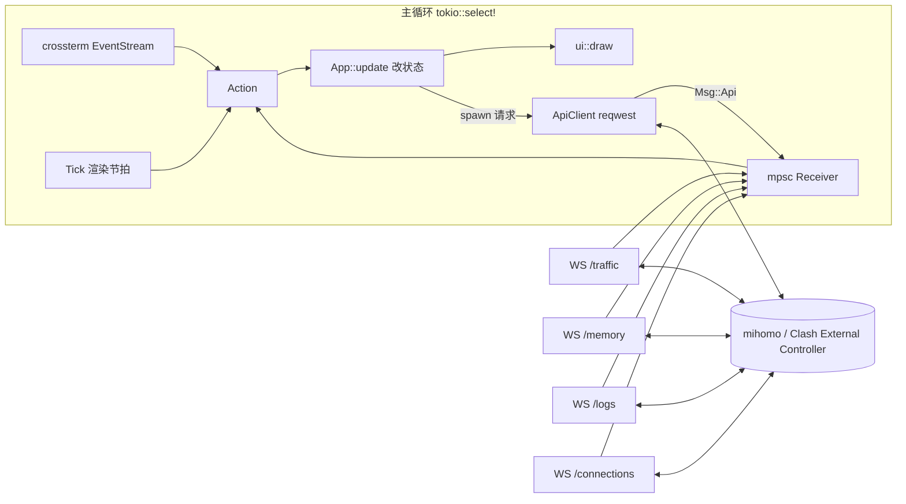

# tabby：Clash External Controller TUI 实施方案

- 日期：2026-11-05
- 状态：实施中
- 工具链：rustc / cargo 1.99.0，edition 2024

## 1. 目标与范围

tabby 是一个 Rust 编写的终端界面，通过 Clash 的 External Controller（RESTful API + WebSocket）查看和控制运行中的代理内核。

**目标**

- 以 mihomo（原 Clash.Meta）为主要内核，兼容原版 Clash 的 API 子集。
- 覆盖日常操作：模式切换、节点选择与测速、连接管理、日志查看、Provider 更新、配置维护。
- 视觉上做到信息层级清晰、配色统一、动效克制，默认跟随终端主题。
- Linux 上验证，代码保持跨平台。

**非目标**

- 不管理内核进程（不负责启动、安装、守护 mihomo）。
- 不编辑订阅或 YAML 配置文件本身，只通过 API 修改运行时配置。
- 不做 Web 面板。

## 2. 依赖选型

版本为 2026-11-05 在 crates.io 查到的最新稳定版，兼容性已核对。实施时用 `cargo add` 添加，届时再次确认最新版本。

```toml
[dependencies]
ratatui = "0.30.2"
crossterm = { version = "0.29.0", features = ["event-stream"] }
tokio = { version = "1.54.1", features = ["rt-multi-thread", "macros", "sync", "time"] }
reqwest = { version = "0.13.5", default-features = false, features = ["rustls", "json"] }
tokio-tungstenite = { version = "0.30.0", features = ["rustls-tls-webpki-roots"] }
futures-util = "0.3.34"
serde = { version = "1.0.229", features = ["derive"] }
serde_json = "1.0.154"
toml = "1.2.0"
directories = "6.0.0"
clap = { version = "4.6.7", features = ["derive", "env"] }
color-eyre = "0.6.5"
thiserror = "2.0.21"
percent-encoding = "2.3.2"
tui-input = "0.15.5"
unicode-width = "0.2.3"
jiff = "0.2.39"
tracing = "0.1.44"
tracing-subscriber = { version = "0.3.23", features = ["env-filter"] }
tracing-appender = "0.2.5"

[dev-dependencies]
wiremock = "0.6.5"
```

| crate | 选型理由 |
|---|---|
| `ratatui` | TUI 事实标准。0.30 拆分为 `ratatui-core` + 后端，默认后端为 crossterm 0.29 |
| `crossterm` | 直接依赖，只为开启 `event-stream` 拿到异步 `EventStream`；版本与 ratatui 内部一致，不会重复编译 |
| `tokio` | 异步运行时 |
| `reqwest` | HTTP 客户端。0.13 默认 TLS 为 rustls；关闭默认 feature，避免 `system-proxy`（见风险 R1） |
| `tokio-tungstenite` | WebSocket 订阅实时数据流；开启 rustls 以支持 `wss://` 远程控制器 |
| `futures-util` | `StreamExt` / `SinkExt` |
| `serde` / `serde_json` | API 数据模型 |
| `toml` + `directories` | 配置文件与 XDG 目录 |
| `clap` | 命令行参数，`env` feature 支持环境变量覆盖 |
| `color-eyre` | 应用层错误与 panic 报告 |
| `thiserror` | API 层类型化错误 |
| `percent-encoding` | 节点名、组名作为 URL 路径段时的编码 |
| `tui-input` | 过滤框、Secret 输入；原生适配 ratatui 0.30 / crossterm 0.29 |
| `unicode-width` | 按显示宽度截断中文与 emoji 名称 |
| `jiff` | 连接开始时间的 RFC 3339 解析与持续时间；Providers 的相对时间和日志页的本地时间也用它 |
| `tracing` 系列 | 日志写入文件（TUI 占用 stdout） |
| `wiremock` | API 客户端测试 |

**未采用**

- `tui-logger`：日志来自 WS，自写环形缓冲 + List 更简单。
- `humansize`：字节格式化十几行即可。
- `insta`：UI 快照测试过于脆弱。
- `throbber-widgets-tui`：转圈动画用 10 帧盲文字符自实现。

**Lint 配置**

```toml
[lints.rust]
unsafe_code = "forbid"

[lints.clippy]
pedantic = { level = "warn", priority = -1 }
module_name_repetitions = "allow"
```

## 3. 架构

单 UI 循环 + 若干后台任务。后台任务只通过 `mpsc` channel 向 UI 发送消息，应用状态只在主循环里修改。



### 3.1 消息流

- `crossterm::event::Event` 先按当前焦点和页面映射为 `Action`（例如 `Action::SelectNode`）。
- `App::update(Action)` 修改状态。需要网络请求时 spawn 一个 tokio 任务，任务完成后发回 `Msg::Api(ApiResult)`。
- WS 任务把收到的帧解析成 `Msg::Traffic` / `Msg::Memory` / `Msg::Log` / `Msg::Connections` 发回。
- UI 不等待任何网络请求；进行中的请求在状态里记为 `Pending`，用来显示转圈。

### 3.2 渲染策略

- 有事件时重绘。
- 有动画（转圈、提示消息倒计时）时按 100ms 节拍重绘，空闲时不触发重绘。
- 实时流数据到达时标记脏，下一次节拍统一重绘，避免一秒多次全屏重绘。

### 3.3 内核识别

启动和每次重连时调用 `GET /version`：

- 返回 `meta: true` → `CoreKind::Mihomo`，开启内存、整组测速、DNS 查询、FakeIP 刷新、GeoData 更新、重启、升级等功能。
- 否则 → `CoreKind::Clash`，上述功能在界面中置灰并注明“需要 mihomo”。

### 3.4 WS 订阅与重连

- 四个流各一个任务，统一实现在 `api/stream.rs`。
- 鉴权：WS 无法自定义请求头，使用 `?token=<secret>`，token 做 URL 编码。
- 断线后指数退避重连：1s、2s、4s … 封顶 30s；重连成功后退避重置。
- 断线只有一个判定来源：`/version` 探测加现有的 `Reconnect` 横幅，WS 不另建一套状态。顶栏状态点同样只读这个来源。
- 流状态只用来决定何时探测和重取：
  - 曾有流连上、之后所有流都断开，且横幅尚未出现时，立即发起一次 `/version` 探测；失败即进入现有的重连流程，横幅随之出现。启动时还没有流连上过，不算断线，避免与启动请求重复。
  - 全部断开之后，任一流重新连上，执行与 REST 重试相同的启动请求（`/version`、`/configs`、`/proxies`），刷新内核类型、模式标签、mihomo 专属功能的置灰状态和代理页数据；按需加载的规则页、Providers 页数据只要加载过或加载失败过，也一并重取（第 41 项）。
- `r` 唤醒所有正在等待退避的流并立即重连；正在连接或已连接的流不受影响。
- 每个流只在连接状态变化时上报一次（Connected / Disconnected）。连接失败只写 debug 日志，避免服务停止期间刷屏；帧解析失败写 warn，不断开连接。
- `/memory` 在 `/version` 确认为 mihomo 之后才启动。
- 一次连接尝试最多 5 秒（含握手），与 REST 客户端的连接超时一致。
- 已解码 `/traffic`、`/connections`（总量，以及每条连接的 id、累计上下行、开始时间、链路、规则及其 payload，和表格、详情弹窗用到的 metadata 字段）、`/memory`、`/logs`（`type` 与 `payload`，plain 格式，两种内核一致；不用 mihomo 的 `format=structured`）。
- `/logs` 的 `level` 参数随日志页的级别变化：`Streams::set_log_level` 记下新级别，中止正在运行的日志任务并按新参数另起一个。被中止的任务不会上报 `Disconnected`，新任务连上后照常上报 `Connected`，所以刻意重订阅不算断线。

## 4. 目录结构

```
tabby/
├── Cargo.toml
├── docs/plans/                 # 本方案与界面草图
├── src/
│   ├── main.rs                 # clap、tracing、color-eyre、终端初始化与恢复、启动 App
│   ├── config.rs               # config.toml 加载与覆盖优先级
│   ├── app.rs                  # App 状态、Action、Msg、update
│   ├── event.rs                # 主循环与 Tick
│   ├── format.rs               # 字节/速率/时长格式化、按显示宽度截断
│   ├── api/
│   │   ├── mod.rs
│   │   ├── client.rs           # ApiClient：REST 接口、鉴权、路径编码
│   │   ├── error.rs            # ApiError
│   │   ├── models.rs           # Version/Configs/Proxy/Provider/Rule/Connection/Log/Traffic/Memory
│   │   └── stream.rs           # WS 订阅与重连
│   └── ui/
│       ├── mod.rs              # 整体布局：顶栏、标签栏、内容区、底栏、浮层
│       ├── theme.rs            # 语义配色与内置主题
│       ├── components/         # header、tabs、footer、toast、popup、confirm、help、states
│       ├── overview.rs
│       ├── proxies.rs
│       ├── providers.rs
│       ├── rules.rs
│       ├── connections.rs
│       ├── logs.rs
│       └── settings.rs
└── tests/fixtures/             # 真实 mihomo 接口返回的 JSON 样本
```

单个 bin crate，不拆 lib；测试写在模块内的 `#[cfg(test)]` 中，fixtures 放在 `tests/fixtures/`。

## 5. 配置

路径：`~/.config/tabby/config.toml`（由 `directories` 决定）。

```toml
default = "local"
theme = "terminal"        # terminal | tokyo-night | catppuccin-mocha
icons = "unicode"         # unicode | nerd

[delay]                  # 延迟测试，默认值如下
url = "https://www.gstatic.com/generate_204"
timeout_ms = 5000

[profiles.local]
url = "http://127.0.0.1:9090"
secret = "xxx"

[profiles.router]
url = "http://192.168.1.1:9090"

# 可选：覆盖主题中的单个语义颜色
[theme_overrides]
accent = "#7aa2f7"
```

**覆盖优先级**：命令行参数 > 环境变量 > 配置文件 > 默认值。

| 项 | 命令行 | 环境变量 | 默认值 |
|---|---|---|---|
| profile | `--profile` | `TABBY_PROFILE` | 配置中的 `default` |
| url | `--url` | `TABBY_URL` | `http://127.0.0.1:9090` |
| secret | `--secret` | `TABBY_SECRET` | 无 |
| theme | `--theme` | `TABBY_THEME` | `terminal` |

配置文件不存在时直接使用默认值启动，不报错。日志写入 `~/.local/state/tabby/tabby.log`。

## 6. API 覆盖

标注 (M) 的接口仅 mihomo 提供。

| 页面 | 接口 |
|---|---|
| 全局 | `GET /version`、`GET /configs` |
| 概览 | WS `/traffic`、WS `/memory` (M)、WS `/connections`（取总量和连接数）、`PATCH /configs`（切换模式） |
| 代理 | `GET /proxies`、`PUT /proxies/{group}`、`GET /proxies/{name}/delay`、`GET /group/{name}/delay` (M) |
| Providers | `GET /providers/proxies`、`PUT /providers/proxies/{name}`、`GET /providers/proxies/{name}/healthcheck`、`GET /providers/rules`、`PUT /providers/rules/{name}` |
| 规则 | `GET /rules` |
| 连接 | WS `/connections`、`DELETE /connections`、`DELETE /connections/{id}` |
| 日志 | WS `/logs?level=` |
| 设置 | `PATCH /configs`、`PUT /configs?force=true`、`POST /cache/fakeip/flush` (M)、`POST /configs/geo` (M)、`POST /restart` (M)、`POST /upgrade` (M) |

**约定**

- 所有路径参数用 `percent-encoding` 的路径段规则编码，覆盖 `/`、`#`、`%`、`?`、空格、中文、emoji。
- 延迟测试参数：`url` 默认 `https://www.gstatic.com/generate_204`，`timeout` 默认 5000ms，二者都可在配置中修改。
- 模型字段统一使用 `#[serde(default)]` 或 `Option`，以兼容两种内核的字段差异。

## 7. 界面设计

### 7.1 配色

所有界面代码只引用语义颜色，不写死具体颜色。

| 语义 | 用途 | `terminal` 主题映射 |
|---|---|---|
| fg | 正文 | Reset |
| muted | 次要信息、边框、单位 | DarkGray |
| surface | 光标高亮背景 | 由主题决定；`terminal` 下用反色 |
| accent | 焦点、选中、当前标签、按键提示中的按键 | Blue |
| success | 延迟 < 200ms、已连接、开关为开 | Green |
| warning | 延迟 200–500ms | Yellow |
| error | 延迟 > 500ms、超时、错误 | Red |
| c1 / c2 | 上传 / 下载，全应用统一 | Magenta / Cyan |
| c3 / c4 | 连接数、内存 | LightRed / LightCyan |

- `terminal`：只用 16 色 ANSI，自动跟随终端主题（Omarchy 切换主题时同步变化）。
- `tokyo-night`、`catppuccin-mocha`：内置真彩色主题。
- `[theme_overrides]` 可覆盖单个语义颜色。

### 7.2 组件规范

- **面板**：圆角边框；有焦点的面板边框为 accent，否则为 muted。
- **顶栏**：logo、内核版本标签、模式标签（RULE / GLOBAL / DIRECT），右侧为实时上下行速率和连接状态点。
- **标签栏**：`1`–`7` 编号，当前标签为 accent 色加下划线。
- **底栏**：按当前页面和焦点显示可用按键，按键为 accent 色，说明为 muted 色。
- **提示消息**：右上角弹出，3 秒后消失；类型分 success / error；同时最多显示 3 条。
- **弹窗**：居中，先清除底层内容；危险操作要求按 `y` 确认，`n` / `Esc` 取消。
- **数字**：右对齐；单位自动换算 B / KB / MB / GB，保留 1 位小数，不足 1 KB 的整数字节不带小数（`1023 B/s`，而不是 `1023.0 B/s`）；进位按四舍五入后的值判断（1023.96 KB 显示为 `1.0 MB`）；速率带 `/s`。顶栏速率的数值和单位按固定宽度排版，数值变化时状态点不会跳动。
- **文本截断**：按显示宽度截断并补 `…`，不会把宽字符切成两半。
- **三种状态**：每个页面都要实现加载中（转圈）、空列表（说明原因和可按的键）、出错（显示错误，按 `r` 重试）。
- **断线横幅**：控制器不可达时在内容区顶部显示“正在重连（第 N 次，Xs 后）”，并提示 `P` 切换配置。
- **图标**：默认通用 Unicode 符号；`icons = "nerd"` 时改用 Nerd Font 图标。

### 7.3 响应式布局

| 条件 | 调整 |
|---|---|
| 宽度 < 100 列 | 代理页分组栏折叠为顶部下拉选择；标签只显示数字 |
| 宽度 < 70 列 | 连接表隐藏“进程”和“总量”列 |
| 宽度 < 70 列 | 帮助浮层改成单列（全局和页面按键上下排列），内容超出高度时可用 `j` / `k` 滚动 |
| 高度 < 28 行 | 概览页隐藏统计卡片 |
| 宽度 < 50 列或高度 < 15 行 | 显示“终端尺寸过小”提示，不渲染页面 |

代理页的节点卡片列数不按终端宽度分档，由节点面板宽度决定：每张卡最少 26 列，最多 4 列。

### 7.4 页面草图

草图使用 tokyo-night 配色，仅表示布局与信息层级；终端实际效果以字符格为单位。

**概览**


- 流量图用 ratatui `Chart` 加盲文点绘制，保留最近 60 秒，Y 轴自动缩放到最大值的整数刻度。
- 统计卡片中的迷你折线用 `Sparkline`。
- 上传、下载总量是内核启动以来的累计值，与 tabby 的运行时间无关，副标题写“自内核启动”（草图里的“本次会话”不准确）。
- 内存卡片在原版 Clash 下显示“需要 mihomo”。

**代理**


- 左栏：代理组列表，每项显示组名、类型缩写（SEL / URL / FB / LB）、当前节点；URLTest 组额外显示当前延迟。
  - `GLOBAL` 只在 global 模式显示，排在第一位；切换到 global 模式时光标移到 `GLOBAL`。rule / direct 模式下隐藏。
- 右栏：节点卡片网格。
  - 当前使用的节点：accent 边框 + ✓。
  - 光标所在卡片：背景高亮。
  - 底部细条表示延迟，500ms 封顶，颜色与延迟分档一致。
  - 测速中显示盲文转圈动画；超时显示“超时”，节点不通显示“失败”，都用 error 色。
  - 整组测速的接口不区分失败与超时，没有返回结果的成员一律显示“失败”；内核历史里的 0 ms 同样不区分，刷新后显示“失败”。
- 只有 Selector 组可以切换节点；对其他类型的组按 `Enter` 时提示“该组为自动选择”。
- 排序方式：默认顺序 / 延迟 / 名称，`s` 循环切换。

**其他页面**

| 页面 | 设计要点 |
|---|---|
| 3 Providers | 分为“代理集合”“规则集合”两个区块。行内显示名称、类型（HTTP / File / Inline）、数量、更新时间（相对时间，如“3 小时前”）。代理集合显示健康度条（可用节点比例）。更新中该行显示转圈 |
| 4 规则 | 表格列：序号、类型、匹配内容、目标。类型用彩色标签区分（DOMAIN、DOMAIN-SUFFIX、GEOIP、RULE-SET、MATCH……）。`/` 过滤时高亮匹配文字 |
| 5 连接 | 表格列：主机、进程、规则 → 链路、上行速率、下行速率、总量、持续时间。行背景交替；当前排序列表头标 ▲ / ▼；新连接短暂高亮。`Enter` 打开详情弹窗（源/目标地址、网络类型、链路、规则、开始时间） |
| 6 日志 | 每行：时间（muted）、级别标签（DEBUG / INFO / WARN / ERROR 各一色）、内容。右上角显示“● 实时”或“⏸ 已暂停”。离开底部时停止自动滚动，`G` 回到最新。缓冲上限 2000 条 |
| 7 设置 | 分组表单：基础（模式、局域网连接、日志级别、IPv6）、端口、TUN、维护（重载配置、刷新 FakeIP、更新 GeoData、重启、升级）。开关显示 `● 开 / ○ 关`；mihomo 独有项在原版 Clash 下置灰 |
| `?` 帮助 | 居中弹窗，左列为全局按键，右列为当前页面按键 |
| `P` 切换配置 | 弹窗列出所有 profile，标出当前项，回车切换并重连 |

### 7.5 按键

**全局**

| 按键 | 作用 |
|---|---|
| `q` / `Ctrl+C` | 退出 |
| `1`–`7` / `Tab` / `Shift+Tab` | 切换页面 |
| `j` / `k` / `↓` / `↑` | 上下移动 |
| `g` / `G` | 跳到顶部 / 底部 |
| `Ctrl+d` / `Ctrl+u` | 翻半页：列表翻半个可见高度；节点网格翻“可见行数的一半 × 列数”，最少 1 行 |
| `/` | 过滤（`Esc` 清除） |
| `r` | 刷新当前页 |
| `m` | 循环切换代理模式 |
| `P` | 切换 profile |
| `?` | 帮助 |

**页面专属**

| 页面 | 按键 |
|---|---|
| 代理 | 网格内 `j` / `k` 按行上下移动，`h` / `l`（或 `←` / `→`）在同一行内左右移动；最左列按 `h` 回到分组面板，分组面板按 `l` 进入节点区；最后一行不满时，`j` 落到该行同一列，这一列没有卡片则落到最后一张；`Enter` 选择节点；`t` 测当前节点；`T` 测整组；`s` 切换排序 |
| Providers | `u` 更新；`U` 全部更新；`h` 健康检查 |
| 连接 | `Enter` 详情；`s` 切换排序列；`S` 反转排序；`x` 关闭选中连接；`X` 全部关闭（需确认）；`p` 暂停刷新 |
| 日志 | `l` 循环切换级别；`p` 暂停；`c` 清空 |
| 设置 | `Enter` / `Space` 切换开关或执行操作；危险操作需确认 |

## 8. 错误处理

- `ApiError`（thiserror）：`Unauthorized`、`NotFound`、`Http { status, message }`、`Timeout`、`Connect`、`Decode`。
- 401 时显示“Secret 错误”，并提示用 `--secret` 或修改配置。
- 单个请求失败时弹出 error 提示，不影响其他功能。
- 启动时控制器不可达也照常进入界面，显示断线横幅并后台重连。
- panic：`ratatui::init()` 自带的 hook 负责恢复终端，color-eyre 输出报告，同时写入日志文件。

## 9. 测试策略

只写能抓住真实缺陷的测试，不测连线和默认值。

| 范围 | 方式 |
|---|---|
| 模型解析 | `tests/fixtures/` 中放真实 mihomo 和原版 Clash 的返回样本，验证字段缺失时能正确解析 |
| ApiClient | wiremock：鉴权头、带特殊字符的路径编码、401/404/5xx 映射、`no_proxy` 生效 |
| 格式化与截断 | 单位边界（1023B / 1KB）、CJK 与 emoji 截断不越界 |
| 配置覆盖 | 命令行 > 环境变量 > 文件 > 默认值 |
| 连接速率 | 两次快照做差，覆盖连接消失、新增的情况 |
| 测速分类 | 单点测速：503 → 失败，504 → 超时，其他错误弹出提示且不记作测速结果；整组测速：缺失成员记为失败 |
| 节点排序 | 按延迟：有延迟的从小到大，其后依次是超时、失败、未测，同类保持配置顺序；按名称：连续数字按数值比较（2 < 10），数字与非数字混合时其余部分按小写 Unicode 比较 |

## 10. 风险

| 编号 | 风险 | 处理 |
|---|---|---|
| R1 | shell 设置了 `HTTP_PROXY` 时，控制器请求被绕回 Clash 本身 | reqwest 关闭 `system-proxy` 并显式调用 `.no_proxy()` |
| R2 | WS 无法携带 Authorization 头 | 使用 `?token=`，并做 URL 编码 |
| R3 | 节点名包含 `/`、`#`、`%`、空格、emoji | 路径段编码，测试覆盖 |
| R4 | 两种内核 JSON 字段不一致 | `#[serde(default)]` + `Option`，用真实样本测试 |
| R5 | 崩溃后终端状态损坏 | `ratatui::init` / `restore` 自带 panic hook |
| R6 | `/connections` 每秒推送全量快照，连接多时开销大 | 只构建可见行；速率由相邻快照做差得到 |
| R7 | 原版 Clash 与 mihomo 的部分接口方法不同 | 按 `CoreKind` 分派，不支持的功能在界面置灰 |

## 11. 提交计划

使用 Conventional Commits。每个提交都要求 `cargo build`、`cargo clippy --all-targets -- -D warnings`、`cargo test` 通过。

**M0 骨架**

1. `chore: init cargo project with gitignore`
2. `chore: set edition 2024 and workspace lints`
3. `chore: add core dependencies`
4. `feat(tui): init and restore terminal with panic hook`
5. `feat(app): add event loop with tokio select and tick`
6. `feat(app): add Action/Msg dispatch and quit handling`

**M1 配置与 API 基础**

7. `feat(config): load profiles from config.toml`
8. `feat(cli): add clap args with env/config override precedence`
9. `feat(log): write tracing logs to state dir`
10. `feat(api): add ApiClient with auth and no_proxy`
11. `feat(api): add error type and HTTP status mapping`
12. `feat(api): add version and configs endpoints`
13. `test(api): cover auth header and path encoding with wiremock`

**M2 界面基础设施**

14. `feat(ui): add semantic theme with terminal palette`
15. `feat(ui): add tokyo-night and catppuccin-mocha themes`
16. `feat(ui): add header with core badge, mode pill and status`
17. `feat(ui): add tab bar and page routing`
18. `feat(ui): add contextual key hints footer`
19. `feat(ui): add toast notifications`
20. `feat(ui): add popup`
21. `feat(ui): add help overlay`
22. `feat(ui): add loading and error states`
23. `feat(ui): add disconnected banner`

**M3 代理页**

24. `feat(api): add proxies models and endpoints`
25. `test(api): parse proxies fixtures from mihomo`
26. `feat(ui): add empty state`
27. `feat(proxies): render group list panel`
28. `feat(proxies): render node card grid with delay colors`
29. `feat(proxies): select node in selector group`
30. `feat(proxies): test delay for node and group with spinner`
31. `feat(proxies): sort and filter nodes`

**M4 实时流**

32. `feat(api): add websocket subscriber with backoff reconnect`
    - 验收：顶栏右侧显示实时上下行速率，颜色用 c1 / c2。
    - 验收：四个 WS 流全部断开时，主动显示断线横幅。
    - 验收：重连成功后重新请求 `/version` 和 `/configs`，更新内核类型、顶栏的模式标签和 mihomo 专属功能的置灰状态。
    - 实现记录：格式化函数没有单独提交，bin crate 中没有调用者的函数会触发 dead_code 而使 clippy 失败，所以与顶栏速率放在同一个提交里。`format.rs` 目前只有 `rate`；不带 `/s` 的字节格式化等第 34 项有了调用者再加，两者共用同一个换算函数。
33. `feat(overview): add traffic chart and mode switcher`
    - 实现记录：
      - `/configs` 乱序：会回滚。启动或恢复时发出的 `/configs` 与切换后的重取是两个独立请求，没有先后保证；旧的那个（服务端在 PATCH 之前读到旧模式）若晚到，会把刚切换的模式改回去。因此 `Msg::Configs` 照 `Msg::Proxies` 加了 `seq`，比已应用的更旧的回复丢弃。在途保护也靠它：重取发出后记下它的序号，收到序号不小于它的回复才放开 `m`，所以更旧的回复先到不会提前放开。
      - 切换后的重取带 `refetch` 标记，失败时保留屏幕上的数据只弹提示，与 `/proxies` 的重取一致；否则一次网络抖动会让概览页整页变成错误页。启动、`r` 重试和流恢复发出的 `/configs` 不带标记，失败仍显示错误页，行为不变。
      - 模式解析只有一处：`Mode::parse`（不区分大小写），顶栏、`is_global_mode`、模式面板和循环切换都经过它。顶栏遇到未知模式时显示控制器原样的值，不再转大写；已知模式显示 `RULE` / `GLOBAL` / `DIRECT`。
      - Y 轴单位取“最大值达到的最大单位”，不做 `rate` 那样的四舍五入进位，因为刻度要的是整数倍的单位，而不是显示用的一位小数。换算复用 `format.rs` 的 `RATE_UNITS`，新增 `format::unit_for`，单位名去掉 `/s`。1 MB − 1 的峰值用 KB，最高刻度显示 `1024 KB`。
      - 只有一个样本时折线画不出线段（`GraphType::Line` 至少需要两点），第二秒起才有曲线。
      - 切换成功不弹提示：模式面板和顶栏就是反馈。失败弹 error。
      - `m` 的底栏提示只放在概览页，位置按草图在 `1-7` 之后；代理页底栏已经很长，没有再加。帮助浮层的全局键里有 `m`。
      - 控制器不可达时，概览页显示的是现有的错误页（`ready(configs)`），不是图表。`等待流量数据…` 出现在流断开、`/configs` 重试尚未失败的这段时间，以及启动后第一帧之前。
      - 模式面板高 5 行，右栏与流量图按 1 : 2 分宽；当前模式的胶囊是无边框的 accent 反色块，其余是 muted 圆角边框，三个胶囊等分面板宽度。
34. `feat(overview): add stat cards and core info`
    - 实现记录：
      - 样本：`tests/fixtures/mihomo_connections.json`（`GET /connections`，5 条连接：2 条走代理的 TCP、1 条直连 TCP、1 条经 mixed-port 的 SOCKS5 UDP、1 条 TUN 入站的 TCP）和 `mihomo_memory.json`（`/memory` 流的一行）。取自本机 FlClash 内核 v1.19.33，脱敏：`host`、目的 IP、`remoteDestination` 换成 example.com 系域名和 RFC 5737 文档地址，进程名和路径换成 `curl`、`/usr/bin/curl`，链路换成 `Node n → Auto → Proxy`，连接 id、开始时间重写，ASN 清空；字段结构不变。总量和 `inuse` 保持真实值。
      - 模型：快照类型叫 `ConnectionSnapshot`，不叫 `Connections`，因为 clippy 的 `struct_field_names` 不接受 `Connections.connections`。`connections` 为 `null` 用 `null_as_default` 读成空列表（`serde(default)` 只管字段缺失）。`Connection` 只有 `metadata.network`，其余字段留给第 35 项。TCP / UDP 数不区分大小写；网络类型缺失或未知的连接计入“活动连接”，但不计入 TCP 或 UDP，所以 `TCP + UDP` 可以小于总数。真实帧里还有 `memory` 字段，没有读。
      - App 只存 `ConnectionStats`（两个总量、活动数、TCP 数、UDP 数），不存连接列表。三份历史（流量、连接数、内存）共用 `push_sample`。某个流断开时，它自己的最新值和历史在同一处清掉，其他流不受影响。
      - 内存的 0 不当作读数：流刚连上时第一帧是 `{"inuse":0}`（真机抓到），采纳它会让内存卡片闪一下 `0 B`，并把一个 0 记进迷你折线。所以 `inuse == 0` 的帧丢弃，卡片继续显示 `—`。
      - 高度：卡片 7 行（边框 2、标签 1、数值 1、副标题 1、迷你折线 2）；内核面板 6 行（边框 2、四行内容），占满右栏模式面板以下的全部空间。显示卡片的条件是终端高度 ≥ 28，此时内容区 23 行（有重连横幅时 22 行），去掉卡片后上方 16（15）行，右栏内核面板 11（10）行，流量图至少 15 行。80×24 没有卡片，只看流量图和右栏。判断用终端高度 `App::size`（已改为 `pub`），不是内容区高度，与 plan §7.3 一致。
      - 卡片等宽：宽度 `(总宽 − 3) / 4`，卡片间固定一列空隙，除不尽的 0–3 列留在右侧，所以右边缘可能比上方面板短几列。试过 `SpaceBetween` 把余数摊进空隙，空隙宽窄不一，看着像错位，放弃。
      - 迷你折线：`Sparkline` 右到左排，最新值在最右。折线宽度是卡片内宽（100 列下 20 列左右），小于 60 个样本，所以只画最新的那部分；历史仍存满 60 个。纵向比例是 ratatui 的默认：从 0 到窗口内最大值。活动连接数在几十上下小幅波动时，折线几乎是平的。
      - 缺数据：主值显示 muted 的 `—`，不画折线；活动连接的副标题此时留空。原版 Clash 的内存卡片显示 `需要 mihomo`，副标题仍是 `mihomo 进程`。上传、下载卡片的主值来自连接流，折线来自流量流，所以只有一个流断开时，它们可以分别显示和消失。
      - 内核面板：`/version` 失败时版本显示 `—`；`TUN`、`局域网连接` 开关用 success `● 开启` / muted `○ 关闭`，`tun` 为 `None` 显示 `需要 mihomo`；值按显示宽度截断，名称不截。
      - 主题：加了 `c3`（活动连接）、`c4`（内存）。`terminal` 用 LightRed / LightCyan；tokyo-night 取草图里的 `#ff9e64` / `#73daca`；catppuccin-mocha 取 peach `#fab387` / teal `#94e2d5`。
      - 验证：对本机 mihomo 实测，卡片与 `GET /connections`（39 条，TCP 32 · UDP 7）、`/configs`、`/version` 一致；8 路经 mixed-port 的下载（nju 镜像，限速 3 MB/s）期间连接数 21 → 27、下载总量 1.9 → 2.4 GB，结束后回落到 22。100×30、100×28 有卡片，100×27、80×24 没有，均不越界。用临时 mock 验证置灰：版本 `v1.18.0` 且无 `tun` 时 TUN 和内存卡片显示 `需要 mihomo`，其余卡片 `—`；另一个 mock 的流在 8 秒后断开，卡片回到 `—`，程序不崩溃。
35. `feat(connections): render live table with speed diff`
    - 实现记录：
      - 范围：实时表格、速率差分、光标、暂停、窄屏规则。排序切换和表头箭头、`/` 过滤、详情弹窗留给第 36 项，`x` / `X` 留给第 38 项。`Connection` 只加了表格读取的字段（`id`、`upload`、`download`、`start`、`chains`、`rule`，`metadata` 的 `host`、`destinationIP`、`process`）；原版 Clash 没有 `process`，按缺失字段读成空串。
      - `start` 用 `jiff::Timestamp`，读取函数是宽松的：缺失、不是字符串、不是 RFC 3339 都得到 `None`，整帧照常解析。`None` 的连接持续时间显示 muted `—`，排序时排在有开始时间的后面。`jiff` 用默认 feature（含系统时区），Providers 的相对时间和日志页的本地时间会用到。样本 fixture 没有改（stats 与 stream 的测试依赖它的 5 条），`start` 格式错误的连接写在模型测试的内联 JSON 里。
      - 帧间隔：速率 = 相邻两帧累计值之差，按“每帧 1 秒”显示为 `/s`，不按帧实际到达的间隔换算。mihomo 和原版 Clash 默认每 1000 ms 推一帧，tabby 的 URL 没有带 `interval` 参数；以后若加这个参数，必须同时改差分。
      - 差分是 `ConnectionSnapshot::rates(&Baseline) -> (Vec<Option<Rate>>, Baseline)`，纯函数。速率与 `connections` 同序；新连接 `None`；累计值变小记 0；消失的连接不在返回的速率和新基准里。
      - 状态在 `ConnectionsView`：当前行、基准、高亮剩余帧数、光标、`Scroll`、暂停标记、`as_of`。`on_stream` 改为按值接收事件，帧里的连接直接移进表格，不再克隆。
      - 默认顺序：开始时间新的在前，相同或读不出的按 `id`。光标按 `id` 锚定；连接消失后留在原下标，超出末尾则夹到最后一行。流断开时表格、基准、高亮一起清空，暂停标记保留。
      - 暂停：表格行、速率、持续时间都冻结。持续时间算到“表格取帧时的本机时钟”（`as_of`），不是绘制时的时钟，否则暂停时数字还在走。暂停期间每帧仍更新基准和高亮计数，所以恢复后的第一帧是相邻两帧之差。与提示不一致之处：暂停时若表格还从没收到过帧（刚启动或断线重连后），第一帧照样放进表格，之后才冻结；否则暂停状态下会一直转圈。恢复后要等下一帧（约 1 秒）表格才刷新，没有缓存暂停期间最后一帧。
      - 高亮：出现的那一帧和之后两帧，共 3 帧（约 3 秒），按帧计数。流（重新）连上后的第一帧不高亮。主机格 success 色加粗。
      - 列：主机、进程、规则 → 链路、上行、下行、总量、持续时间。表头写 `时长`，不是 `持续时间`：后者 8 列宽，放不进 6 列。列宽：上行、下行各 11（最宽的 `1023.9 KB/s`），总量 9（`1023.9 KB`），时长 6（`12m05s`、`99d23h`），列间空 1 列，面板内不加水平内边距；主机、进程、规则 → 链路按 3 : 2 : 4 分剩下的宽度（`Fill`）。进程没有取固定宽度，70 列时固定宽度会把主机和链路挤到 8 列以下。70 列时主机约 7 列、链路约 11 列，已经很窄，但这是 §7.3 要求仍显示全部列的最小宽度。宽度小于 70 列（`App::size`）隐藏进程和总量。规则类型 muted，后面 ` → ` 与链路中，链路反向显示；规则太长时只显示被截断的规则。
      - 用 `Table` 但只给它 `Scroll::window` 取出的行；不用 `TableState`，列宽先用同一个 `Layout` 算好再传 `Length`，文本按这些宽度截断。半页是 `capacity(body) / 2`，`capacity` 与绘制用同一个函数。
      - 边框用 accent：它是页面上唯一的、有键盘焦点的面板。标题右侧 success `● 实时` / warning `⏸ 已暂停`。
      - 条纹：theme 加了 `stripe: Style`。`terminal` 为空（16 色里没有足够淡的背景）；tokyo-night `#212434`（页面 `#1a1b26` 与 surface `#292e42` 的中间值），catppuccin-mocha `#272639`（`#1e1e2e` 与 `#313244` 的中间值）。下标为奇数的行加条纹，按行在表中的位置算，滚动时同一行颜色不变；光标行用 `surface`，优先。
      - 三种状态：还没收到第一帧或流断开时，整个内容区只有转圈和 `等待连接数据…`，不画面板（`is_loading` 已含连接页）；没有连接时画面板，里面是 `states::empty`，不列按键；没有出错页。
      - 底栏：`j/k 移动`、`g/G 首尾`、`p 暂停` / `p 恢复`。帮助浮层多一项 `Ctrl+d / Ctrl+u 翻半页`。
      - 验证（本机 FlClash 内核 v1.19.33，全程没有切换节点、模式，没有改任何配置，也没有关闭连接）：
        - 连接数、前几条的主机、链路方向（外层在前）、规则、持续时间与 `GET /connections` 一致，持续时间与 `start` 相差不超过取帧延迟（1–2 秒）。本机内核没有填 `process`，进程列全是 `—`。
        - 经 mixed-port 的 `curl --limit-rate 1M` 下载（nju 镜像）：第 1 帧速率 `—`，主机 success 加粗，持续 3 帧后恢复普通色；第 2 帧是 curl 起步阶段的 `64.2 KB/s`，第 3 帧起稳定在 `1.0 MB/s`，总量每帧约 +1 MB；下载结束后该行消失。
        - 光标停在一条长连接上，上方不断插入新连接，光标始终在这条连接上，持续时间连续增长。
        - 暂停 16 秒：标题 `⏸ 已暂停`，底栏 `p 恢复`，表格行（`4s`、`5.0 MB`、`1.0 MB/s`）一直不变；概览页的活动连接 19 → 21，折线在变；回到连接页仍是暂停状态。恢复后第一帧是 `1.0 MB/s`（总量 +18 MB，没有尖峰）。
        - 100×30、80×24、70×24、69×24、60×20：69 列和 60 列没有进程和总量，70 列有；边框完整，内容不越界，中文和 emoji 在截断处不被劈开。69 / 70 列时顶栏的模式标签被挤坏（`RUL↑`），这是顶栏组件的窄屏行为，不在本项范围，留给第 44 项。
        - `--url` 指向不可达地址：转圈在动，下方是重连横幅，不崩溃。用临时 mock（10 秒可用、10 秒不可用，实现了最小的 WS 握手）验证恢复：断开时表格换回转圈，恢复后表格重新出现，第一帧速率为 `—`，第二帧起为差值（`400 B/s`、`3.9 KB/s`，与 mock 的累计值一致）。
        - 三个主题：terminal 光标行反色、无条纹；tokyo-night、catppuccin-mocha 的光标行是 surface 背景，隔行是条纹背景。
36. `feat(connections): sort, filter and detail popup`
    - 实现记录：
      - 范围：排序切换与表头箭头、`/` 过滤、`Enter` 详情弹窗。确认弹窗（第 37 项）和 `x` / `X`（第 38 项）没有做。“光标所在的连接”是 `ConnectionsView::selected_connection`，放在 `ConnectionsView` 上，没有放在 `App` 上（与说明不一致），因为它只读连接页自己的状态；详情已经在用它，第 38 项直接复用。模型只加了详情和过滤会读的字段：`metadata` 的 `sourceIP`、`sourcePort`、`destinationPort`、`type`（字段名 `kind`）、`processPath`，`Connection` 的 `rulePayload`；端口按字符串读，缺失为空。样本 fixture 没改（它的 `process` / `processPath` 本来就是空串），非空的进程和路径写在模型测试的内联 JSON 里。
      - 排序：`SortColumn`（主机、进程、上行、下行、总量、时长，按表格从左到右）加 `ConnectionSort { column, ascending }`，都在 `app.rs`。排序代码只有 `ConnectionSort::sort` 一处，新帧（`apply`）和切换排序（`set_sort`）都调它，`apply` 里原来写死的排序已删掉。默认“时长 ▲”，即开始时间新的在前，与第 35 项一致。`s` 切到右边下一列并取该列默认方向（主机、进程、时长升序，上行、下行、总量降序），`S` 只反转方向。暂停时切换排序立即重排冻结的行。
      - 比较：主机、进程按 `natural_cmp` 比较小写值，小写值每行只算一次再排序，不在比较函数里分配。主机取 `host`，为空用 `destinationIP`，与表格显示共用 `ConnectionRow::host`。上行、下行按速率，总量按 `upload + download`，时长按开始时间取反（晚的算短）。
      - 缺值：速率 `None`、`start` 为 `None`、进程为空，以及主机和 `destinationIP` 都为空（说明里没有列出这一种，按显示 `—` 的一致性归为缺值），升序降序都排最后：方向只作用于两边都有值的比较，不是把整个比较结果反过来。值相同（含两边都缺）按 `id` 升序，两个方向都一样，不随方向反转。
      - 表头：排序列的表头文字 accent 加粗，末尾 ` ▲` / ` ▼`（中间一个空格）；放不下时保留箭头、截断文字并去掉空格（`进…▲`）。列宽不需要调整：`时长 ▲` 正好 6 列，与 `DURATION_WIDTH` 相同；70 列时“进程”列算出来 6 列，`进程 ▲` 正好放下，主机 8 列，100 / 80 / 70 / 69 / 60 列实测都没有触发截断，箭头不越界。
      - 窄屏：`s` 依次经过 `connections::sort_columns(size)`，它和绘制用的是同一份列清单（`shown`），宽度 < 70 时没有进程和总量，所以 `s` 跳过它们。正按进程或总量排序时终端变窄，排序照旧，只是表头上看不到箭头；这时按 `s` 切到当前列右边第一个可见的列（按进程排序时是上行）。
      - 过滤：`ConnectionsView` 自己有 `filter: Input` 和 `typing`，与代理页不共用。“是否在输入”统一成 `App::typing()`，当前页的过滤框是 `App::filter()`，`event.rs` 和底栏都改为读它们；开始、确认、清除过滤（`StartFilter` / `FilterAccept` / `FilterClear`）以及 `Esc`（`Dismiss`）都按当前页面分派。`/` 和 `s` 在代理页、连接页都有，`S` 只在连接页。不区分大小写的子串，匹配主机、`destinationIP`、进程、规则类型、`rulePayload`、链路中任一节点或组名。顺带修了一处：输入时按 `Esc`（`FilterClear`）原来没有标记重绘，要等下一次 tick 才清掉，现在立即重绘。
      - 过滤只影响显示：`rows` 仍是全部连接（已排序），`ConnectionsView::visible()` 按需过滤，差分基准、高亮计数和概览卡片照旧看整帧。光标下标指向 `visible()`；新帧、切换排序、过滤条件每次变化都先记下光标所在连接的 `id` 和下标，之后按 `id` 找回，找不到（消失或被过滤掉）就留在原下标，再夹到列表末尾。暂停时过滤作用于冻结的行。
      - 标题：有过滤时 `连接  m/n · 过滤「…」`，`n` 是表格里的连接数（暂停时是冻结的行数）。过滤后为空：`没有匹配「…」的连接`，按键 `Esc 清除过滤`、`/ 修改过滤`。有过滤、但本身就没有连接时，显示的也是过滤为空的状态（说明没有规定，取能告诉用户怎么清掉过滤的那个）；没有过滤且没有连接时仍是第 35 项的空状态。
      - 流断开（`reset`）时，暂停、排序、过滤（含正在输入的状态）都保留，与暂停的处理一致：它们是用户的设置，不是数据。
      - 详情弹窗：`Overlay::Connection`，数据在 `ConnectionsView::detail`（`Detail { row, as_of, closed }`，`row` 是表格行的副本）。`Enter` 打开光标所在连接，没有连接时什么都不做。表格每次更新（`apply` 里没有因暂停而返回的那条路径）按 `id` 刷新 `row` 和 `as_of`；找不到就把 `closed` 置上，保留最后一份数据和 `as_of`，所以时长停在那里。`connections` 流断开时 `reset` 清掉 `detail`，`on_stream` 关掉浮层。`Esc` 关闭并清掉 `detail`；`?` 在弹窗打开时不变（`ToggleHelp` 只在没有浮层或浮层是帮助时切换），其他按键按“浮层是模态”被忽略。
      - 与说明不一致：弹窗是模态的，所以弹窗打开时按 `p` 不会暂停。验证“暂停后不变”的做法是 `Esc` 关掉、`p` 暂停、再 `Enter` 打开。
      - 目标地址：`destinationIP` 为空时用 `host` 代替（与说明不一致）。测试实例上经 mixed-port 的 HTTP 代理连接按域名命中规则，没有解析，`destinationIP` 为空、`destinationPort` 为 `443`；只写 `—` 会丢掉端口。IPv6 加方括号只在有端口时；端口为空时不带冒号，也不加方括号；地址为空时显示 `—`（来源同理）。
      - 内容：左列 muted 名称（10 列：`开始时间` 8 列加 2 列间隔），右列值。网络是大写的网络类型加 ` · type`，缺哪部分就不写哪部分；进程是 `process` 加 muted 的 ` processPath`，只有路径时只写路径；规则 `RuleSet(example.com)`，payload 为空只写类型，类型也为空写 `—`；开始时间用 `TimeZone::system()` 转本机时区，格式 `%Y-%m-%d %H:%M:%S`；时长用表格的 `elapsed` 和 `format::duration`；上传、下载是 `5.0 MB · 1.0 MB/s`，数值 c1 / c2、单位和分隔符 muted，速率沿用表格的 `rate`（新连接 `—`，0 为 muted）。
      - 尺寸：宽 `min(屏幕宽, 72)`，`popup::panel` 的边框和左右内边距各占 2 列，值列宽 `宽 − 4 − 10`（72 列时 58，60 列时 46）；高度 = 行数 + 2，居中，`popup::centered` 夹到屏幕大小。值按显示宽度逐字符换行（宽字符不劈开，续行开头的空格去掉），续行与值列对齐。内容超过弹窗内高时只画放得下的行，最后一行截到内宽 − 1 再补 muted 的 `…`。`已关闭` 跟在标题后面，error 色；`popup::panel` 为此加了一个可选的 `status` 参数，帮助和提示消息传 `None`。
      - 底栏：连接页 `Enter 详情`、`s 排序`、`S 反转`、`/ 过滤`、`j/k 移动`、`g/G 首尾`、`p 暂停` / `p 恢复`，有已生效的过滤时再加 `Esc 清除过滤`（这条现在对代理页和连接页是同一段代码）。弹窗打开时只有 `Esc 关闭`、`q 退出`。100 列时底栏末尾的 `? 帮助` 已被挤出，留给第 44 项。帮助浮层连接页补了 `Enter`、`s`、`S`、`/`、`Esc`。
      - 测试：每列两个方向的顺序和缺值位置；值相同按 `id`；`s` 重置方向、`S` 只反转；窄屏 `s` 跳过隐藏列（含正按隐藏列排序时）；光标在切换排序、过滤变化、新帧之后留在同一条连接上，被过滤掉时留在原下标并夹到末尾；各字段命中（中文、不区分大小写）；过滤不影响差分和概览连接数、暂停时作用于冻结的行；暂停时切换排序立即重排；输入过滤时 `p`、`s`、`S`、`m`、数字键在代理页和连接页都进过滤框（扩展了 `m_switches_mode_on_every_page_except_while_typing_a_filter`，经过 `App::typing()`）；详情打开的是光标所在连接、新帧刷新、暂停时不刷新、消失后标已关闭并保留数据和时钟、流断开时关闭、`?` 等按键被忽略；地址格式化（IPv4、IPv6 方括号、端口为空）；换行不劈开宽字符、保留样式。
      - 验证（测试实例 v1.19.33；全程没有对 FlClash 发出 GET 以外的请求）：
        - 经 17890 的 `curl --limit-rate 2M`（ustc 镜像）和 `--limit-rate 500K`、`300K`（nju 镜像；ustc 同时只给一条 range 下载，第二条一直 0 字节）：`s` 依次切到主机 ▲、进程 ▲、上行 ▼、下行 ▼、总量 ▼、时长 ▲，表头箭头和顺序正确；下行 ▼ 时 2.0 MB/s 在最前，`S` 后在最后；新开的连接（上行、下行 `—`）在下行 ▲ 和 ▼ 下都在最后一行；光标停在 300 KB/s 那条上，六次切换排序始终跟着它。
        - `/` 输入 `pm`：标题 `连接  0/4 · 过滤「pm」`，`p`、`m` 进了过滤框，模式仍是 RULE，表格仍是 `● 实时`；改成 `UsT`：只剩 ustc 一行，`1/4`；`Enter` 后底栏出现 `Esc 清除过滤`，`Esc` 恢复 4 行；输入 `nosuchhost` 显示 `没有匹配「nosuchhost」的连接` 和两个按键。
        - 在 2M 那行按 `Enter`：主机、来源 `127.0.0.1:48120`、`TCP · HTTPS`、`RuleSet(测试域名)`、`自动选择 → 直连 A`、开始时间 `2026-11-05 18:50:53`、上传 `5.2 KB`（5352 B）、下载 `199.8 MB`（209517155 B）与 `GET /connections` 一致；目标起初是 `—`（`destinationIP` 为空），改成用 host 后为 `mirrors.ustc.edu.cn:443`。时长和下载每秒变（2m18s → 2m19s，278.5 → 280.5 MB）；暂停后 2.5 秒内不变；另开一条 12 MB 的下载，打开它的弹窗等它结束：最后一帧 `12.0 MB · 0 B/s`、时长 6s，下一帧标题变成 `连接详情 已关闭`，之后几秒数据和时长都不变；`Esc` 关闭。
        - 弹窗打开时停掉测试实例：弹窗关闭，内容区换回 `等待连接数据…` 和重连横幅，程序不崩溃；重新启动后表格重新出现。
        - 100×30、80×24、70×24、69×24、60×20、60×15：表头箭头都在列内；69 列时 `s` 依次是上行、下行、时长、主机，正按进程排序时看不到箭头、顺序照旧，再按 `s` 到上行。临时给测试实例加了 `find-process-mode: always`、三层长名字的 select 组和一个长路径的 curl 副本（验证后恢复配置，`sha256` 与原来一致）：长链路和长进程路径在 100、80、60 列下按宽度换行，续行与值列对齐；60×20 能看全（16 行内容）；60×15 下截到 `开始时间` 那一行并补 `…`。
        - 弹窗打开时按 `?`：帮助没有出现，弹窗和底栏不变。
        - 只读连 FlClash（21 条连接）：下行 ▼ 时两条限速下载在前，接着按速率；过滤 `GitHub` 得 `4/21`；打开 `alive.github.com` 的详情，目标 `140.82.113.26:443`、来源 `198.18.0.1:46776`、`TCP · Tun`、`DomainSuffix(github.com)`、链路、上传 5439 B、下载 3931 B 与 `GET /connections` 一致。只按了 `5`、`s`、`/`、字母、`Enter`、`Esc`、`q`。前后对比 `GET /configs` 完全相同，所有 Selector 组的当前节点不变；有变化的只有 URLTest / Fallback 组，是内核自己的健康检查。
37. `feat(ui): add confirm dialog`
    - 实现记录：
      - 与第 38 项合并提交，提交名是 `feat(connections): close connections with confirm dialog`：单独提交时弹窗没有调用者，bin crate 会报 dead_code，clippy 不通过（第 32 项也是这个原因）。
      - 结构：浮层加了 `Overlay::Confirm`，待确认的操作放在 `App::pending: Option<Confirm>`。`Confirm` 目前只有一个变体 `CloseConnections(Closing)`，`Closing` 是 `All { count }` 或 `Matching { filter, ids }`，执行需要的东西都在变体里。标题、正文和 `y` 的说明分别由 `Confirm::title`、`body`、`verb` 给出，组件 `ui/components/confirm.rs` 只管画。第 42 项加变体就能用。关浮层统一走 `App::close_overlay`：关详情时清 `detail`，关确认弹窗时清 `pending`。
      - 画法：宽 `min(屏幕宽, 48)`，用 `popup::centered` 和 `popup::panel`，边框 warning。内容依次是空行、正文、空行、按键行，高度是行数 + 2。正文按内宽（48 列时 44）换行，每行居中。原来 `ui/connections.rs` 里的 `wrap` 移到 `ui/text.rs` 共用，测试也跟着移过去。按键行 `y 确认   n / Esc 取消` 居中，键用 accent 加粗，与底栏一样，说明用 muted。正文以“？”结尾，比说明里的写法多一个问号，因为这是一个提问。
      - 按键：`y` 映射为 `Action::Accept`，`n` 映射为 `Action::Cancel`，在 `action_for` 里对所有页面生效；没有弹窗时 `update` 直接忽略这两个动作。这样 `action_for` 不用多一个浮层参数。弹窗打开时，`update` 里有一个分支排在 `ToggleHelp` 前面，只处理 `Accept`、`Cancel`、`Dismiss`（`Esc`）；`Quit` 和 `Resize` 排在它之前，所以照常生效。其余按键都被忽略，包括 `?`、`Enter`、数字键、`m`、`x` / `X`、`p`、`s`、`/`。只认小写 `y`，`Y` 什么都不做：弹窗上写的是 `y`，而且危险操作不应因为误按了 Shift 就执行。
      - 底栏：弹窗打开时只显示 `y 确认`（说明取自 `Confirm::verb`）和 `n/Esc 取消`。
      - 不和别的浮层叠加：详情弹窗和帮助都是模态的，在里面按 `x` / `X` 会被忽略。这是说明里最简单的那种做法。
      - 目标不存在时：按 `y` 时以当时的表格为准。表格为 `None`（流已断开）时不发任何请求。`Matching` 只关闭仍在表格里的 id（查的是全部行，不看过滤），一个都不剩就不发；`All` 在表格为空时不发。`connections` 流断开时，如果 `pending` 是关闭连接，就关掉弹窗，这段逻辑和关详情弹窗写在同一处。
38. `feat(connections): close one or all connections`
    - 实现记录：
      - 与第 37 项合并提交，原因见第 37 项。
      - `ApiClient` 新增 `close_connection(id)`（`DELETE /connections/{id}`，id 按路径段编码）和 `close_all_connections()`（`DELETE /connections`），两者共用新加的 `delete`，返回 2xx 才算成功。在 mihomo v1.19.33 上实测，两个接口都回 204；对不存在的 id 调 `DELETE /connections/{id}` 也回 204。wiremock 测试覆盖三点：编码后的 id 路径（`a%2Fb%20c%3F`）、close-all 的路径、未匹配的请求（wiremock 回 404）得到 `ApiError::NotFound`，后一点用来确认新方法经过了状态检查。鉴权头和各状态码的映射已有测试覆盖，没有重复。
      - `x` 关闭光标所在连接，不弹确认；没有连接时什么都不做。
      - `X` 没有过滤时记下 `Closing::All { count }`，`count` 是表格总数（这时等于可见数），正文为 `关闭全部 N 条连接？`，按 `y` 后发 `DELETE /connections`。有过滤时记下当时可见的 id，正文为 `关闭匹配「…」的 M 条连接？`，按 `y` 后对每个 id 发一次 `DELETE /connections/{id}`，所有请求在同一个任务里用 `futures_util::future::join_all` 并发发出，回复合成一条 `Msg::ConnectionsClosed`，因此只需要一处汇总。这样做的理由是用户只看得到过滤后的行，把看不见的连接也关掉会出乎意料。可见连接为 0 时不弹窗。
      - 计数：close-all 成功时提示 `已关闭 N 条连接`，N 取按 `y` 时表格的行数，因为内核关掉的是那一刻的全部连接。弹窗开着时如果来了新帧，这个数可能和弹窗里写的差几条。逐个关闭时按实际关掉的条数计数。
      - 404：`x` 和逐个关闭都不把 404 当作失败，也不弹 error。连接已经不在了，这正是想要的结果，而且 mihomo 对未知 id 本来就回 204。所以 404 也计入 `已关闭 N 条连接`，并从表格里移除。说明只写了“静默忽略”，没有规定计不计数，这里选择计入。
      - 失败：`x` 失败时提示 `关闭连接失败：<describe>`；逐个关闭只弹一条汇总 `n 条关闭失败：<第一条的 describe>`，如果同时有成功的，另弹一条 success；close-all 失败时提示 `关闭连接失败：<describe>`。这些都不走 `note_failure`，与选节点、测速一致：用户主动操作失败时总是提示。
      - 移除：关闭成功（含 404）的连接由 `ConnectionsView::remove` 立即从 `rows` 里去掉，暂停时也一样，否则冻结的表里会留着已关闭的连接。光标沿用 `anchor` / `restore`：光标所在的连接还在就跟着它；它被关掉了，光标就留在原下标，超出末尾则夹到最后一行。差分基准和高亮计数不动。close-all 成功时清空表格（`remove(|_| true)`）。`x` 不弹成功提示，行消失本身就是反馈：收到回复后的那一帧（100 ms 节拍）就会消失，不用等下一个流帧。
      - 原版 Clash 也有这两个接口，没有置灰。
      - 底栏：`Enter 详情` 后面是 `x 关闭` 和 `X 全部关闭`，有过滤时后者改为 `X 关闭匹配`。100 列时底栏显示到 `1-7/Tab` 就被截断，`r 刷新`、`? 帮助`、`q 退出` 都看不到，留给第 44 项。帮助浮层的连接页加了 `x 关闭选中连接` 和 `X 关闭全部 / 匹配的`。后者的说明 17 列，加上 17 列的键名是 34 列，帮助右栏 35 列放得下。
      - 测试：
        - 弹窗：`n`、`Esc` 关闭弹窗，不发请求；弹窗打开时按 `?`、`x`、`X`、`5`、`m`、`p`、`s`、`/`、`Y`、`Enter`，页面、暂停、排序、过滤状态都不变，也没有提示；只有 `y` 发出 close-all。
        - 过滤：`X` 只针对可见的 `a`、`c`；过滤后一行都没有，或表格为空时不弹窗。
        - 按 `y` 时只关闭表格里还有的连接，全都没了就不发请求。流断开时弹窗关闭，之后按 `y` 不发请求。在详情弹窗里按 `x` / `X` 被忽略。
        - `x`：发出的是光标所在连接；关闭后行立即消失，光标落在原下标；暂停、该帧被冻结时也立即移除；404 不弹提示。
        - 逐个关闭部分失败：success 计数 2（含 404），error 只有一条汇总。
        - 判断“发出了哪些请求”的方法与 `requests_made` 一样，看留在 channel 上的回复（`closes_sent`）。
      - 验证（测试实例 v1.19.33；所有关闭操作都在测试实例上做，对 FlClash 只发了 GET）：
        - 经 17890 的三个下载：ustc `--limit-rate 2M`、nju `500K`、tuna `300K`（ubuntu-24.04.4-live-server ISO）。光标移到 tuna 那行按 `x`：该 curl 在按键后 0.05 秒内以退出码 55 结束，行消失，标题从 3 变成 2；ustc 和 nju 两个下载没有受影响。
        - 按 `p` 暂停，标题变成 `⏸ 已暂停`，光标在 nju 那行，按 `x`：0.3 秒内该行从冻结的表格里消失；其余行的数值（`609.0 KB`、`59.4 MB`）保持不变；nju 的 curl 退出码 55。
        - 再开一个 nju 下载，`/` 过滤 `tuna`，标题 `连接  1/3 · 过滤「tuna」`，底栏出现 `X 关闭匹配`。按 `X`，弹窗写 `关闭匹配「tuna」的 1 条连接？`，边框是 warning 色（ANSI 3）。弹窗打开时依次按 `?`、`5`、`m`、`x`、`Enter`、`p`：帮助没有出现，页面还是 5，`GET /configs` 的 mode 仍是 `rule`，表格仍是 `● 实时`，tuna 还在下载。按 `n` 关闭弹窗，什么也没发生。再按 `X` → `y`：提示 `✓ 已关闭 1 条连接`，标题变成 `0/2`，只有 tuna 的 curl 退出（55）；`GET /connections` 里还剩 ustc 和 nju。
        - `Esc` 清除过滤后按 `X`：弹窗写 `关闭全部 2 条连接？`；按 `Esc` 取消，表格不变。再按 `X` → `y`：提示 `✓ 已关闭 2 条连接`，标题 `连接  0`，两个 curl 都以 55 退出，`GET /connections` 的 `connections` 为 `null`。
        - 已结束的连接：开一个下载后暂停表格，用 curl 对它 `DELETE`（回 204，curl 以 55 退出，`GET /connections` 为空），冻结的表格里仍留着这一行。在 tabby 里对它按 `x`：行被移除，没有任何提示。实机上内核回的是 204，所以 404 分支只有单元测试覆盖。
        - 弹窗打开时停掉测试实例：弹窗关闭，内容区换回 `等待连接数据…`，出现重连横幅；随后按 `y` 没有反应，程序不崩溃。
        - 80×24、60×20：弹窗都是 48 列宽，居中，显示完整；过滤词较长（`mirrors.tuna.tsinghua.edu`）时正文分两行（`关闭匹配「mirrors.tuna.tsinghua.edu」的 1 条` / `连接？`），两行都居中。100×30 和 80×24 下，帮助浮层连接页的 `x`、`X` 两行完整显示。
        - 只读连接 FlClash（16 条连接）：底栏是 `Enter 详情   x 关闭   X 全部关闭 …`，帮助里有 `x`、`X` 两行。只按了 `5`、`?`、`?`、`q`，没有按 `x` / `X`。前后对比，`GET /configs` 完全相同，20 个 Selector 组的当前节点不变。
39. `feat(logs): stream logs with level filter and pause`
    - 实现记录：
      - 样本：`tests/fixtures/mihomo_log.json` 是测试实例 v1.19.33 在 `level=debug` 下推的一行 info（经 17890 请求 example.com 时的 `[TCP] … match DomainSuffix(example.com) using 节点选择[直连 A]`）。内容只有 127.0.0.1、example.com 和测试配置里的组名，没有脱敏。同一次抓取里还有 `debug`（`Auth success`、`[DNS] …`）和 `warning`（`dial … dns resolve failed`）帧，结构相同。
      - 模型（`api/models.rs`）：`LogLevel`（`Debug` / `Info` / `Warning` / `Error`，`parse` 不区分大小写，`name` 是 API 的拼写，`next` 按 debug → info → warning → error → debug 循环）；`LogKind` 是 `Level(LogLevel)` 或 `Other(String)`，经 `#[serde(from = "String")]` 读取，`silent`、`warn` 等未知值原样保留，不丢帧；`Log { kind, payload }`，字段缺失按默认值。`type` 不是字符串、`payload` 不是字符串的帧解析失败，照现有做法写 warn、跳过、不断流。
      - 初始级别：tabby 的配置里没有日志级别项，没有新增，初始为 `info`。`/configs` 里的 `log-level` 是内核自己的输出级别，与 WS 订阅的级别无关（本机 FlClash 的 `log-level` 是 `error`，`level=info` 的订阅照样收到 info），所以也没有拿它当初始值。
      - 重订阅：说明里举例的是 `restart(Stream::Logs)`，实际做成 `Streams::set_log_level(level)`：保存级别，有运行中的日志任务就 `abort` 掉再 `start` 一个新的；没有任务（还没启动）时只保存，之后 `start` 用新级别。`url` 多了一个级别参数，只有 `/logs` 用它。
      - 不算断线：被中止的任务发不出 `Disconnected`，所以不会触发 outage 探测、横幅或启动请求的重放，其他流的状态也不动。`App::cycle_level` 同时把 `Logs` 从 `links.up` 里移掉，等新任务的 `Connected` 再放回：这段时间里如果其他流全部断开，仍然算作“全部断开”。重订阅期间标题不说“实时”（第 40 项随附的修复，提交 `fix(logs): show reconnecting while the log stream resubscribes`）：`LogsView` 原来的 `live: bool` 换成 `link: LogLink`（`Down` / `Resubscribing` / `Live`），`cycle_level` 把 `Live` 改成 `Resubscribing`，标题右侧显示 muted `◌ 连接中`，新任务的 `Connected` 把它改回 `Live`（`● 实时`），`Disconnected` 改成 `Down`。原来是 `Down`（流已断开）时按 `l` 仍是 `Down`，标题照旧 `○ 未连接`。正常情况下 `◌ 连接中` 只闪几十毫秒；如果恰好在重订阅时控制器挂了，新任务从没连上、不会上报 `Disconnected`，标题就一直是 `◌ 连接中`（新任务确实还在反复重试连接），连上后才变回 `● 实时`。修复前这种情况下标题会一直显示 `● 实时`。`waiting()` 只看 `Down`，所以缓冲为空时重订阅期间仍画面板，不换成转圈。
      - 缓冲：`LogsView.entries` 是 `VecDeque`，上限 `LOG_CAPACITY = 2000`，满了丢最旧的。暂停时新日志进 `pending`（同样上限 2000），挤出去的条数记在 `missed`；标题的“新增 N 条”是 `pending.len() + missed`，所以超过 2000 后计数仍然增长，但恢复时只补得上最新的 2000 条。暂停期间切换级别照常重订阅，新级别的日志同样进 `pending`。`c` 清空缓冲、待追加队列和计数，回到跟随，不改暂停状态，不需要确认。
      - 每条记录：接收时 `Zoned::now().time()`（系统时区），显示 `%H:%M:%S`；级别；内容。内容里的 `\t` 换成空格，`\n` 保留（在显示时另起一行），其余控制字符丢掉，避免 ANSI 转义把屏幕弄乱（说明里没有要求，按“终端里不能输出原始控制字符”处理）。另存一份小写的内容给过滤用，不在每帧重复转换。
      - 滚动单位：屏幕行（换行后的行），`j` / `k` 一次一行，`Ctrl+d` / `Ctrl+u` 半个可见高度，`g` 到最早一行，`G` 回到最新并跟随。视图位置是 `top: Option<LogSpot { entry, row }>`，`None` 表示跟随最新。从跟随状态按 `k` 时，先从底部往上算出当前顶行，再上移一行。任何一次滚动、过滤变化、终端尺寸变化之后，如果顶行以下已经不足一屏（滚到了底、过滤后变少、窗口变大），就回到跟随；所以整段日志放得下一屏时 `k` / `g` 不会离开底部。
      - 淘汰时不跳：缓冲满时每丢掉一条最旧的，`top.entry` 减 1，视图停在同一批记录上；顶行那条本身被丢掉时，改为剩下的最早一条的第一行。
      - 只排可见行：跟随时从最新一条往前，逐条按宽度换行，排满一屏就停，再丢掉最上面多出来的几行；不跟随时从顶行往后排满一屏。判断“顶行以下够不够一屏”的 `rows_from` 也排到一屏加一行就停。每帧不对 2000 条全部换行，只有标题的条数（有过滤时）要对每条做一次子串匹配。
      - 换行：`ui/logs.rs::wrap_message` 先按 `\n` 分段，再复用 `ui/text.rs::wrap` 按显示宽度换行，宽字符不劈开，续行开头的空格去掉。续行前面补 15 个空格（时间 8 + 空格 + 标签 5 + 空格），与内容列对齐。消息列宽 = 面板内宽 − 15。
      - 颜色：时间 muted；标签加粗，`DEBUG` muted、`INFO` success、`WARN` warning、`ERROR` error（terminal 主题下分别是暗灰、绿、黄、红，四级一眼可分）。未知级别显示原文大写，muted，超过 5 列截断加 `…`（`silent` → `SILE…`）。标题里的当前级别用同一套颜色。标签按显示宽度补齐到 5 列。
      - 面板与标题：圆角，accent 边框（页面唯一的焦点面板，与连接页一致）。左侧 ` 日志  级别 INFO · 2000 `，有过滤时 ` · m/n · 过滤「…」`，`n` 是缓冲里的条数（不含待追加队列）。右侧依次判断（`ui/logs.rs::status`）：流未连上 error `○ 未连接`；重订阅中 muted `◌ 连接中`；暂停 warning `⏸ 已暂停 · 新增 N 条`；否则 success `● 实时`。重订阅排在暂停前面：暂停时切换级别，标题同样先是 `◌ 连接中`。
      - 三种状态：流没连上且缓冲和待追加队列都为空时整个内容区是转圈和 `等待日志…`（`is_loading` 已含日志页，转圈会动）；有面板但没有可显示的条目时是 `当前级别下暂无日志` + `l 切换级别`；有过滤且过滤后为空时照连接页：`没有匹配「…」的日志` + `Esc 清除过滤`、`/ 修改过滤`。流断开时保留已有日志，面板照画，标题 `○ 未连接`；恢复后继续追加。
      - 过滤：复用连接页的基础设施（`App::typing()`、`App::filter()`、`StartFilter` / `FilterInput` / `FilterAccept` / `FilterClear`、`Esc`）。不区分大小写的子串，只匹配内容，不匹配时间和级别。只影响显示：不匹配的日志照样进缓冲。
      - 按键：`l` 只在日志页是 `CycleLevel`（代理页的 `l` 仍是右移），`c` 只在日志页是 `ClearLogs`（`Ctrl+C` 先匹配，仍是退出），`p` 在连接页和日志页按当前页分派，`/` 在代理、连接、日志三页都有，`s` 不在日志页。输入过滤时这些键都进过滤框。`update` 超过 clippy 的 100 行上限，把暂停和过滤输入的分派抽成 `toggle_pause`、`type_into_filter`。`a_table_paused_before_its_first_frame_still_gets_that_frame` 原来没设页面（`p` 以前只对连接表），现在补上 `Page::Connections`。
      - 底栏：`l 级别`、`p 暂停` / `p 恢复`、`c 清空`、`/ 过滤`，不跟随时多一个 `G 最新`，有已生效的过滤时多一个 `Esc 清除过滤`。帮助浮层的日志页：`l`、`p`、`c`、`/`、`Esc`、`j / k / ↓ / ↑ 按行滚动`、`g 最早`、`G 最新并跟随`、`Ctrl+d / Ctrl+u 翻半页`。
      - 测试：fixture、未知级别和大小写、坏帧（`not json`、`payload` 为数字）；级别循环；`logs` URL 带级别、其他流不带；真实 WS 服务器上 `set_log_level` 之后直接收到第二个 `Connected` 和新连接的帧，中间没有 `Disconnected`，旧连接被关闭，两次握手的 `level` 依次是 `info`、`debug`；App 层切换级别不发 `/version`、`/configs`、`/proxies`（`requests_made`），不出现横幅和 outage，其他流的数据不变，日志流是唯一连着的流时也一样；缓冲上限；跟随时始终在底部；上翻后满缓冲继续进新日志，屏幕内容不变，顶行条目下标前移；顶行被淘汰时落到最早一条；滚回底部和 `G` 恢复跟随；放得下一屏时不离开底部；按屏幕行滚动和窄屏下保持位置；暂停冻结、计数、恢复顺序、待追加队列上限与计数；`c` 清空；过滤只影响显示；输入过滤时 `l`、`p`、`c` 和原有的键都进过滤框；断流后保留日志、控制字符处理；换行不劈中文和 emoji、`\n` 换行、续行对齐、未知级别截断。
      - 验证（测试实例 v1.19.33，100×30 起步；对 FlClash 只订阅 WS 和发 GET）：
        1. `info` 下经 17890 请求 example.com、www.baidu.com、no-such-host.invalid：出现两条 INFO（`… match DomainSuffix(example.com) using 节点选择[直连 A]`、`… match Match using …`）和一条 WARN（`dial … dns resolve failed`），长行在第 15 列对齐续行。`l` 切到 WARN：之前的 3 条保留，再请求两次只多出 WARN 那条。`l` 切到 ERROR 后 `c` 清空、再请求两次：空状态 `○ 当前级别下暂无日志` / `l 切换级别`。`l` 切到 DEBUG，请求一次多出 8 条（`Auth success`、`[Rule] use default rules`、`[DNS] …` 和 INFO 那条）。三次切换期间没有出现横幅，顶栏状态点不变；`tabby.log` 里每次切换只多一行 `stream connected stream=Logs`，没有 `stream disconnected`；切到概览页流量图和卡片在更新，连接页是 `● 实时`。颜色用 `capture-pane -e` 看：时间、DEBUG 是 ANSI 8，INFO 是 ANSI 2，边框 ANSI 4。
        2. DEBUG 下 8 路并发共 300 次 curl（约 75 秒）：跟随时底部始终是最新一行；开始后按一次 `k`，条数 64 → 100 → 1522 期间屏幕停在同一屏，底栏出现 `G 最新`。`G` 后再按 5 次 `k`，又发 150 次请求，条数到 2000 封顶，前后两次截屏除标题条数外逐行相同。`G` 回到底部、`G 最新` 消失，下一次请求的日志出现在最底下。
        3. `p`：标题 `⏸ 已暂停 · 新增 0 条`，底栏 `p 恢复`；三次请求后依次 8、16、24 条，屏幕不变。`p` 恢复后这 24 条按时间顺序（19:44:43、:45、:48）补在最后。另外在暂停中按 `l`（DEBUG → INFO）再请求一次：`新增 1 条`，恢复后补上的是 INFO 那条。
        4. `/` 后按 `l`、`p`、`c`：过滤框里是 `lpc`，标题 `0/2000 · 过滤「lpc」`，级别仍是 DEBUG，没有暂停，缓冲没清。改成 `baidu`：`6/2000`，只剩 www.baidu.com 的 DNS 日志；`Enter` 后底栏出现 `Esc 清除过滤`，`Esc` 回到 2000 条。60×20 下过滤 `zzzq` 显示 `○ 没有匹配「zzzq」的日志` 和两个按键。
        5. 停掉测试实例：约 1 秒后标题右侧 `○ 未连接`，上方是 `⚠ 正在重连（第 3 次，4s 后）`，2000 条日志都在。重新启动后标题回到 `● 实时`，新请求的日志（19:45:19）接在后面。
        6. 100×30、80×24、60×20：长日志在消息列宽处换行，续行与内容列对齐，`节点选择[直连 A]` 在宽度不够时整字移到下一行（60 列时是 `节点选` / `择[直连 A]`），边框完整、不越界。80×24 的帮助浮层日志页 9 行完整显示。60×20 时底栏在 `r 刷` 处被截断，是现有的窄屏问题，留给第 44 项。
        7. 只读连 FlClash：4 秒内收到 6 条 INFO（`[UDP] mihomo --> 223.5.5.5:53 match RuleSet(cncidr) using DIRECT`、TUN 入站的 TCP 等）。`l` 到 WARN、再 `l` `l` 到 DEBUG（27 条，含 `[TUN] Auto detect interface …`），再 `l` 回 INFO。只按了 `6`、`l`、`q`。前后对比 `GET /configs` 字节相同，全部 Selector 组的 `now` 相同。
        8. 见下面的 M4 里程碑验证。
    - M4 里程碑验证（测试实例 v1.19.33，100×30；第 32–39 项新增的页面与操作全部走一遍）：
      - 概览：流量图、模式面板、内核面板（`mihomo v1.19.33`、混合端口 17890、TUN 和局域网连接 `○ 关闭`）、四张统计卡片（上传 158 B、下载 1.8 KB、活动连接 0、内存 55.8 MB）都在。`m` 切到 GLOBAL，`GET /configs` 为 `global`；紧接着连按两次 `m` 只生效一次（第 33 项的在途保护），到 `direct`；再按 `m` 回到 `rule`，测试实例恢复原状。
      - 连接：经 17890 的三个限速下载（ustc 500K、tuna 200K、nju 100K）。下行显示 501.5 / 200.6 / 100.3 KB/s；`s` 四次到 `下行 ▼`，顺序 ustc、tuna、nju，`S` 后反过来；`Enter` 打开 nju 的详情（目标 `mirrors.nju.edu.cn:443`、`TCP · HTTPS`、`RuleSet(测试域名)`、`自动选择 → 直连 B`、上传下载与速率），`Esc` 关闭；`p` 后标题 `⏸ 已暂停`；对 nju 按 `x`，行立即消失，剩 2 条；`p` 恢复，`/tuna` `Enter` 后 `1/2 · 过滤「tuna」`，`X` 弹出 `关闭匹配「tuna」的 1 条连接？`，`y` 后提示 `✓ 已关闭 1 条连接`，`GET /connections` 只剩 ustc；`Esc` 清除过滤，`X` 弹出 `关闭全部 1 条连接？`，`y` 后 `GET /connections` 为 `null`，三个 curl 都已结束。
      - 日志：上述连接对应的 `[TCP] … mirrors.*.edu.cn:443 match RuleSet(测试域名) using 自动选择[直连 B]` 都在；`l` 到 WARN、`p` 暂停、`c` 清空都生效（`级别 WARN · 0`、`⏸ 已暂停 · 新增 0 条`）。
      - 测试中的一个插曲：在 tmux 里把 `Escape` 和下一个键放在同一次 `send-keys` 里连发，终端把它们读成 `Alt+p`，被 tabby 忽略，弹窗没有关。这是终端输入的时序，不是 tabby 的问题；按键分开发送后一切正常。
      - 结束时测试实例已停掉。FlClash 只被订阅了 WS 和 GET，状态未改。

**M5 其余页面**

M5 验收：代码里不再出现“此页面尚未实现”。

40. `feat(rules): list and filter rules`
    - 实现记录：
      - 范围：规则页（列表、`/` 过滤与高亮、刷新），以及第 39 项遗留的“重订阅时标题仍显示实时”的修复（单独的 `fix(logs)` 提交，做法和行为见第 39 项“不算断线”一条）。
      - 样本：`tests/fixtures/mihomo_rules.json` 是测试实例 v1.19.33 的 `GET /rules` 原样回复（6 条：`RuleSet`、`DomainSuffix`、`DomainKeyword`、两条 `IPCIDR`、`Match`），只有测试配置里的名字，没有脱敏。FlClash 的回复（53 条，`DomainSuffix` 25、`RuleSet` 21、`Domain` 4、`GeoIP` 2、`Match` 1）字段结构相同：`index`、`type`、`payload`、`proxy`、`size`（`GeoIP` 为 0，其余 -1）、`extra`（`disabled`、`hitCount`、`hitAt`、`missCount`、`missAt`）。它的内容是个人域名和机场分组名，只取了结构，没有另存文件（与说明不一致：说明要两份样本，这里只存了一份）；`Domain`、`GeoIP` 这两种只在 FlClash 出现的类型放进了类型名测试。
      - 模型：`RuleList { rules }`（`null` 和缺失都读成空列表）与 `Rule { kind, payload, proxy }`，`type` 读作 `kind`，三个字段缺失按空串。`index`、`size`、`extra` 不读（`extra.disabled` 也不显示）。序号是在列表中的位置加 1：mihomo 的 `index` 就是位置，原版 Clash 没有这个字段，两者一致。`ApiClient::rules()` 返回 `Vec<Rule>`。
      - 请求：`Msg::Rules { seq, refetch, result }`，序号与 `/proxies` 一样只增不减，`App::apply_rules` 丢弃比已应用的更旧的回复；`note_failure` 照常提示；`RulesView::apply` 在 `refetch` 失败且屏幕上已有规则时保留规则，其余失败显示错误页。`handle_msg` 加上这一支超过 clippy 的 100 行上限，所以处理放在 `apply_rules` 里。
      - 加载时机：启动时不请求。第一次进入规则页时发出不带 `refetch` 的请求，转圈 `正在加载规则…`；回复到达前离开再进来不会重复请求（`rows` 为 `None` 且已经发过请求，说明它还在路上）。之后每次进入规则页都在后台带 `refetch` 重取，不转圈。上一次加载失败（错误页）时进入规则页，清掉错误重新加载并转圈（说明没有规定）。`r` 在规则页另外重取规则：错误页先换回转圈，请求不带 `refetch`，与代理页的 `r` 一致（有数据时失败也换成错误页）；在其他页面按 `r` 不请求规则。流恢复后的启动请求重放不含规则，所以断线期间出现的规则错误页在恢复后仍然留着，直到按 `r` 或再次进入规则页（实测如此）。
      - 状态：`RulesView { rows, cursor, scroll, filter, typing }`，`rows` 是 `Option<Result<Vec<RuleRow>, ApiError>>`，`draw_page` 直接交给 `ready`。`RuleRow` 在收到回复时建好一次：序号、显示用的类型名、payload、目标，以及三者折叠成小写的副本，每帧不再转换。`App::typing()`、`filter()`、`StartFilter` / `FilterInput` / `FilterAccept` / `FilterClear`、`Esc` 都接上了规则页。
      - 移动：`j` / `k` / `↓` / `↑` / `g` / `G` / `Ctrl+d` / `Ctrl+u` 与连接页一致，半页是 `rules::capacity(body) / 2`（至少 1），`capacity` 与绘制用同一个函数（面板内高减表头）。
      - 过滤：不区分大小写的子串，匹配显示出来的类型名、payload、目标任一。折叠用逐字符 `char::to_lowercase`（`rules::fold`），过滤和高亮用同一种折叠，所以一行通过过滤时一定有文字被高亮；不用 `str::to_lowercase`，它对词尾的 Σ 有特殊处理，会让两者对不上。类型按显示名匹配：`ip-c` 命中 `IP-CIDR`，`ipcidr`（内核的拼写）不命中，这样命中的地方总是看得见。过滤条件每次变化，光标回到第一条匹配；`Esc` 清除过滤时则按序号留在原来那条规则上（说明只写了“过滤变化回到第一条”，清除也是一种变化；这里选择让刚找到的规则在完整列表里仍在光标下，便于看上下文）。
      - 重取后的光标：先记下光标所在规则的序号和下标，回复应用后在可见列表里找同一序号；找不到（规则变少，或这条被过滤掉）就留在原下标，再夹到末尾。规则没有稳定 id，序号是唯一的锚点，所以在列表上方插入一条后光标停在同一个序号上，内容变成了原来的上一条。
      - 类型名（`rules::type_name`）：先查一张 10 项的表，处理通用转换会弄错的拼写：`GeoIP` → `GEOIP`、`SrcGeoIP` → `SRC-GEOIP`、`GeoSite` → `GEOSITE`、`IPCIDR` → `IP-CIDR`、`SrcIPCIDR` → `SRC-IP-CIDR`、`IPASN` → `IP-ASN`、`SrcIPASN` → `SRC-IP-ASN`、`IPSet` → `IPSET`、`Process`（原版 Clash）→ `PROCESS-NAME`、`SubRules` → `SUB-RULE`。其余按大小写变化拆词再转大写，用 `-` 连接：小写或数字后接大写处断开，连续大写在“后面跟小写”的那个大写前断开（`DomainSuffix` → `DOMAIN-SUFFIX`、`IPSuffix` → `IP-SUFFIX`、`ProcessName` → `PROCESS-NAME`、未知的 `FooBARBaz2Qux` → `FOO-BAR-BAZ2-QUX`）。所有字母都保留，只改大小写、加连字符；已经是配置写法的（`DOMAIN-SUFFIX`）原样不变。实测 mihomo 把 `IP-CIDR6` 规则报成 `IPCIDR`，所以表里没有 `IPCIDR6`；`PROCESS-NAME` 报成 `ProcessName`。
      - 类别与颜色（只用 theme 语义色；类型文字不加粗）：域名类（首词 `DOMAIN`，或 `GEOSITE`）c2；IP 类（任一词是 `IP`、`GEOIP`、`IPSET`：`IP-CIDR`、`SRC-IP-CIDR`、`GEOIP`、`SRC-GEOIP`、`IP-ASN`、`IP-SUFFIX`……）c3；集合类（`RULE-SET`，以及转到子规则表的 `SUB-RULE`）c1；兜底 `MATCH` success；其余（进程、端口、网络、`UID`、`IN-*`、`DSCP`、`AND` / `OR` / `NOT`、未知类型）warning。terminal 主题下分别是 Cyan、LightRed、Magenta、Green、Yellow；类型列没有用 accent，accent 留给高亮。目标列 `DIRECT` success，`REJECT` 开头的（`REJECT`、`REJECT-DROP`）error，其余 fg。序号 muted、右对齐。payload 为空显示 muted `—`。
      - 高亮：命中的文字 accent + 加粗 + 反色（说明里的两种做法同时用）：反色在任何类型颜色上都醒目；terminal 主题的光标行本身是反色，高亮段在那里显示为 accent 背景，仍与行内其他文字区分得开。切分是纯函数 `rules::highlight(text, needle, width)`：先按 `format::truncate` 截断，再按字符标记命中；一个字符的小写形式有多个字符时（`İ`），命中其中任一部分就整个字符高亮；省略号从不高亮；各段拼起来恰好等于截断后的文字。只为可见行切分。
      - 布局：圆角面板、accent 边框，标题 ` 规则  N `，有过滤时 ` 规则  m/n · 过滤「…」 `，与连接页同一格式（两个空格），右侧没有状态。表头一行 muted 加粗：`序号`、`类型`、`匹配内容`、`目标`，序号列表头右对齐。列宽：序号列宽为总条数的位数与表头宽度（4）中的大者，按总条数而不是过滤后的条数，过滤时列宽不跳；类型固定 14 列（最宽的常见类型 `DOMAIN-KEYWORD`），更长的（`PROCESS-PATH-REGEX`）截断；匹配内容与目标按 3 : 2 分剩下的宽度，列间 1 列。终端宽度 < 70 时序号列表头改成 `#`、宽度只取位数（第 44 项还会统一处理），其他列不变：60 列、规则数为四位数时匹配内容 22 列、目标 15 列。行背景条纹、光标行 `surface` 与连接页相同；只为 `Scroll::window` 取出的行构建 `Row`。
      - 三种状态：首次加载转圈 `正在加载规则…`；失败走 `ready` 的错误页（`按 r 重试`）；没有规则时面板里是 `states::empty` 的 `没有规则` + `r 刷新`；有过滤且过滤后为空时照连接页 `没有匹配「…」的规则` + `Esc 清除过滤`、`/ 修改过滤`，本身没有规则但有过滤时也显示这一个。
      - 底栏：`/ 过滤`、`j/k 移动`、`g/G 首尾`，有已生效的过滤时加 `Esc 清除过滤`；`r 刷新` 是全局的，没有重复。帮助浮层规则页：`/ 过滤规则`、`Esc 清除过滤`、`j / k / ↓ / ↑ 上下移动`、`g / G 顶部 / 底部`、`Ctrl+d / Ctrl+u 翻半页`。
      - 测试：样本解析（mihomo fixture 的 6 条与顺序；原版 Clash 三字段的内联 JSON；字段缺失、`rules` 为 `null` 或缺失）；类型名与类别（已知的 16 种，含 `Process` / `ProcessName`、已是配置写法的，和一个未知类型）；高亮切分（多处匹配且大小写不同、中文、`İ`、截断后只剩半个匹配、匹配全在截断之后、各宽度下拼接等于 `truncate`）；过滤命中类型、payload、目标，不区分大小写，中文，类型只按显示名；过滤变化光标回到第一条、清除后回到原规则；重取后光标在同一序号、夹到末尾、序号被过滤掉时留在原下标；首次进入才加载、在途不重复、再次进入后台重取不转圈。旧回复丢弃、`refetch` 失败保留数据两条原来的代理页测试改为同时覆盖 `/proxies` 和 `/rules`（`replies_older_than_the_applied_one_are_dropped`、`failed_refetches_keep_the_data_but_failed_loads_do_not`），没有另写一份。输入过滤时按键进过滤框的测试加上了规则页。修复 A 的测试：切换级别后、新任务连上前标题是 `◌ 连接中`（暂停时也是），收到 `Connected` 后是 `● 实时`，流已断开时按 `l` 仍是 `○ 未连接`。
      - 验证（测试实例 v1.19.33，100×30 起步；对 FlClash 只发 GET）：
        1. 修复 A：日志页 `● 实时` 时按 `l`，10 ms 后截屏是 `◌ 连接中`，300 ms 后是 `● 实时`。先 `kill -STOP` 冻结测试实例再按 `l`（新连接的握手挂住，等同于重订阅时控制器挂掉）：标题 `◌ 连接中`，8 秒后仍是；再 `kill -9`：横幅 `⚠ 正在重连（第 3 次，4s 后）` 出现，标题仍是 `◌ 连接中`，没有显示 `● 实时`；重新启动实例后不按任何键，约 15 秒内（重连退避）标题回到 `● 实时`。另一种顺序：先停实例再按 `l`，旧连接已报断开，标题 `○ 未连接`，缓冲为空所以是 `等待日志…` 转圈。
        2. 规则页：`规则  6`，6 行的序号 1–6、类型 `RULE-SET`、`DOMAIN-SUFFIX`、`DOMAIN-KEYWORD`、`IP-CIDR`、`IP-CIDR`、`MATCH`、内容（`MATCH` 为 `—`）、目标与 `GET /rules` 一致。`capture-pane -e` 看颜色：`RULE-SET` ANSI 5，`DOMAIN-SUFFIX` / `DOMAIN-KEYWORD` / `DOMAIN` ANSI 6，`IP-CIDR` ANSI 9，`MATCH` ANSI 2，`DST-PORT` ANSI 3，目标 `DIRECT` ANSI 2、`REJECT` ANSI 1，序号和 `—` ANSI 8，光标行反色，边框 ANSI 4。进入规则页的第一帧是 `⠙ 正在加载规则…`。
        3. 过滤：`直连` → `1/6`，只剩 3 号 `DOMAIN-KEYWORD mirror 直连 A`，`直连` 两个字整体高亮（`ESC[1m ESC[38;5;4m直连`，接着 ` A` 恢复）；`example` → `1/6`，`example.com` 只有 `example` 高亮；`ip` → `2/6`，两条 `IP-CIDR` 的 `IP` 高亮，`-CIDR` 仍是 ANSI 9。
        4. 刷新：光标放在 5 号，在 `config.yaml` 的规则最前面加 `DOMAIN,new.example.org,直连 B`，`PUT /configs?force=true` 重载（204）。切到日志页再回规则页：先立即显示旧的 6 条（没有转圈），随后变成 `规则  7`，新规则是 1 号 `DOMAIN`（ANSI 6），光标留在 5 号（现在是 `IP-CIDR 127.0.0.0/8`）。再在 `MATCH` 前加 `DST-PORT,8443,REJECT` 并重载，`G` 到 7 号后按 `r`：`规则  8`，弹出 `✓ 已刷新`，光标仍在 7 号（现在是 `DST-PORT 8443 REJECT`）。恢复原配置（`sha256` 与原来同为 `76f98d82…`）并重载、`r` 后回到 6 条，光标夹到最后一条。另用 `PUT /configs` 的 `payload` 临时加载 `rules: []`：显示 `○ 没有规则` / `r 刷新`，随后重载原配置。
        5. FlClash（只读）：`规则  53`，与 `GET /rules` 一致；`Ctrl+d` 两次光标到 12、23 号，第二次窗口下移一行；`G` 到 53 号 `MATCH`，`Ctrl+u` 到 42，`g` 回 1。`/GOOGLE` → `9/53`，序号 13、37–41、43、44、46 与 `jq` 按小写子串筛出的完全一致，`withgoogle.com` 只有 `google` 高亮；`/谷歌` → `12/53`，目标 `📢 谷歌服务` 中只有 `谷歌` 高亮，emoji 与中文都没有被劈开。FlClash 只有 53 条（说明预计几百上千条），所以另在测试实例上临时加了 3000 条 `DOMAIN-SUFFIX`、一条超长中文 `PROCESS-NAME` 和一条 `IP-CIDR6`：`规则  3008`，连按 40 次 `Ctrl+d` 立即到 441 号，`G` 到 3008 号，过滤 `HOST29` → `111/3008`（host29、host290–299、host2900–2999），按键后 100 ms 内截屏已是结果，没有可感知的延迟。验证完恢复配置（`sha256` 一致）。FlClash 前后对比：`GET /configs` 字节相同，全部 Selector 组的 `now` 相同；只按了 `4`、`Ctrl+d`、`Ctrl+u`、`G`、`g`、`/`、字母、中文、`Enter`（过滤框内）、`Esc`、`q`。
        6. 尺寸：100×30、80×24、60×20 下边框完整、不越界。80 列匹配内容 35 列、目标 23 列，超长进程名截成 `一个特别长的进程名字用来测试截断…`，过滤 `截断` 时只有可见的 `截断` 两字高亮、`…` 不高亮；60 列序号表头变 `#`（4 位数时 4 列宽），匹配内容 22 列，同一条截成 `一个特别长的进程名字…`，匹配整个落在截断之后，不高亮。80×24 的帮助浮层规则页 5 行完整。60×20 时底栏在 `?` 处截断，是已知的窄屏问题，留给第 44 项。
        7. 停掉测试实例后在规则页按 `r`：错误页 `✗ 无法连接控制器`、原因、`按 r 重试`。重启实例后横幅消失，错误页仍在（流恢复不重放规则请求），`r` 后显示 6 条。
      - 结束时测试实例已停掉，`config.yaml` 与开始时一致。FlClash 只被发了 GET 和 WS 订阅，状态未改。
41. `feat(providers): update and health check providers`
    - 实现记录：
      - 范围：Providers 页（两个区块的列表、`/` 过滤、`u` / `U` / `h`、刷新），以及第 40 项留下的“断线恢复后规则页仍是错误页”的修复（见“断线恢复”一条）。
      - 样本：`tests/fixtures/mihomo_proxy_providers.json`、`mihomo_rule_providers.json` 取自测试实例 v1.19.33。测试配置里临时加了 HTTP 类型的 `机场 订阅`（代理）和 `远程 IP`（规则，ipcidr），指向本地一个只有十几行的 `http.server`，代理文件的响应头带 `subscription-userinfo`，所以 HTTP 类型和订阅用量的结构不是从 FlClash 抓的，没有隐私，不用脱敏。代理样本删掉了 `节点选择`、`自动选择`、`故障转移` 三个 `Compatible` 条目，`default` 只留前 3 个节点（原样有 18 KB 的重复内容），留下的 `default` 和 `负载均衡` 用来测 `Compatible` 被过滤。样本里 `本地集合`（File）最后一次延迟是 3422 / 1398 / 0（可用 2/3），`机场 订阅`（HTTP）是 2383 / 2328 / 0 / 0，`subscriptionInfo` 为 `Upload 1288490188`、`Download 12079595520`、`Total 107374182400`、`Expire 1798732800`；`File` 类型的条目没有 `subscriptionInfo` 字段。
      - 模型（`api/models.rs`）：`ProviderList<T>` 读 `{"providers": {name: …}}`（`null` 和缺失都是空），`shown()` 只留 `vehicleType` 为 `HTTP` / `File` / `Inline` 的条目，`Compatible`（`default` 和每个代理组）隐藏；名称取 map 的键（请求路径用的就是它），按小写的 `natural_cmp` 排序，因为接口是 map，没有配置顺序。`ProxyProvider`：名称、`vehicleType`、`updatedAt`、`proxies`（复用 `Proxy`）、`subscriptionInfo`；`RuleProvider`：名称、`vehicleType`、`behavior`、`ruleCount`、`updatedAt`。`format` 不读（页面不显示，读了就是 dead_code）。`updatedAt` 用 `provider_time`：在 `lenient_timestamp` 之上，1970 年以前的时间（包括零值 `0001-01-01T00:00:00Z`）也算 `None`，显示 `—`。`Subscription` 四个字段都是 `i64`（与内核一致，服务器给出负数时不会让整个回复解析失败），全为 0 视同没有。健康度 `Health { alive, total, tested }`：可用 = 最后一条 `history` 的延迟 > 0，`tested` = 有任一节点有 history。
      - 原版 Clash：按 `CoreKind` 判断，不靠 404。`fetch_rule_providers` 只在 `/version` 已经说是 mihomo 时发请求；是原版 Clash 时什么都不发；还不知道（`/version` 没回或失败）时只记下“想要一次”（`deferred_rule_providers`，带 refetch 标记），等下一个说是 mihomo 的 `/version` 回复再发。`/version` 说是 Clash 时清掉延后的请求和规则集合数据。规则区块在原版 Clash 下标题是 `规则集合 · 需要 mihomo`（muted），没有行，也没有错误。
      - `ApiClient`：`proxy_providers()`、`rule_providers()`、`update_proxy_provider(name)` / `update_rule_provider(name)`（不带 body 的 `PUT`，新加的 `put`）、`healthcheck_proxy_provider(name, timeout)`（`GET`，请求单独设超时）。实测 v1.19.33 三个写接口都回 204，名字不存在回 404；`default` 这种 Compatible 的 `PUT` 也回 204（页面不显示它，不会发）。健康检查的超时是 `2 × 延迟超时 + 30 s`，默认 40 s：mihomo 的健康检查等所有节点测完才回复，一次最多并发 10 个，每个节点的超时是 provider 自己的 `health-check.timeout`（默认 5000 ms），所以全部是死节点时大约 `ceil(n / 10) × 5 s`，40 s 够 70 个左右的死节点；超时后提示 `健康检查失败：请求超时`，内核里的检查照样跑完。实测测试实例的 `本地集合` 一次 3–5 秒（等死节点超时）。
      - 加载与刷新：照第 40 项。两个列表各自一个请求、各自的序号（`proxy_provider_fetches` / `rule_provider_fetches` 与对应的 applied），旧回复丢弃，`refetch` 失败保留数据。第一次进入页面加载两个列表；回复到达前离开再进不重复请求；之后每次进入后台带 `refetch` 重取；上次失败的那个清掉、不带 `refetch` 重新加载。`r` 在 Providers 页重取两个列表（失败的先换回加载中）。整页转圈只在两个列表都还没回来时；整页错误只在代理集合失败、且规则集合没有可显示的数据时（两个都失败，或原版 Clash 只有一个列表）；其余情况下失败的那个区块里显示一行 `✗ 原因  按 r 重试`，加载中的区块显示一行转圈 `正在加载…`。
      - 断线恢复：流恢复（outage 结束）时除了 `start()`，再执行 `reload_visited`：规则页、代理集合、规则集合中加载过或加载失败过的，各重取一次；有数据的带 `refetch`，失败过的不带（回复直接替换错误页）；从没进过的不请求。规则集合的这次重取同样经过 `fetch_rule_providers`，断线期间 `/version` 是失败的，所以它会延后到恢复后的 `/version` 回复。这一条同时修了第 40 项的规则页：断线期间出现的规则错误页现在恢复后自动换成规则，不用再按 `r`。
      - 光标与过滤：光标在“可见的代理集合 + 可见的规则集合”上连续移动，`Scroll` 按面板里的行（含区块标题、空行、提示行）计算窗口，只为窗口内的行排版。重取后按 `(类型, 名称)` 找回光标所在的 provider，找不到留在原下标再夹到末尾。例外（验证时发现的问题）：一个列表“出现”时（第一次加载，或失败后重新加载成功）只保持光标下标、不跟随：原来规则集合先回来时光标落在它上面，代理集合随后出现在上方，光标被锚点带到第二行，按 `h` 得到的是“规则集合不支持健康检查”。`/` 过滤按名称，不区分大小写的子串；过滤变化时光标回第一条，`Esc` 清除时留在原来那个 provider 上（与规则页一致）。接入了 `App::typing()` / `filter()` 等，输入过滤时 `u`、`U`、`h` 进过滤框。
      - 操作：进行中的 provider 记在 `ProvidersView::busy: HashMap<ProviderRef, Work>`（`Updating` / `Checking`），同一个 provider 进行中时再按 `u` / `h` 忽略。`u` 更新光标所在的 provider（File / Inline 也能更新，不置灰）；`h` 只对代理集合，光标在规则集合时提示 `规则集合不支持健康检查`（选了提示而不是在底栏隐藏 `h`：底栏不随光标所在区块变化）。`U` 走确认弹窗 `Confirm::UpdateProviders { filter, targets }`，标题 `更新 Provider`，`y` 的说明 `更新`，正文 `更新全部 N 个 provider？`，有过滤时 `更新匹配「…」的 N 个 provider？`，N 是两个区块可见数之和，只更新可见的；可见数为 0 不弹窗。按 `y` 时跳过已在进行中的，其余标为更新中，在一个任务里用 `join_all` 并发发出，回复合成一条 `ProviderMsg::Updated`。provider 的消息都放在 `Msg::Providers(ProviderMsg)` 里，`handle_msg` 只多一个分支（它已在 clippy 的行数上限附近）；`update` 里 `r` 的处理抽成了 `refresh`，原因相同。
      - 结果：成功提示 `已更新 xxx`、`xxx 健康检查完成`；失败提示 `更新失败：<describe>`、`健康检查失败：<describe>`，不带名字（与说明不一致）：提示框正文最多 44 列，`更新 机场 订阅 失败：控制器返回错误（HTTP 503）` 被截成 `…（HTTP 5…`，原因比名字重要，而失败的就是光标所在那个。`U` 汇总成一条：全部成功 `已更新 N 个 provider`，否则 error `成功 N，失败 M：<第一条 describe>`（只一条，按说明的“汇总成一条”；第 38 项是成功、失败各一条）。成功后重取对应列表（`refetch`，不转圈），`U` 只重取有成功项的列表；失败不重取（内核里没变）。健康检查成功后，如果代理页数据已加载，同时后台重取 `/proxies`。
      - 代理页里的 provider 节点（与说明不一致，未处理）：mihomo v1.19.33 的 `GET /proxies` 不包含 provider 里的节点（测试实例上 `/proxies` 只有配置里直接写的节点和组，`GET /proxies/集合%20直连%201` 也查不到），所以代理页里 `集合 直连 1` 这类卡片一直是没有类型、延迟 `—` 的样子，`t` 也测不了；健康检查后重取 `/proxies` 改变的只有组的选择。说明里“代理页对应节点延迟也更新了”因此无法观察到。这是代理页（第 28、30 项）的问题，要从 `/providers/proxies` 补节点数据，不在本项范围，没有改。
      - `on_tick` 的转圈条件加上 Providers 页“有进行中的操作，或有区块还在加载”。
      - 渲染（`ui/providers.rs`）：一个圆角 accent 面板，标题 ` Providers `，有过滤时加 ` · 过滤「…」`。区块标题 ` 代理集合  N` / ` 规则集合  N`（加粗，数量 muted，有过滤时 `m/n`），两个区块之间空一行。每行：2 列标记（进行中时是 accent 转圈帧加空格）、名称、再按 2 列间隔排各列。代理集合的列：类型标签、`N 个节点`（右对齐）、健康度、时间、订阅用量；规则集合：类型标签、`behavior`（原样，`Domain` / `IPCIDR` / `Classical`）、`N 条规则`（右对齐）、时间。各列宽度取本区块可见行里最宽的文字，所以同一区块的列对齐，过滤后会收窄。名称最宽 24 列；放不下时从右往左去掉列，直到名称至少有 8 列（或它本身更短）；订阅用量只在其余列都放得下、剩余至少 12 列时显示，占满剩下的宽度并按宽度截断。60 列终端（面板内 58 列）下除用量外都放得下。类型标签 `HTTP` c2、`File` c1、`Inline` c4（terminal 下 Cyan、Magenta、LightCyan）。
      - 健康度条：10 格，`█` 已填（颜色按比例分档）、`░` 未填（muted），之后一个空格、muted 的 `可用 ` 和分档色的 `m/n`。填充格数 = `alive × 10 / total` 四舍五入，但有可用节点时至少 1 格、不是全部可用时至多 9 格（1/30 不会显示成空条，29/30 不会显示成满条）。分档：≥ 80 % success，≥ 50 % warning，其余 error（2/3 是 warning，4/5 是 success，1/3 是 error）。没有任何 history 时 10 格全 muted，后面写 muted 的 `未测`。
      - 时间：`format::ago(then, now)`：< 1 分钟 `刚刚`，`N 分钟前`，`N 小时前`，`N 天前`（N ≤ 30），更早显示日期 `2026-10-01`；日期按 `now` 的时区（绘制时用 `Zoned::now()`，即系统时区）；未来时间当 `刚刚`。缺失显示 `—`。进行中的行这一列换成 muted 的 `更新中…` / `检查中…`。
      - 订阅用量：`已用 / 总量 · 到期日 到期`，如 `12.4 GB / 100.0 GB · 2027-01-01 到期`，已用 = upload + download，数值沿用 `format::bytes`；总量为 0 时只写 `已用 12.4 GB`；到期为 0 时不写日期。整段 fg 色。
      - 三种状态：整页转圈 `正在加载 provider…`；两个列表都是空的（原版 Clash 时代理集合为空）时面板里是 `states::empty`：`没有 provider：配置里没有 proxy-providers 和 rule-providers`（原版 Clash 只写 proxy-providers）+ `r 刷新`；有过滤且两个区块都没有匹配时照连接页 `没有匹配「…」的 provider` + `Esc 清除过滤`、`/ 修改过滤`。只有一个区块为空时，该区块里一行 muted 的 `配置里没有 proxy-providers` / `配置里没有 rule-providers`，过滤后为空是 `没有匹配的代理集合` / `没有匹配的规则集合`。
      - 底栏：`u 更新`、`U 全部更新`（有过滤时 `U 更新匹配`）、`h 健康检查`、`/ 过滤`、`j/k 移动`，有已生效的过滤时加 `Esc 清除过滤`。帮助浮层：`u 更新当前 provider`、`U 更新全部 / 匹配的`、`h 健康检查代理集合`、`/ 按名称过滤`、`Esc 清除过滤`、`j / k / ↓ / ↑ 上下移动`、`g / G 顶部 / 底部`、`Ctrl+d / Ctrl+u 翻半页`（说明都不超过 18 列，帮助右栏放得下）。
      - 测试：样本解析（Compatible 被过滤、名称与顺序、`updatedAt`、`subscriptionInfo` 有 / 无、两个规则集合的字段）；零值 / 缺失 / 非字符串 / 非 RFC 3339 的 `updatedAt` 和全零 / `null` 的 `subscriptionInfo` 读成 `None`，`providers` 为 `null` 或缺失；原版 Clash 形状（无 `subscriptionInfo`、Compatible 没有 `updatedAt`、history 带 `meanDelay`）；健康度（全可用、部分、全不可用、无 history、没有节点，且只看最后一条）；`ago` 边界（59 s / 60 s、59 m / 1 h、23 h / 1 d、30 d / 31 d、未来时间、日期按时区）；健康度条的取整与上下限、分档颜色、行布局在 0–119 列下不越界、用量文字；client 三个写接口的方法与中文名编码路径，以及两种 provider 不共用端点；进行中重复按 `u` / `h` 不重复发请求、规则集合上 `h` 只提示；完成后从集合移除并重取对应列表，健康检查另外重取 `/proxies`（已加载时），失败不重取；`U` 有过滤时只更新可见的并跳过进行中的、正文计数；`U` 汇总提示和只重取有成功项的列表；原版 Clash 下进页面和按 `r` 都不请求 `/providers/rules`，内核未知时延后到 `/version` 说是 mihomo 再发一次；首次进入加载、在途不重复、再次进入后台重取、失败的重新加载、旧回复丢弃；光标跨两个区块、重取后留在同一 provider、规则集合先回来时光标在顶部；流恢复后加载过 / 失败过的重取（`refetch` 标记分别是 true / false）、从没进过的不请求。输入过滤时按键进过滤框的测试加上了 Providers 页和 `u`、`U`、`h`。
      - 验证（测试实例 v1.19.33，100×30 起步；对 FlClash 只发 GET）：
        1. `本地集合  File  3 个节点` 和 `测试域名  File  Domain  3 条规则` 正确显示。按 `h`：该行名称前转圈、时间列 `检查中…`，约 3–5 秒后提示 `✓ 本地集合 健康检查完成`，健康度条变为 `███████░░░ 可用 2/3`，`capture-pane -e` 看条和 `2/3` 都是 ANSI 3（warning），`░` 和 `可用` 是 ANSI 8，光标行反色。代理页 `节点选择` 里的 `集合 直连 1/2`、`集合 死节点` 卡片仍是 `—`：见上面“代理页里的 provider 节点”。
        2. 在 `providers/local-proxies.yaml` 末尾加 `集合 直连 3` 后按 `u`：50 ms 时行内是转圈和 `更新中…`，随后 `✓ 已更新 本地集合`，`4 个节点`，时间 `刚刚`（`updatedAt` 21:10:23）。恢复原文件（`sha256` 同为 `48d8a82f…`）后再 `u`：`3 个节点`、`刚刚`。更新刚结束时健康度是 `可用 0/4`，几秒后按 `r` 变成 `可用 1/3`：这是内核在更新后重新检查期间的状态，页面照实显示。
        3. 临时加上 HTTP 的 `机场 订阅` 和 `远程 IP` 并 `PUT /configs?force=true` 重载（204）：代理集合 `机场 订阅  HTTP  4 个节点 … 刚刚  12.4 GB / 100.0 GB · 2027-01-01 到期`（100 列下完整），规则集合 `远程 IP   HTTP  IPCIDR  2 条规则  刚刚`。`U` 弹出 `更新全部 4 个 provider？`，`y` 后四行同时转圈、`更新中…`，随后一条 `✓ 已更新 4 个 provider`，本地 http server 收到 `GET /proxies.yaml`、`GET /rules.yaml` 各一次。停掉 http server 后在 `机场 订阅` 上按 `u`：约 3 秒后 `✗ 更新失败：控制器返回错误（HTTP 503）`（内核回 503 `Get "http://127.0.0.1:18080/proxies.yaml": EOF`）；改提示文字之前这里是带名字的长句，被截成 `…（HTTP 5…`，于是改成不带名字。再 `U` → `y`：一条 `✗ 成功 2，失败 2：控制器返回错误（HTTP 503）`，两个 File 的时间变成 `刚刚`，两个 HTTP 的仍是 `2 分钟前`。验证完恢复 `config.yaml`（`sha256` 同为 `76f98d82…`）并重载，删掉 `providers/` 下内核写出的 `http-proxies.yaml`、`http-rules.yaml` 和临时的服务器、文件。
        4. `/` 输入 `订阅` 后 `Enter`：标题 ` Providers  · 过滤「订阅」`，`代理集合  1/2` 只剩 `机场 订阅`，`规则集合  0/2` 下是 `没有匹配的规则集合`，底栏 `U 更新匹配`、`Esc 清除过滤`。`U` 弹出 `更新匹配「订阅」的 1 个 provider？`，`y` 后 `✓ 已更新 1 个 provider`；`GET /providers/*` 里只有 `机场 订阅` 的 `updatedAt` 变了（21:11:05，其余仍是 21:10:56），http server 只多一条 `GET /proxies.yaml`。
        5. 原版 Clash：临时 mock（`/version` 为 `{"version":"v1.18.0"}`，`/configs`、`/proxies` 用 Clash 样本，`/providers/proxies` 返回一个 Compatible、一个 HTTP（5 个节点 4 个可用）、一个 File（无 history），其余 404）。顶栏 `clash v1.18.0`；代理集合 `本地  File  1 个节点  ░░░░░░░░░░ 未测  2026-09-01`、`订阅 A  HTTP  5 个节点  ████████░░ 可用 4/5  12 小时前`；规则集合 ` 规则集合 · 需要 mihomo`，没有错误。进页面、按 `r`、切走再回来之后，mock 的请求日志里有三次 `GET /providers/proxies`，没有任何 `/providers/rules`。`U` 的正文是 `更新全部 2 个 provider？`（按 `n` 取消）。验证完删掉 mock。
        6. FlClash（只读）：它的配置里没有 proxy-provider（`/providers/proxies` 的 32 个条目全是 Compatible：`default` 和各个组），订阅节点是直接写进配置的，所以“真实的 HTTP 订阅 provider（订阅用量、健康度）”无法在 FlClash 上看到（与说明不一致），这部分由第 3 条的本地 HTTP provider 代替。页面显示 `代理集合  0` / `配置里没有 proxy-providers`，`规则集合  21`：21 个 HTTP 规则集合，`behavior`、条数（`direct` 110189、`reject` 197239）、时间（`21 小时前`、`16 小时前`）与 `GET /providers/rules` 一致；`j` 20 次后窗口滚到最后的 `youtube`；`/cidr` 得 `3/21`（`cncidr`、`lancidr`、`telegramcidr`），`Esc` 清除。只按了 `3`、`j`、`k`、`/`、字母、`Esc`、`q`。前后对比 `GET /providers/proxies` 和 `GET /providers/rules` 全部条目的 `updatedAt`，完全相同。
        7. 100×30、80×24、60×20：边框完整、不越界。80 列时用量截成 `12.4 GB / 100.0 G…`，60 列时用量不显示、其余列都在。80×24 的帮助浮层 Providers 页 8 行完整。帮助浮层左边框正好压在区块标题 `规则集合` 的“规”字上时，那一格显示成“规”而不是边框：宽字符跨在浮层边缘，是现有弹窗组件的通病（其他页面的中文在同样位置也会这样），不在本项范围。
        8. 断线恢复：在 Providers 页停掉测试实例后按 `r`，代理集合区块是 `✗ 无法连接控制器  按 r 重试`，规则集合保留原数据；重启实例后不按任何键，横幅消失、提示 `已重新连接`，代理集合自动恢复。规则页同样操作：停掉实例后 `r` 得到错误页，重启后约 1 秒错误页自动换成 `规则  6`（第 40 项时这里要手动按 `r`）。
      - 结束时测试实例已停掉，`config.yaml` 和 `providers/` 下两个文件与开始时一致（`sha256` 对比），临时的 http server、mock 和文件都已删除。FlClash 只被发了 GET 和 WS 订阅，状态未改。
42. `feat(settings): patch configs and run maintenance actions`
    - 实现记录：
      - 范围：设置页（`src/ui/settings.rs`）的四组设置与维护操作。`ui/mod.rs` 的 `draw_unbuilt` 随设置页接入失去最后一个调用者，bin crate 里没有调用者的函数会让 clippy 失败，所以它在功能提交里删掉，没有等到 `docs:` 提交（与说明的顺序不一致）。`grep` 代码已没有“此页面尚未实现”。
      - 模型：`Configs` 的端口（`port`、`socks-port`、`redir-port`、`tproxy-port`、`mixed-port`）、`allow-lan`、`ipv6` 改为 `Option`，缺失读成 `None`，不再读成 0 / `false`；`mode`、`log-level` 仍是字符串，缺失为空串；`Tun` 加了 `stack`、`device`（字符串，缺失为空）。概览内核面板跟着改：混合端口和局域网连接缺失时显示 muted `—`（以前会显示 `未启用` / `○ 关闭`）。内核日志级别用 `KERNEL_LOG_LEVELS`（`silent → error → warning → info → debug`）和 `next_kernel_log_level`，不区分大小写，未知值跳到 `info`（照“未知模式回到 rule”）；与日志页 `LogLevel` 无关，日志页的订阅级别不受影响。
      - `ApiClient`：`set_mode` 换成通用的 `patch_configs(body)`（模式切换也走它）；新增 `reload_config`（`PUT /configs?force=true`，body `{"path":"","payload":""}`）、`flush_fake_ip`、`update_geo`、`restart`、`upgrade`，后四个是不带 body 的 `POST`。`update_geo` 和 `upgrade` 单独给 300 秒超时（会下载），其余用默认的 30 秒。
      - 在途保护与乱序（复用第 33 项）：原来只服务模式切换的 `ModeSwitch` 推广成 `App::changing: HashMap<Setting, Stage>`，`Stage` 是 `Sending`（请求在途）或 `Refetching(seq)`（等序号不小于 `seq` 的 `/configs`）。`m` 和设置页的“代理模式”是同一个 `Setting::Mode`，`cycle_mode` 也走 `send_change`，所以两边共用一套保护：在途时再按 `m` 或在设置页按 `Enter` 都被忽略。`Msg::ModeSet` 换成 `Msg::Changed { change, result }`。PATCH 和重载成功后发带 `refetch` 的 `/configs`，记下序号，等它（或更新的）回来才放开该项；旧回复靠 `Msg::Configs` 的 `seq` 丢弃，不会回滚。刷新 FakeIP、更新 GeoData、重启、升级收到回复即放开，不重取 `/configs`（运行设置没变；重启和升级的数据刷新交给断线恢复）。失败时放开并弹 error。
      - 置灰：`App::gate(setting, configs)` 返回 `Open`、`NeedsMihomo`、`Missing`。`/version` 说是原版 Clash 时，TUN、刷新 FakeIP、更新 GeoData、重启、升级一律 `NeedsMihomo`；其余项看 `/configs` 有没有报这个值，Clash 下缺失也是 `NeedsMihomo`（muted 名称、右侧 `需要 mihomo`，按键提示 `需要 mihomo`，不发请求）。与说明不一致之处：mihomo（或内核未知）却缺了某个值时是 `Missing`，右侧 muted `—`，按键提示 `内核没有提供这一项`，同样不发请求——从一个不知道的值出发切换开关或编辑端口都没有依据，而写“需要 mihomo”又不对。重载配置在原版 Clash 下可用。内核未知（`/version` 没回或失败）按 mihomo 处理，由请求本身报错。
      - 开关：局域网连接 `PATCH {"allow-lan": !v}`、IPv6 `PATCH {"ipv6": !v}`、TUN `PATCH {"tun": {"enable": !v}}`，body 只有这一个键。`Enter` 和 `Space` 都是 `Action::Confirm`；`Space` 只在设置页映射，其他页照旧。
      - 端口编辑：`SettingsView::editing: Option<(Port, Input)>`，打开时填入当前端口（0 填空串，免得先删 0）。只接受数字：非数字字符直接不进输入框（`SettingsView::type_key`），`Backspace`、方向键等编辑键照常。接入 `App::typing()`，所以编辑时 `m`、`q`、数字键都进输入框，不会切模式、退出或换页；`FilterInput` / `FilterAccept` / `FilterClear` 按页面分派到端口框（`accept_input` 在设置页调 `submit_port`）。`Enter`：空输入关闭不发请求；与当前值相同关闭不发请求；`parse_port` 校验 0–65535（去掉前导 0 后超过 5 位直接拒绝，不溢出），超出范围或含非数字提示 `端口须在 0–65535 之间` / `端口只能是数字`，输入框保持打开以便改正；0 表示关闭该端口。`Esc` 取消。
      - 需确认的项：TUN、重载配置、更新 GeoData、重启内核、升级内核，走 `Confirm::Change(Change)`，标题、正文、`y` 的说明由 `Change` 给出：`开启 TUN？内核会接管本机流量并修改系统路由。`（关闭时另一句）、`重新加载配置文件？运行中改过的设置会被文件里的值覆盖。`、`下载 GeoIP / GeoSite 数据库？需要联网，可能要等一会儿。`、`重启内核？现有连接会全部断开，控制器短暂不可用。`、`升级内核？会下载并替换内核程序，完成后内核自动重启。`；`y` 的说明分别是 `开启` / `关闭`、`重载`、`更新`、`重启`、`升级`。可用的需确认项名称后加 warning 加粗的 ` !`（说明里的可选项，选了加），置灰时不加。刷新 FakeIP 不确认。
      - 提示：成功 `局域网连接已开启` / `已关闭`、`内核日志级别已设为 debug`、`IPv6 已开启`、`Mixed 端口已改为 17891` / `Mixed 端口已关闭`、`TUN 已开启`、`已重载配置`、`已刷新 FakeIP`、`GeoData 已更新`、`内核正在重启`、`已升级，内核正在重启`；模式切换成功仍不提示（第 33 项）。失败 `修改失败：…`、`重载配置失败：…`、`升级失败：…` 等，原因用新加的 `text::reason`：内核回了带 message 的错误时显示内核原话（`/upgrade` 已是最新版本时的错误就这样照实显示），否则用 `describe`。
      - 实测（mihomo v1.19.33）：`PATCH /configs` 回 204；`PUT /configs?force=true` 空 path 回 204，确实重新加载启动时的配置文件（改了 `config.yaml` 后重载，规则和 `ipv6` 都变成文件里的值，运行中切到的 GLOBAL 也回到 rule），与说明一致；`POST /cache/fakeip/flush` 在没开 fake-ip 的实例上也回 204，照实提示 `已刷新 FakeIP`；`POST /restart` 回 200 `{"status":"ok"}`，回复写完并 flush 之后内核才 exec 自身（同一 pid），curl 三次都完整收到 16 字节，所以没有做“连接被关闭当作成功”的特殊处理，请求错误就是错误（与说明的预案不同，按实测）；源码里 `/configs/geo` 同步下载完才回 204，且 v1.19.33 不会在下载后重载配置（说明没提，起初按“会重载”写了重取，已改掉），配置里没用到 GeoIP / GeoSite / ASN 时什么也不下载，立即回 204。
      - 重载后：除了带 `refetch` 的 `/configs`，已加载的 `/proxies` 带 `refetch` 重取，规则页和两个 provider 列表照第 41 项调用 `reload_visited`。重启 / 升级不另写逻辑：流断开 → `/version` 探测失败 → 横幅 → 流恢复时 `start()` + `reload_visited()`。
      - 进入设置页且 `/configs` 已加载时，后台带 `refetch` 重取一次（说明没有要求；设置可能在 tabby 之外被改过，照代理页“进入页面后台重取”）。对 FlClash 这是一次 GET，允许。
      - 渲染：一个圆角 accent 面板，标题 ` 设置 `；分组标题 muted 加粗，组间空一行；每行 2 列标记（进行中是 accent 转圈帧）、名称、右对齐的值，右侧留 1 列。值：模式 `RULE` / `GLOBAL` / `DIRECT` 加粗（未知模式原样）；开关 `● 开` success / `○ 关` muted；日志级别原样；端口数字或 muted `未启用`；TUN 开关后接 muted 的 `stack · device`（空的不写）；维护项平时空，进行中 muted `进行中…`。值太宽时按片段截断（`fit`：放得下的整段保留，放不下的那段截断加 `…`，其余丢掉）。编辑端口时值换成 accent 下划线的输入框（至少 6 列），终端光标在插入点。光标行 `surface`；光标只停在 15 个设置项上，`Scroll` 按面板行（含标题和空行）算窗口，光标上移到一组的第一项时连同组标题一起滚进来；只为窗口内的行排版。`j` / `k` / `g` / `G` / `Ctrl+d` / `Ctrl+u`，半页是 `settings::capacity(body) / 2`。`/configs` 未加载转圈 `正在读取设置…`，失败走 `ready` 的错误页；`is_loading` 和 `on_tick` 的转圈条件加上设置页（有进行中的项时转）。
      - 底栏：`Enter` 的说明随光标所在项变化（`切换模式`、`切换`、`切换级别`、`修改端口`、`执行`），该项不可用时键名 muted；然后 `j/k 移动`、`g/G 首尾`。编辑端口时只有 `Enter 确定`、`Esc 取消`。帮助浮层设置页 8 行：`Enter / Space` 切换开关或执行操作、端口行编辑、编辑中提交 / 取消、`y` 确认标 `!` 的操作、`n / Esc` 取消、移动三行。
      - 测试：`Configs` 新字段（mihomo、Clash fixtures，内联 JSON 全缺失时为 `None`）；内核日志级别循环（含大小写和未知值）；`parse_port`（空、0、65535、前导 0、65536、70000、超长、字母、负号、空格）；端口框只收数字、编辑时 `m` / `q` / `7` 进输入框、超范围拒绝并保持打开、`Esc` 取消、空输入和同值不发请求、0 发出；原版 Clash 下 7 个置灰项弹 `需要 mihomo` 不发请求而局域网连接照发，mihomo 缺值弹 `内核没有提供这一项` 不发请求；wiremock 上逐项按键，需确认的先按 `n`（不发）再 `Space` + `y`，核对发出的方法、路径（含 `?force=true`）和 body 的完整序列（`/upgrade` 只在这里发过）；在途时重复按键不重发、refetch 回来前保持忙、旧的 `/configs` 不回滚、维护项也不重发。第 33 项的模式测试改用 `Msg::Changed`，没有另写一套。
      - 验证（测试实例 v1.19.33，100×30 起步；对 FlClash 只发 GET）：
        1. 设置页各项与 `GET /configs` 一致：模式 RULE、局域网连接 `○ 关`、内核日志级别 `info`、IPv6 `○ 关`、HTTP / SOCKS / Redir / TProxy `未启用`、Mixed `17890`、TUN `○ 关  Mips`（device 为空不写）。`capture-pane -e`：边框 ANSI 4，光标行反色，`○ 关` ANSI 8，`!` ANSI 3 加粗。
        2. 模式：`Enter` 三次，顶栏和该行依次 GLOBAL、DIRECT、RULE，`GET /configs` 同步；连按两次 `Enter` 只切了一次（global）。局域网连接：`● 开`、提示 `✓ 局域网连接已开启`、`GET /configs` 为 `true`（17890 仍只监听 127.0.0.1），`Space` 关回 `false`；打开时切到概览页，内核面板也是 `● 开启`。内核日志级别：每按一次后经 17890 请求 3 次，实例 stdout 新增行数 debug 27、silent 0、error 0、warning 0、info 6，`GET /configs` 与该行一致，最后回到 info。IPv6：`● 开` / `true`，再按回 `○ 关` / `false`。Mixed：编辑框显示 `17890`，终端光标在末尾；改成 `17891` 提示 `✓ Mixed 端口已改为 17891`，只监听 17891，经 17891 访问控制器 `/version` 200，17890 连接被拒（curl 7）；输入 `70a000`，`a` 没进框，框里 `70000`，`Enter` 提示 `✗ 端口须在 0–65535 之间`，框仍打开、`GET /configs` 仍是 17891；改回 17890 后经 17890 访问 200。打开编辑框输入后 `Esc`：值不变、底栏恢复，没有请求。
        3. TUN（没有真的开启）：`Enter` 弹出 `开启 TUN`，正文 `开启 TUN？内核会接管本机流量并修改系统路由。`、`y 开启   n / Esc 取消`；`n` 后 `GET /configs` 的 `tun.enable` 仍为 `false`，实例 stdout 没有新行，没有新网卡。`y` 的 body `{"tun":{"enable":true}}` 由 wiremock 测试覆盖。
        4. 维护：刷新 FakeIP（未开 fake-ip）回 204，提示 `✓ 已刷新 FakeIP`。重载配置：先进过规则页（6 条）；在 `config.yaml` 加 `DOMAIN,new.example.org,直连 B` 并把 `ipv6` 改成 `true`，用 `m` 切到 GLOBAL，然后重载：弹窗 `重新加载配置文件？运行中改过的设置会被文件里的值覆盖。`，`y` 后 `✓ 已重载配置`，顶栏回到 RULE，IPv6 `● 开`；按 `4` 后 30 ms 内截屏已是 `规则  7`，1 号 `DOMAIN new.example.org 直连 B`（后台重取在重载时已发出）。恢复原文件（`sha256` `76f98d82…`）再重载，回到 6 条、IPv6 `○ 关`。更新 GeoData：弹窗、`y` 后 50 ms 截屏该行 `⠙ 更新 GeoData !  …  进行中…`，随后 `✓ GeoData 已更新`；测试配置没用到 geo 规则，内核只打印 `[GEO] Start updating` / `Updating`，没有下载任何文件，实例目录里没有新文件。重启内核：弹窗 `重启内核？…`，`y` 后 0.1 秒内提示 `✓ 内核正在重启`、顶栏版本消失、横幅 `⚠ 正在重连（第 1 次，1s 后）`，约 1–2 秒后横幅消失、提示 `已重新连接`、版本和速率回来，实例日志里多一次 `RESTful API listening`（pid 不变）。升级内核：弹窗 `升级内核？会下载并替换内核程序，完成后内核自动重启。`，`y 升级`，按 `n` 取消，实例 stdout 没有新行；`/upgrade` 在任何实例上都没有发过。
        5. 原版 Clash：临时 mock（`/version` 为 `{"version":"v1.18.0"}`，`/configs`、`/proxies` 用 Clash 样本，其余 404，记录请求）。顶栏 `clash v1.18.0`；TUN、刷新 FakeIP、更新 GeoData、重启、升级是 muted 名称、右侧 `需要 mihomo`、没有 `!`；SOCKS 等端口照样本（都有）显示；重载配置可用。对五个置灰项按 `Enter` 都弹 `✗ 需要 mihomo`、没有弹窗，置灰项上底栏的 `Enter` 是 muted；对重载配置按 `Enter` 弹出确认，`n` 取消。mock 的请求日志里只有流的 `GET /traffic`、`/logs`、`/connections`（404），没有任何 GET 以外的请求。mock 已删除。
        6. FlClash（只读）：设置页显示模式 RULE、局域网连接 `○ 关`、内核日志级别 `error`、IPv6 `● 开`、Mixed `7890`、其余端口 `未启用`、TUN `● 开  Mixed · FlClash`，与 `GET /configs` 一致。只按了 `7`、`j`、`k`、`?`、`q`。前后 `GET /configs` 字节相同（`sha256` 同为 `d0f03328…`）。
        7. 100×30、80×24、60×20：边框完整、值右对齐不越界；80×24 时 `G` 滚到底，分组标题随光标出现，`g` 回到 `基础` 标题，`Ctrl+d` 两次到 `升级内核`；60×20 时端口编辑框和终端光标在面板内，确认弹窗 48 列完整。100×30 帮助浮层设置页 8 行完整。60 列时顶栏被挤（`mihomo v1.19↑`）、底栏截到 `r 刷新`，是第 44 项的已知问题；60×20 的确认弹窗左边框压在 `启用` 的“用”字上时那一格显示成字，是第 41 项记下的弹窗组件通病。
        8. 见下面的 M5 里程碑验证。
    - M5 里程碑验证（测试实例 v1.19.33，100×30；第 40–42 项的三页走一遍）：
      - 规则：`规则  6`，6 行与 `GET /rules` 一致；`/ip` `Enter` 后 `2/6 · 过滤「ip」`，只剩两条 `IP-CIDR`，底栏有 `Esc 清除过滤`；`Esc` 回到 6 条；`r` 提示 `✓ 已刷新`。另见上面重载配置后规则页自动变成 7 条。
      - Providers：`本地集合  File  3 个节点  ███████░░░ 可用 2/3  39 分钟前`、`测试域名  File  Domain  3 条规则  3 小时前`。`u` → `✓ 已更新 本地集合`、时间 `刚刚`；`h` 时行内转圈和 `检查中…`，约 5 秒后 `✓ 本地集合 健康检查完成`；`U` 弹出 `更新全部 2 个 provider？`，`y` 后两行时间都是 `刚刚`。
      - 设置：上面第 2–4 条。最后把局域网连接、IPv6、日志级别、Mixed、模式都恢复到文件里的值（`GET /configs`：`allow-lan` false、`ipv6` false、`info`、17890、`rule`、TUN false）。
      - 结束时测试实例已停掉，`config.yaml` 和 `providers/` 下两个文件与开始时一致（`sha256` 对比），实例目录没有新文件；临时 mock 已删除。FlClash 只被发了 GET 和 WS 订阅，状态未改；任何实例上都没有执行 `/upgrade`、没有开启 TUN。

**M6 收尾**

43. `feat(app): switch profiles at runtime`
    - 验收：断线横幅里显示 `P` 切换配置的提示。
44. `feat(ui): responsive layout for narrow terminals`
    - 验收：面板标题和右侧计数在任何宽度下都不能重叠；宽度不够时先隐藏计数，再把标题截断成 `…`。
    - 验收：顶栏在 50–99 列下，模式标签和右侧速率不被挤坏（第 35 项验证发现 69 / 70 列时模式标签被挤成 `RUL↑`）。
45. `feat(ui): optional nerd font icons`
46. `feat(config): apply theme overrides`
    - 验收：能覆盖全部语义色。
    - 验收：颜色支持 `#rrggbb` 和 ANSI 颜色名两种写法。
    - 验收：遇到未知的键名或无法解析的颜色值时，启动报错，错误信息里写出具体是哪个键。
47. `docs: add README`

## 12. 验证

- 每个里程碑完成后，实际启动 tabby 连接本机 mihomo，把该阶段新增的页面与操作走一遍。
- 本机没有运行中的 mihomo 时，临时启动一个测试实例：只监听 127.0.0.1，出口只有 DIRECT，加若干本地假节点，用于测试节点切换与测速。
- 窄屏布局在 80×24 与 60×20 两种终端尺寸下实际检查。
- 用一个原版 Clash API 兼容的实例（或 wiremock 模拟）检查 mihomo 独有功能的置灰逻辑。
