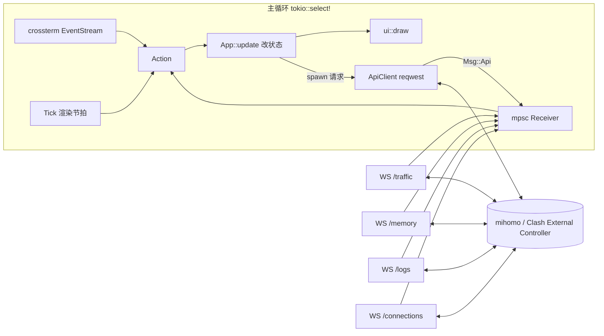

# tabby：Clash External Controller TUI 实施方案

- 日期：2026-11-05
- 状态：实施中
- 工具链：rustc / cargo 1.99.0，edition 2024

## 1. 目标与范围

tabby 是一个 Rust 编写的终端界面，通过 Clash 的 External Controller（RESTful API + WebSocket）查看和控制运行中的代理内核。

**目标**

- 以 mihomo（原 Clash.Meta）为主要内核，兼容原版 Clash 的 API 子集。
- 覆盖日常操作：模式切换、节点选择与测速、连接管理、日志查看、Provider 更新、配置维护。
- 视觉上做到信息层级清晰、配色统一、动效克制，默认跟随终端主题。
- Linux 上验证，代码保持跨平台。

**非目标**

- 不管理内核进程（不负责启动、安装、守护 mihomo）。
- 不编辑订阅或 YAML 配置文件本身，只通过 API 修改运行时配置。
- 不做 Web 面板。

## 2. 依赖选型

版本为 2026-11-05 在 crates.io 查到的最新稳定版，兼容性已核对。实施时用 `cargo add` 添加，届时再次确认最新版本。

```toml
[dependencies]
ratatui = "0.30.2"
crossterm = { version = "0.29.0", features = ["event-stream"] }
tokio = { version = "1.54.1", features = ["rt-multi-thread", "macros", "sync", "time"] }
reqwest = { version = "0.13.5", default-features = false, features = ["rustls", "json"] }
tokio-tungstenite = { version = "0.30.0", features = ["rustls-tls-webpki-roots"] }
futures-util = "0.3.34"
serde = { version = "1.0.229", features = ["derive"] }
serde_json = "1.0.154"
toml = "1.2.0"
directories = "6.0.0"
clap = { version = "4.6.7", features = ["derive", "env"] }
color-eyre = "0.6.5"
thiserror = "2.0.21"
percent-encoding = "2.3.2"
tui-input = "0.15.5"
unicode-width = "0.2.3"
jiff = "0.2.39"
tracing = "0.1.44"
tracing-subscriber = { version = "0.3.23", features = ["env-filter"] }
tracing-appender = "0.2.5"

[dev-dependencies]
wiremock = "0.6.5"
```

| crate | 选型理由 |
|---|---|
| `ratatui` | TUI 事实标准。0.30 拆分为 `ratatui-core` + 后端，默认后端为 crossterm 0.29 |
| `crossterm` | 直接依赖，只为开启 `event-stream` 拿到异步 `EventStream`；版本与 ratatui 内部一致，不会重复编译 |
| `tokio` | 异步运行时 |
| `reqwest` | HTTP 客户端。0.13 默认 TLS 为 rustls；关闭默认 feature，避免 `system-proxy`（见风险 R1） |
| `tokio-tungstenite` | WebSocket 订阅实时数据流；开启 rustls 以支持 `wss://` 远程控制器 |
| `futures-util` | `StreamExt` / `SinkExt` |
| `serde` / `serde_json` | API 数据模型 |
| `toml` + `directories` | 配置文件与 XDG 目录 |
| `clap` | 命令行参数，`env` feature 支持环境变量覆盖 |
| `color-eyre` | 应用层错误与 panic 报告 |
| `thiserror` | API 层类型化错误 |
| `percent-encoding` | 节点名、组名作为 URL 路径段时的编码 |
| `tui-input` | 过滤框、Secret 输入；原生适配 ratatui 0.30 / crossterm 0.29 |
| `unicode-width` | 按显示宽度截断中文与 emoji 名称 |
| `jiff` | 连接开始时间的 RFC 3339 解析与持续时间；Providers 的相对时间和日志页的本地时间也用它 |
| `tracing` 系列 | 日志写入文件（TUI 占用 stdout） |
| `wiremock` | API 客户端测试 |

**未采用**

- `tui-logger`：日志来自 WS，自写环形缓冲 + List 更简单。
- `humansize`：字节格式化十几行即可。
- `insta`：UI 快照测试过于脆弱。
- `throbber-widgets-tui`：转圈动画用 10 帧盲文字符自实现。

**Lint 配置**

```toml
[lints.rust]
unsafe_code = "forbid"

[lints.clippy]
pedantic = { level = "warn", priority = -1 }
module_name_repetitions = "allow"
```

## 3. 架构

单 UI 循环 + 若干后台任务。后台任务只通过 `mpsc` channel 向 UI 发送消息，应用状态只在主循环里修改。



### 3.1 消息流

- `crossterm::event::Event` 先按当前焦点和页面映射为 `Action`（例如 `Action::SelectNode`）。
- `App::update(Action)` 修改状态。需要网络请求时 spawn 一个 tokio 任务，任务完成后发回 `Msg::Api(ApiResult)`。
- WS 任务把收到的帧解析成 `Msg::Traffic` / `Msg::Memory` / `Msg::Log` / `Msg::Connections` 发回。
- UI 不等待任何网络请求；进行中的请求在状态里记为 `Pending`，用来显示转圈。

### 3.2 渲染策略

- 有事件时重绘。
- 有动画（转圈、提示消息倒计时）时按 100ms 节拍重绘，空闲时不触发重绘。
- 实时流数据到达时标记脏，下一次节拍统一重绘，避免一秒多次全屏重绘。

### 3.3 内核识别

启动和每次重连时调用 `GET /version`：

- 返回 `meta: true` → `CoreKind::Mihomo`，开启内存、整组测速、DNS 查询、FakeIP 刷新、GeoData 更新、重启、升级等功能。
- 否则 → `CoreKind::Clash`，上述功能在界面中置灰并注明“需要 mihomo”。

### 3.4 WS 订阅与重连

- 四个流各一个任务，统一实现在 `api/stream.rs`。
- 鉴权：WS 无法自定义请求头，使用 `?token=<secret>`，token 做 URL 编码。
- 断线后指数退避重连：1s、2s、4s … 封顶 30s；重连成功后退避重置。
- 断线只有一个判定来源：`/version` 探测加现有的 `Reconnect` 横幅，WS 不另建一套状态。顶栏状态点同样只读这个来源。
- 流状态只用来决定何时探测和重取：
  - 曾有流连上、之后所有流都断开，且横幅尚未出现时，立即发起一次 `/version` 探测；失败即进入现有的重连流程，横幅随之出现。启动时还没有流连上过，不算断线，避免与启动请求重复。
  - 全部断开之后，任一流重新连上，执行与 REST 重试相同的启动请求（`/version`、`/configs`、`/proxies`），刷新内核类型、模式标签、mihomo 专属功能的置灰状态和代理页数据。
- `r` 唤醒所有正在等待退避的流并立即重连；正在连接或已连接的流不受影响。
- 每个流只在连接状态变化时上报一次（Connected / Disconnected）。连接失败只写 debug 日志，避免服务停止期间刷屏；帧解析失败写 warn，不断开连接。
- `/memory` 在 `/version` 确认为 mihomo 之后才启动。
- 一次连接尝试最多 5 秒（含握手），与 REST 客户端的连接超时一致。
- 已解码 `/traffic`、`/connections`（总量，以及每条连接的 id、累计上下行、开始时间、链路、规则及其 payload，和表格、详情弹窗用到的 metadata 字段）、`/memory`；`/logs` 的帧先丢弃，解码留给日志页。

## 4. 目录结构

```
tabby/
├── Cargo.toml
├── docs/plans/                 # 本方案与界面草图
├── src/
│   ├── main.rs                 # clap、tracing、color-eyre、终端初始化与恢复、启动 App
│   ├── config.rs               # config.toml 加载与覆盖优先级
│   ├── app.rs                  # App 状态、Action、Msg、update
│   ├── event.rs                # 主循环与 Tick
│   ├── format.rs               # 字节/速率/时长格式化、按显示宽度截断
│   ├── api/
│   │   ├── mod.rs
│   │   ├── client.rs           # ApiClient：REST 接口、鉴权、路径编码
│   │   ├── error.rs            # ApiError
│   │   ├── models.rs           # Version/Configs/Proxy/Provider/Rule/Connection/Log/Traffic/Memory
│   │   └── stream.rs           # WS 订阅与重连
│   └── ui/
│       ├── mod.rs              # 整体布局：顶栏、标签栏、内容区、底栏、浮层
│       ├── theme.rs            # 语义配色与内置主题
│       ├── components/         # header、tabs、footer、toast、popup、confirm、help、states
│       ├── overview.rs
│       ├── proxies.rs
│       ├── providers.rs
│       ├── rules.rs
│       ├── connections.rs
│       ├── logs.rs
│       └── settings.rs
└── tests/fixtures/             # 真实 mihomo 接口返回的 JSON 样本
```

单个 bin crate，不拆 lib；测试写在模块内的 `#[cfg(test)]` 中，fixtures 放在 `tests/fixtures/`。

## 5. 配置

路径：`~/.config/tabby/config.toml`（由 `directories` 决定）。

```toml
default = "local"
theme = "terminal"        # terminal | tokyo-night | catppuccin-mocha
icons = "unicode"         # unicode | nerd

[delay]                  # 延迟测试，默认值如下
url = "https://www.gstatic.com/generate_204"
timeout_ms = 5000

[profiles.local]
url = "http://127.0.0.1:9090"
secret = "xxx"

[profiles.router]
url = "http://192.168.1.1:9090"

# 可选：覆盖主题中的单个语义颜色
[theme_overrides]
accent = "#7aa2f7"
```

**覆盖优先级**：命令行参数 > 环境变量 > 配置文件 > 默认值。

| 项 | 命令行 | 环境变量 | 默认值 |
|---|---|---|---|
| profile | `--profile` | `TABBY_PROFILE` | 配置中的 `default` |
| url | `--url` | `TABBY_URL` | `http://127.0.0.1:9090` |
| secret | `--secret` | `TABBY_SECRET` | 无 |
| theme | `--theme` | `TABBY_THEME` | `terminal` |

配置文件不存在时直接使用默认值启动，不报错。日志写入 `~/.local/state/tabby/tabby.log`。

## 6. API 覆盖

标注 (M) 的接口仅 mihomo 提供。

| 页面 | 接口 |
|---|---|
| 全局 | `GET /version`、`GET /configs` |
| 概览 | WS `/traffic`、WS `/memory` (M)、WS `/connections`（取总量和连接数）、`PATCH /configs`（切换模式） |
| 代理 | `GET /proxies`、`PUT /proxies/{group}`、`GET /proxies/{name}/delay`、`GET /group/{name}/delay` (M) |
| Providers | `GET /providers/proxies`、`PUT /providers/proxies/{name}`、`GET /providers/proxies/{name}/healthcheck`、`GET /providers/rules`、`PUT /providers/rules/{name}` |
| 规则 | `GET /rules` |
| 连接 | WS `/connections`、`DELETE /connections`、`DELETE /connections/{id}` |
| 日志 | WS `/logs?level=` |
| 设置 | `PATCH /configs`、`PUT /configs?force=true`、`POST /cache/fakeip/flush` (M)、`POST /configs/geo` (M)、`POST /restart` (M)、`POST /upgrade` (M) |

**约定**

- 所有路径参数用 `percent-encoding` 的路径段规则编码，覆盖 `/`、`#`、`%`、`?`、空格、中文、emoji。
- 延迟测试参数：`url` 默认 `https://www.gstatic.com/generate_204`，`timeout` 默认 5000ms，二者都可在配置中修改。
- 模型字段统一使用 `#[serde(default)]` 或 `Option`，以兼容两种内核的字段差异。

## 7. 界面设计

### 7.1 配色

所有界面代码只引用语义颜色，不写死具体颜色。

| 语义 | 用途 | `terminal` 主题映射 |
|---|---|---|
| fg | 正文 | Reset |
| muted | 次要信息、边框、单位 | DarkGray |
| surface | 光标高亮背景 | 由主题决定；`terminal` 下用反色 |
| accent | 焦点、选中、当前标签、按键提示中的按键 | Blue |
| success | 延迟 < 200ms、已连接、开关为开 | Green |
| warning | 延迟 200–500ms | Yellow |
| error | 延迟 > 500ms、超时、错误 | Red |
| c1 / c2 | 上传 / 下载，全应用统一 | Magenta / Cyan |
| c3 / c4 | 连接数、内存 | LightRed / LightCyan |

- `terminal`：只用 16 色 ANSI，自动跟随终端主题（Omarchy 切换主题时同步变化）。
- `tokyo-night`、`catppuccin-mocha`：内置真彩色主题。
- `[theme_overrides]` 可覆盖单个语义颜色。

### 7.2 组件规范

- **面板**：圆角边框；有焦点的面板边框为 accent，否则为 muted。
- **顶栏**：logo、内核版本标签、模式标签（RULE / GLOBAL / DIRECT），右侧为实时上下行速率和连接状态点。
- **标签栏**：`1`–`7` 编号，当前标签为 accent 色加下划线。
- **底栏**：按当前页面和焦点显示可用按键，按键为 accent 色，说明为 muted 色。
- **提示消息**：右上角弹出，3 秒后消失；类型分 success / error；同时最多显示 3 条。
- **弹窗**：居中，先清除底层内容；危险操作要求按 `y` 确认，`n` / `Esc` 取消。
- **数字**：右对齐；单位自动换算 B / KB / MB / GB，保留 1 位小数，不足 1 KB 的整数字节不带小数（`1023 B/s`，而不是 `1023.0 B/s`）；进位按四舍五入后的值判断（1023.96 KB 显示为 `1.0 MB`）；速率带 `/s`。顶栏速率的数值和单位按固定宽度排版，数值变化时状态点不会跳动。
- **文本截断**：按显示宽度截断并补 `…`，不会把宽字符切成两半。
- **三种状态**：每个页面都要实现加载中（转圈）、空列表（说明原因和可按的键）、出错（显示错误，按 `r` 重试）。
- **断线横幅**：控制器不可达时在内容区顶部显示“正在重连（第 N 次，Xs 后）”，并提示 `P` 切换配置。
- **图标**：默认通用 Unicode 符号；`icons = "nerd"` 时改用 Nerd Font 图标。

### 7.3 响应式布局

| 条件 | 调整 |
|---|---|
| 宽度 < 100 列 | 代理页分组栏折叠为顶部下拉选择；标签只显示数字 |
| 宽度 < 70 列 | 连接表隐藏“进程”和“总量”列 |
| 宽度 < 70 列 | 帮助浮层改成单列（全局和页面按键上下排列），内容超出高度时可用 `j` / `k` 滚动 |
| 高度 < 28 行 | 概览页隐藏统计卡片 |
| 宽度 < 50 列或高度 < 15 行 | 显示“终端尺寸过小”提示，不渲染页面 |

代理页的节点卡片列数不按终端宽度分档，由节点面板宽度决定：每张卡最少 26 列，最多 4 列。

### 7.4 页面草图

草图使用 tokyo-night 配色，仅表示布局与信息层级；终端实际效果以字符格为单位。

**概览**


- 流量图用 ratatui `Chart` 加盲文点绘制，保留最近 60 秒，Y 轴自动缩放到最大值的整数刻度。
- 统计卡片中的迷你折线用 `Sparkline`。
- 上传、下载总量是内核启动以来的累计值，与 tabby 的运行时间无关，副标题写“自内核启动”（草图里的“本次会话”不准确）。
- 内存卡片在原版 Clash 下显示“需要 mihomo”。

**代理**


- 左栏：代理组列表，每项显示组名、类型缩写（SEL / URL / FB / LB）、当前节点；URLTest 组额外显示当前延迟。
  - `GLOBAL` 只在 global 模式显示，排在第一位；切换到 global 模式时光标移到 `GLOBAL`。rule / direct 模式下隐藏。
- 右栏：节点卡片网格。
  - 当前使用的节点：accent 边框 + ✓。
  - 光标所在卡片：背景高亮。
  - 底部细条表示延迟，500ms 封顶，颜色与延迟分档一致。
  - 测速中显示盲文转圈动画；超时显示“超时”，节点不通显示“失败”，都用 error 色。
  - 整组测速的接口不区分失败与超时，没有返回结果的成员一律显示“失败”；内核历史里的 0 ms 同样不区分，刷新后显示“失败”。
- 只有 Selector 组可以切换节点；对其他类型的组按 `Enter` 时提示“该组为自动选择”。
- 排序方式：默认顺序 / 延迟 / 名称，`s` 循环切换。

**其他页面**

| 页面 | 设计要点 |
|---|---|
| 3 Providers | 分为“代理集合”“规则集合”两个区块。行内显示名称、类型（HTTP / File / Inline）、数量、更新时间（相对时间，如“3 小时前”）。代理集合显示健康度条（可用节点比例）。更新中该行显示转圈 |
| 4 规则 | 表格列：序号、类型、匹配内容、目标。类型用彩色标签区分（DOMAIN、DOMAIN-SUFFIX、GEOIP、RULE-SET、MATCH……）。`/` 过滤时高亮匹配文字 |
| 5 连接 | 表格列：主机、进程、规则 → 链路、上行速率、下行速率、总量、持续时间。行背景交替；当前排序列表头标 ▲ / ▼；新连接短暂高亮。`Enter` 打开详情弹窗（源/目标地址、网络类型、链路、规则、开始时间） |
| 6 日志 | 每行：时间（muted）、级别标签（DEBUG / INFO / WARN / ERROR 各一色）、内容。右上角显示“● 实时”或“⏸ 已暂停”。离开底部时停止自动滚动，`G` 回到最新。缓冲上限 2000 条 |
| 7 设置 | 分组表单：基础（模式、局域网连接、日志级别、IPv6）、端口、TUN、维护（重载配置、刷新 FakeIP、更新 GeoData、重启、升级）。开关显示 `● 开 / ○ 关`；mihomo 独有项在原版 Clash 下置灰 |
| `?` 帮助 | 居中弹窗，左列为全局按键，右列为当前页面按键 |
| `P` 切换配置 | 弹窗列出所有 profile，标出当前项，回车切换并重连 |

### 7.5 按键

**全局**

| 按键 | 作用 |
|---|---|
| `q` / `Ctrl+C` | 退出 |
| `1`–`7` / `Tab` / `Shift+Tab` | 切换页面 |
| `j` / `k` / `↓` / `↑` | 上下移动 |
| `g` / `G` | 跳到顶部 / 底部 |
| `Ctrl+d` / `Ctrl+u` | 翻半页：列表翻半个可见高度；节点网格翻“可见行数的一半 × 列数”，最少 1 行 |
| `/` | 过滤（`Esc` 清除） |
| `r` | 刷新当前页 |
| `m` | 循环切换代理模式 |
| `P` | 切换 profile |
| `?` | 帮助 |

**页面专属**

| 页面 | 按键 |
|---|---|
| 代理 | 网格内 `j` / `k` 按行上下移动，`h` / `l`（或 `←` / `→`）在同一行内左右移动；最左列按 `h` 回到分组面板，分组面板按 `l` 进入节点区；最后一行不满时，`j` 落到该行同一列，这一列没有卡片则落到最后一张；`Enter` 选择节点；`t` 测当前节点；`T` 测整组；`s` 切换排序 |
| Providers | `u` 更新；`U` 全部更新；`h` 健康检查 |
| 连接 | `Enter` 详情；`s` 切换排序列；`S` 反转排序；`x` 关闭选中连接；`X` 全部关闭（需确认）；`p` 暂停刷新 |
| 日志 | `l` 循环切换级别；`p` 暂停；`c` 清空 |
| 设置 | `Enter` / `Space` 切换开关或执行操作；危险操作需确认 |

## 8. 错误处理

- `ApiError`（thiserror）：`Unauthorized`、`NotFound`、`Http { status, message }`、`Timeout`、`Connect`、`Decode`。
- 401 时显示“Secret 错误”，并提示用 `--secret` 或修改配置。
- 单个请求失败时弹出 error 提示，不影响其他功能。
- 启动时控制器不可达也照常进入界面，显示断线横幅并后台重连。
- panic：`ratatui::init()` 自带的 hook 负责恢复终端，color-eyre 输出报告，同时写入日志文件。

## 9. 测试策略

只写能抓住真实缺陷的测试，不测连线和默认值。

| 范围 | 方式 |
|---|---|
| 模型解析 | `tests/fixtures/` 中放真实 mihomo 和原版 Clash 的返回样本，验证字段缺失时能正确解析 |
| ApiClient | wiremock：鉴权头、带特殊字符的路径编码、401/404/5xx 映射、`no_proxy` 生效 |
| 格式化与截断 | 单位边界（1023B / 1KB）、CJK 与 emoji 截断不越界 |
| 配置覆盖 | 命令行 > 环境变量 > 文件 > 默认值 |
| 连接速率 | 两次快照做差，覆盖连接消失、新增的情况 |
| 测速分类 | 单点测速：503 → 失败，504 → 超时，其他错误弹出提示且不记作测速结果；整组测速：缺失成员记为失败 |
| 节点排序 | 按延迟：有延迟的从小到大，其后依次是超时、失败、未测，同类保持配置顺序；按名称：连续数字按数值比较（2 < 10），数字与非数字混合时其余部分按小写 Unicode 比较 |

## 10. 风险

| 编号 | 风险 | 处理 |
|---|---|---|
| R1 | shell 设置了 `HTTP_PROXY` 时，控制器请求被绕回 Clash 本身 | reqwest 关闭 `system-proxy` 并显式调用 `.no_proxy()` |
| R2 | WS 无法携带 Authorization 头 | 使用 `?token=`，并做 URL 编码 |
| R3 | 节点名包含 `/`、`#`、`%`、空格、emoji | 路径段编码，测试覆盖 |
| R4 | 两种内核 JSON 字段不一致 | `#[serde(default)]` + `Option`，用真实样本测试 |
| R5 | 崩溃后终端状态损坏 | `ratatui::init` / `restore` 自带 panic hook |
| R6 | `/connections` 每秒推送全量快照，连接多时开销大 | 只构建可见行；速率由相邻快照做差得到 |
| R7 | 原版 Clash 与 mihomo 的部分接口方法不同 | 按 `CoreKind` 分派，不支持的功能在界面置灰 |

## 11. 提交计划

使用 Conventional Commits。每个提交都要求 `cargo build`、`cargo clippy --all-targets -- -D warnings`、`cargo test` 通过。

**M0 骨架**

1. `chore: init cargo project with gitignore`
2. `chore: set edition 2024 and workspace lints`
3. `chore: add core dependencies`
4. `feat(tui): init and restore terminal with panic hook`
5. `feat(app): add event loop with tokio select and tick`
6. `feat(app): add Action/Msg dispatch and quit handling`

**M1 配置与 API 基础**

7. `feat(config): load profiles from config.toml`
8. `feat(cli): add clap args with env/config override precedence`
9. `feat(log): write tracing logs to state dir`
10. `feat(api): add ApiClient with auth and no_proxy`
11. `feat(api): add error type and HTTP status mapping`
12. `feat(api): add version and configs endpoints`
13. `test(api): cover auth header and path encoding with wiremock`

**M2 界面基础设施**

14. `feat(ui): add semantic theme with terminal palette`
15. `feat(ui): add tokyo-night and catppuccin-mocha themes`
16. `feat(ui): add header with core badge, mode pill and status`
17. `feat(ui): add tab bar and page routing`
18. `feat(ui): add contextual key hints footer`
19. `feat(ui): add toast notifications`
20. `feat(ui): add popup`
21. `feat(ui): add help overlay`
22. `feat(ui): add loading and error states`
23. `feat(ui): add disconnected banner`

**M3 代理页**

24. `feat(api): add proxies models and endpoints`
25. `test(api): parse proxies fixtures from mihomo`
26. `feat(ui): add empty state`
27. `feat(proxies): render group list panel`
28. `feat(proxies): render node card grid with delay colors`
29. `feat(proxies): select node in selector group`
30. `feat(proxies): test delay for node and group with spinner`
31. `feat(proxies): sort and filter nodes`

**M4 实时流**

32. `feat(api): add websocket subscriber with backoff reconnect`
    - 验收：顶栏右侧显示实时上下行速率，颜色用 c1 / c2。
    - 验收：四个 WS 流全部断开时，主动显示断线横幅。
    - 验收：重连成功后重新请求 `/version` 和 `/configs`，更新内核类型、顶栏的模式标签和 mihomo 专属功能的置灰状态。
    - 实现记录：格式化函数没有单独提交，bin crate 中没有调用者的函数会触发 dead_code 而使 clippy 失败，所以与顶栏速率放在同一个提交里。`format.rs` 目前只有 `rate`；不带 `/s` 的字节格式化等第 34 项有了调用者再加，两者共用同一个换算函数。
33. `feat(overview): add traffic chart and mode switcher`
    - 实现记录：
      - `/configs` 乱序：会回滚。启动或恢复时发出的 `/configs` 与切换后的重取是两个独立请求，没有先后保证；旧的那个（服务端在 PATCH 之前读到旧模式）若晚到，会把刚切换的模式改回去。因此 `Msg::Configs` 照 `Msg::Proxies` 加了 `seq`，比已应用的更旧的回复丢弃。在途保护也靠它：重取发出后记下它的序号，收到序号不小于它的回复才放开 `m`，所以更旧的回复先到不会提前放开。
      - 切换后的重取带 `refetch` 标记，失败时保留屏幕上的数据只弹提示，与 `/proxies` 的重取一致；否则一次网络抖动会让概览页整页变成错误页。启动、`r` 重试和流恢复发出的 `/configs` 不带标记，失败仍显示错误页，行为不变。
      - 模式解析只有一处：`Mode::parse`（不区分大小写），顶栏、`is_global_mode`、模式面板和循环切换都经过它。顶栏遇到未知模式时显示控制器原样的值，不再转大写；已知模式显示 `RULE` / `GLOBAL` / `DIRECT`。
      - Y 轴单位取“最大值达到的最大单位”，不做 `rate` 那样的四舍五入进位，因为刻度要的是整数倍的单位，而不是显示用的一位小数。换算复用 `format.rs` 的 `RATE_UNITS`，新增 `format::unit_for`，单位名去掉 `/s`。1 MB − 1 的峰值用 KB，最高刻度显示 `1024 KB`。
      - 只有一个样本时折线画不出线段（`GraphType::Line` 至少需要两点），第二秒起才有曲线。
      - 切换成功不弹提示：模式面板和顶栏就是反馈。失败弹 error。
      - `m` 的底栏提示只放在概览页，位置按草图在 `1-7` 之后；代理页底栏已经很长，没有再加。帮助浮层的全局键里有 `m`。
      - 控制器不可达时，概览页显示的是现有的错误页（`ready(configs)`），不是图表。`等待流量数据…` 出现在流断开、`/configs` 重试尚未失败的这段时间，以及启动后第一帧之前。
      - 模式面板高 5 行，右栏与流量图按 1 : 2 分宽；当前模式的胶囊是无边框的 accent 反色块，其余是 muted 圆角边框，三个胶囊等分面板宽度。
34. `feat(overview): add stat cards and core info`
    - 实现记录：
      - 样本：`tests/fixtures/mihomo_connections.json`（`GET /connections`，5 条连接：2 条走代理的 TCP、1 条直连 TCP、1 条经 mixed-port 的 SOCKS5 UDP、1 条 TUN 入站的 TCP）和 `mihomo_memory.json`（`/memory` 流的一行）。取自本机 FlClash 内核 v1.19.33，脱敏：`host`、目的 IP、`remoteDestination` 换成 example.com 系域名和 RFC 5737 文档地址，进程名和路径换成 `curl`、`/usr/bin/curl`，链路换成 `Node n → Auto → Proxy`，连接 id、开始时间重写，ASN 清空；字段结构不变。总量和 `inuse` 保持真实值。
      - 模型：快照类型叫 `ConnectionSnapshot`，不叫 `Connections`，因为 clippy 的 `struct_field_names` 不接受 `Connections.connections`。`connections` 为 `null` 用 `null_as_default` 读成空列表（`serde(default)` 只管字段缺失）。`Connection` 只有 `metadata.network`，其余字段留给第 35 项。TCP / UDP 数不区分大小写；网络类型缺失或未知的连接计入“活动连接”，但不计入 TCP 或 UDP，所以 `TCP + UDP` 可以小于总数。真实帧里还有 `memory` 字段，没有读。
      - App 只存 `ConnectionStats`（两个总量、活动数、TCP 数、UDP 数），不存连接列表。三份历史（流量、连接数、内存）共用 `push_sample`。某个流断开时，它自己的最新值和历史在同一处清掉，其他流不受影响。
      - 内存的 0 不当作读数：流刚连上时第一帧是 `{"inuse":0}`（真机抓到），采纳它会让内存卡片闪一下 `0 B`，并把一个 0 记进迷你折线。所以 `inuse == 0` 的帧丢弃，卡片继续显示 `—`。
      - 高度：卡片 7 行（边框 2、标签 1、数值 1、副标题 1、迷你折线 2）；内核面板 6 行（边框 2、四行内容），占满右栏模式面板以下的全部空间。显示卡片的条件是终端高度 ≥ 28，此时内容区 23 行（有重连横幅时 22 行），去掉卡片后上方 16（15）行，右栏内核面板 11（10）行，流量图至少 15 行。80×24 没有卡片，只看流量图和右栏。判断用终端高度 `App::size`（已改为 `pub`），不是内容区高度，与 plan §7.3 一致。
      - 卡片等宽：宽度 `(总宽 − 3) / 4`，卡片间固定一列空隙，除不尽的 0–3 列留在右侧，所以右边缘可能比上方面板短几列。试过 `SpaceBetween` 把余数摊进空隙，空隙宽窄不一，看着像错位，放弃。
      - 迷你折线：`Sparkline` 右到左排，最新值在最右。折线宽度是卡片内宽（100 列下 20 列左右），小于 60 个样本，所以只画最新的那部分；历史仍存满 60 个。纵向比例是 ratatui 的默认：从 0 到窗口内最大值。活动连接数在几十上下小幅波动时，折线几乎是平的。
      - 缺数据：主值显示 muted 的 `—`，不画折线；活动连接的副标题此时留空。原版 Clash 的内存卡片显示 `需要 mihomo`，副标题仍是 `mihomo 进程`。上传、下载卡片的主值来自连接流，折线来自流量流，所以只有一个流断开时，它们可以分别显示和消失。
      - 内核面板：`/version` 失败时版本显示 `—`；`TUN`、`局域网连接` 开关用 success `● 开启` / muted `○ 关闭`，`tun` 为 `None` 显示 `需要 mihomo`；值按显示宽度截断，名称不截。
      - 主题：加了 `c3`（活动连接）、`c4`（内存）。`terminal` 用 LightRed / LightCyan；tokyo-night 取草图里的 `#ff9e64` / `#73daca`；catppuccin-mocha 取 peach `#fab387` / teal `#94e2d5`。
      - 验证：对本机 mihomo 实测，卡片与 `GET /connections`（39 条，TCP 32 · UDP 7）、`/configs`、`/version` 一致；8 路经 mixed-port 的下载（nju 镜像，限速 3 MB/s）期间连接数 21 → 27、下载总量 1.9 → 2.4 GB，结束后回落到 22。100×30、100×28 有卡片，100×27、80×24 没有，均不越界。用临时 mock 验证置灰：版本 `v1.18.0` 且无 `tun` 时 TUN 和内存卡片显示 `需要 mihomo`，其余卡片 `—`；另一个 mock 的流在 8 秒后断开，卡片回到 `—`，程序不崩溃。
35. `feat(connections): render live table with speed diff`
    - 实现记录：
      - 范围：实时表格、速率差分、光标、暂停、窄屏规则。排序切换和表头箭头、`/` 过滤、详情弹窗留给第 36 项，`x` / `X` 留给第 38 项。`Connection` 只加了表格读取的字段（`id`、`upload`、`download`、`start`、`chains`、`rule`，`metadata` 的 `host`、`destinationIP`、`process`）；原版 Clash 没有 `process`，按缺失字段读成空串。
      - `start` 用 `jiff::Timestamp`，读取函数是宽松的：缺失、不是字符串、不是 RFC 3339 都得到 `None`，整帧照常解析。`None` 的连接持续时间显示 muted `—`，排序时排在有开始时间的后面。`jiff` 用默认 feature（含系统时区），Providers 的相对时间和日志页的本地时间会用到。样本 fixture 没有改（stats 与 stream 的测试依赖它的 5 条），`start` 格式错误的连接写在模型测试的内联 JSON 里。
      - 帧间隔：速率 = 相邻两帧累计值之差，按“每帧 1 秒”显示为 `/s`，不按帧实际到达的间隔换算。mihomo 和原版 Clash 默认每 1000 ms 推一帧，tabby 的 URL 没有带 `interval` 参数；以后若加这个参数，必须同时改差分。
      - 差分是 `ConnectionSnapshot::rates(&Baseline) -> (Vec<Option<Rate>>, Baseline)`，纯函数。速率与 `connections` 同序；新连接 `None`；累计值变小记 0；消失的连接不在返回的速率和新基准里。
      - 状态在 `ConnectionsView`：当前行、基准、高亮剩余帧数、光标、`Scroll`、暂停标记、`as_of`。`on_stream` 改为按值接收事件，帧里的连接直接移进表格，不再克隆。
      - 默认顺序：开始时间新的在前，相同或读不出的按 `id`。光标按 `id` 锚定；连接消失后留在原下标，超出末尾则夹到最后一行。流断开时表格、基准、高亮一起清空，暂停标记保留。
      - 暂停：表格行、速率、持续时间都冻结。持续时间算到“表格取帧时的本机时钟”（`as_of`），不是绘制时的时钟，否则暂停时数字还在走。暂停期间每帧仍更新基准和高亮计数，所以恢复后的第一帧是相邻两帧之差。与提示不一致之处：暂停时若表格还从没收到过帧（刚启动或断线重连后），第一帧照样放进表格，之后才冻结；否则暂停状态下会一直转圈。恢复后要等下一帧（约 1 秒）表格才刷新，没有缓存暂停期间最后一帧。
      - 高亮：出现的那一帧和之后两帧，共 3 帧（约 3 秒），按帧计数。流（重新）连上后的第一帧不高亮。主机格 success 色加粗。
      - 列：主机、进程、规则 → 链路、上行、下行、总量、持续时间。表头写 `时长`，不是 `持续时间`：后者 8 列宽，放不进 6 列。列宽：上行、下行各 11（最宽的 `1023.9 KB/s`），总量 9（`1023.9 KB`），时长 6（`12m05s`、`99d23h`），列间空 1 列，面板内不加水平内边距；主机、进程、规则 → 链路按 3 : 2 : 4 分剩下的宽度（`Fill`）。进程没有取固定宽度，70 列时固定宽度会把主机和链路挤到 8 列以下。70 列时主机约 7 列、链路约 11 列，已经很窄，但这是 §7.3 要求仍显示全部列的最小宽度。宽度小于 70 列（`App::size`）隐藏进程和总量。规则类型 muted，后面 ` → ` 与链路中，链路反向显示；规则太长时只显示被截断的规则。
      - 用 `Table` 但只给它 `Scroll::window` 取出的行；不用 `TableState`，列宽先用同一个 `Layout` 算好再传 `Length`，文本按这些宽度截断。半页是 `capacity(body) / 2`，`capacity` 与绘制用同一个函数。
      - 边框用 accent：它是页面上唯一的、有键盘焦点的面板。标题右侧 success `● 实时` / warning `⏸ 已暂停`。
      - 条纹：theme 加了 `stripe: Style`。`terminal` 为空（16 色里没有足够淡的背景）；tokyo-night `#212434`（页面 `#1a1b26` 与 surface `#292e42` 的中间值），catppuccin-mocha `#272639`（`#1e1e2e` 与 `#313244` 的中间值）。下标为奇数的行加条纹，按行在表中的位置算，滚动时同一行颜色不变；光标行用 `surface`，优先。
      - 三种状态：还没收到第一帧或流断开时，整个内容区只有转圈和 `等待连接数据…`，不画面板（`is_loading` 已含连接页）；没有连接时画面板，里面是 `states::empty`，不列按键；没有出错页。
      - 底栏：`j/k 移动`、`g/G 首尾`、`p 暂停` / `p 恢复`。帮助浮层多一项 `Ctrl+d / Ctrl+u 翻半页`。
      - 验证（本机 FlClash 内核 v1.19.33，全程没有切换节点、模式，没有改任何配置，也没有关闭连接）：
        - 连接数、前几条的主机、链路方向（外层在前）、规则、持续时间与 `GET /connections` 一致，持续时间与 `start` 相差不超过取帧延迟（1–2 秒）。本机内核没有填 `process`，进程列全是 `—`。
        - 经 mixed-port 的 `curl --limit-rate 1M` 下载（nju 镜像）：第 1 帧速率 `—`，主机 success 加粗，持续 3 帧后恢复普通色；第 2 帧是 curl 起步阶段的 `64.2 KB/s`，第 3 帧起稳定在 `1.0 MB/s`，总量每帧约 +1 MB；下载结束后该行消失。
        - 光标停在一条长连接上，上方不断插入新连接，光标始终在这条连接上，持续时间连续增长。
        - 暂停 16 秒：标题 `⏸ 已暂停`，底栏 `p 恢复`，表格行（`4s`、`5.0 MB`、`1.0 MB/s`）一直不变；概览页的活动连接 19 → 21，折线在变；回到连接页仍是暂停状态。恢复后第一帧是 `1.0 MB/s`（总量 +18 MB，没有尖峰）。
        - 100×30、80×24、70×24、69×24、60×20：69 列和 60 列没有进程和总量，70 列有；边框完整，内容不越界，中文和 emoji 在截断处不被劈开。69 / 70 列时顶栏的模式标签被挤坏（`RUL↑`），这是顶栏组件的窄屏行为，不在本项范围，留给第 44 项。
        - `--url` 指向不可达地址：转圈在动，下方是重连横幅，不崩溃。用临时 mock（10 秒可用、10 秒不可用，实现了最小的 WS 握手）验证恢复：断开时表格换回转圈，恢复后表格重新出现，第一帧速率为 `—`，第二帧起为差值（`400 B/s`、`3.9 KB/s`，与 mock 的累计值一致）。
        - 三个主题：terminal 光标行反色、无条纹；tokyo-night、catppuccin-mocha 的光标行是 surface 背景，隔行是条纹背景。
36. `feat(connections): sort, filter and detail popup`
    - 实现记录：
      - 范围：排序切换与表头箭头、`/` 过滤、`Enter` 详情弹窗。确认弹窗（第 37 项）和 `x` / `X`（第 38 项）没有做。“光标所在的连接”是 `ConnectionsView::selected_connection`，放在 `ConnectionsView` 上，没有放在 `App` 上（与说明不一致），因为它只读连接页自己的状态；详情已经在用它，第 38 项直接复用。模型只加了详情和过滤会读的字段：`metadata` 的 `sourceIP`、`sourcePort`、`destinationPort`、`type`（字段名 `kind`）、`processPath`，`Connection` 的 `rulePayload`；端口按字符串读，缺失为空。样本 fixture 没改（它的 `process` / `processPath` 本来就是空串），非空的进程和路径写在模型测试的内联 JSON 里。
      - 排序：`SortColumn`（主机、进程、上行、下行、总量、时长，按表格从左到右）加 `ConnectionSort { column, ascending }`，都在 `app.rs`。排序代码只有 `ConnectionSort::sort` 一处，新帧（`apply`）和切换排序（`set_sort`）都调它，`apply` 里原来写死的排序已删掉。默认“时长 ▲”，即开始时间新的在前，与第 35 项一致。`s` 切到右边下一列并取该列默认方向（主机、进程、时长升序，上行、下行、总量降序），`S` 只反转方向。暂停时切换排序立即重排冻结的行。
      - 比较：主机、进程按 `natural_cmp` 比较小写值，小写值每行只算一次再排序，不在比较函数里分配。主机取 `host`，为空用 `destinationIP`，与表格显示共用 `ConnectionRow::host`。上行、下行按速率，总量按 `upload + download`，时长按开始时间取反（晚的算短）。
      - 缺值：速率 `None`、`start` 为 `None`、进程为空，以及主机和 `destinationIP` 都为空（说明里没有列出这一种，按显示 `—` 的一致性归为缺值），升序降序都排最后：方向只作用于两边都有值的比较，不是把整个比较结果反过来。值相同（含两边都缺）按 `id` 升序，两个方向都一样，不随方向反转。
      - 表头：排序列的表头文字 accent 加粗，末尾 ` ▲` / ` ▼`（中间一个空格）；放不下时保留箭头、截断文字并去掉空格（`进…▲`）。列宽不需要调整：`时长 ▲` 正好 6 列，与 `DURATION_WIDTH` 相同；70 列时“进程”列算出来 6 列，`进程 ▲` 正好放下，主机 8 列，100 / 80 / 70 / 69 / 60 列实测都没有触发截断，箭头不越界。
      - 窄屏：`s` 依次经过 `connections::sort_columns(size)`，它和绘制用的是同一份列清单（`shown`），宽度 < 70 时没有进程和总量，所以 `s` 跳过它们。正按进程或总量排序时终端变窄，排序照旧，只是表头上看不到箭头；这时按 `s` 切到当前列右边第一个可见的列（按进程排序时是上行）。
      - 过滤：`ConnectionsView` 自己有 `filter: Input` 和 `typing`，与代理页不共用。“是否在输入”统一成 `App::typing()`，当前页的过滤框是 `App::filter()`，`event.rs` 和底栏都改为读它们；开始、确认、清除过滤（`StartFilter` / `FilterAccept` / `FilterClear`）以及 `Esc`（`Dismiss`）都按当前页面分派。`/` 和 `s` 在代理页、连接页都有，`S` 只在连接页。不区分大小写的子串，匹配主机、`destinationIP`、进程、规则类型、`rulePayload`、链路中任一节点或组名。顺带修了一处：输入时按 `Esc`（`FilterClear`）原来没有标记重绘，要等下一次 tick 才清掉，现在立即重绘。
      - 过滤只影响显示：`rows` 仍是全部连接（已排序），`ConnectionsView::visible()` 按需过滤，差分基准、高亮计数和概览卡片照旧看整帧。光标下标指向 `visible()`；新帧、切换排序、过滤条件每次变化都先记下光标所在连接的 `id` 和下标，之后按 `id` 找回，找不到（消失或被过滤掉）就留在原下标，再夹到列表末尾。暂停时过滤作用于冻结的行。
      - 标题：有过滤时 `连接  m/n · 过滤「…」`，`n` 是表格里的连接数（暂停时是冻结的行数）。过滤后为空：`没有匹配「…」的连接`，按键 `Esc 清除过滤`、`/ 修改过滤`。有过滤、但本身就没有连接时，显示的也是过滤为空的状态（说明没有规定，取能告诉用户怎么清掉过滤的那个）；没有过滤且没有连接时仍是第 35 项的空状态。
      - 流断开（`reset`）时，暂停、排序、过滤（含正在输入的状态）都保留，与暂停的处理一致：它们是用户的设置，不是数据。
      - 详情弹窗：`Overlay::Connection`，数据在 `ConnectionsView::detail`（`Detail { row, as_of, closed }`，`row` 是表格行的副本）。`Enter` 打开光标所在连接，没有连接时什么都不做。表格每次更新（`apply` 里没有因暂停而返回的那条路径）按 `id` 刷新 `row` 和 `as_of`；找不到就把 `closed` 置上，保留最后一份数据和 `as_of`，所以时长停在那里。`connections` 流断开时 `reset` 清掉 `detail`，`on_stream` 关掉浮层。`Esc` 关闭并清掉 `detail`；`?` 在弹窗打开时不变（`ToggleHelp` 只在没有浮层或浮层是帮助时切换），其他按键按“浮层是模态”被忽略。
      - 与说明不一致：弹窗是模态的，所以弹窗打开时按 `p` 不会暂停。验证“暂停后不变”的做法是 `Esc` 关掉、`p` 暂停、再 `Enter` 打开。
      - 目标地址：`destinationIP` 为空时用 `host` 代替（与说明不一致）。测试实例上经 mixed-port 的 HTTP 代理连接按域名命中规则，没有解析，`destinationIP` 为空、`destinationPort` 为 `443`；只写 `—` 会丢掉端口。IPv6 加方括号只在有端口时；端口为空时不带冒号，也不加方括号；地址为空时显示 `—`（来源同理）。
      - 内容：左列 muted 名称（10 列：`开始时间` 8 列加 2 列间隔），右列值。网络是大写的网络类型加 ` · type`，缺哪部分就不写哪部分；进程是 `process` 加 muted 的 ` processPath`，只有路径时只写路径；规则 `RuleSet(example.com)`，payload 为空只写类型，类型也为空写 `—`；开始时间用 `TimeZone::system()` 转本机时区，格式 `%Y-%m-%d %H:%M:%S`；时长用表格的 `elapsed` 和 `format::duration`；上传、下载是 `5.0 MB · 1.0 MB/s`，数值 c1 / c2、单位和分隔符 muted，速率沿用表格的 `rate`（新连接 `—`，0 为 muted）。
      - 尺寸：宽 `min(屏幕宽, 72)`，`popup::panel` 的边框和左右内边距各占 2 列，值列宽 `宽 − 4 − 10`（72 列时 58，60 列时 46）；高度 = 行数 + 2，居中，`popup::centered` 夹到屏幕大小。值按显示宽度逐字符换行（宽字符不劈开，续行开头的空格去掉），续行与值列对齐。内容超过弹窗内高时只画放得下的行，最后一行截到内宽 − 1 再补 muted 的 `…`。`已关闭` 跟在标题后面，error 色；`popup::panel` 为此加了一个可选的 `status` 参数，帮助和提示消息传 `None`。
      - 底栏：连接页 `Enter 详情`、`s 排序`、`S 反转`、`/ 过滤`、`j/k 移动`、`g/G 首尾`、`p 暂停` / `p 恢复`，有已生效的过滤时再加 `Esc 清除过滤`（这条现在对代理页和连接页是同一段代码）。弹窗打开时只有 `Esc 关闭`、`q 退出`。100 列时底栏末尾的 `? 帮助` 已被挤出，留给第 44 项。帮助浮层连接页补了 `Enter`、`s`、`S`、`/`、`Esc`。
      - 测试：每列两个方向的顺序和缺值位置；值相同按 `id`；`s` 重置方向、`S` 只反转；窄屏 `s` 跳过隐藏列（含正按隐藏列排序时）；光标在切换排序、过滤变化、新帧之后留在同一条连接上，被过滤掉时留在原下标并夹到末尾；各字段命中（中文、不区分大小写）；过滤不影响差分和概览连接数、暂停时作用于冻结的行；暂停时切换排序立即重排；输入过滤时 `p`、`s`、`S`、`m`、数字键在代理页和连接页都进过滤框（扩展了 `m_switches_mode_on_every_page_except_while_typing_a_filter`，经过 `App::typing()`）；详情打开的是光标所在连接、新帧刷新、暂停时不刷新、消失后标已关闭并保留数据和时钟、流断开时关闭、`?` 等按键被忽略；地址格式化（IPv4、IPv6 方括号、端口为空）；换行不劈开宽字符、保留样式。
      - 验证（测试实例 v1.19.33；全程没有对 FlClash 发出 GET 以外的请求）：
        - 经 17890 的 `curl --limit-rate 2M`（ustc 镜像）和 `--limit-rate 500K`、`300K`（nju 镜像；ustc 同时只给一条 range 下载，第二条一直 0 字节）：`s` 依次切到主机 ▲、进程 ▲、上行 ▼、下行 ▼、总量 ▼、时长 ▲，表头箭头和顺序正确；下行 ▼ 时 2.0 MB/s 在最前，`S` 后在最后；新开的连接（上行、下行 `—`）在下行 ▲ 和 ▼ 下都在最后一行；光标停在 300 KB/s 那条上，六次切换排序始终跟着它。
        - `/` 输入 `pm`：标题 `连接  0/4 · 过滤「pm」`，`p`、`m` 进了过滤框，模式仍是 RULE，表格仍是 `● 实时`；改成 `UsT`：只剩 ustc 一行，`1/4`；`Enter` 后底栏出现 `Esc 清除过滤`，`Esc` 恢复 4 行；输入 `nosuchhost` 显示 `没有匹配「nosuchhost」的连接` 和两个按键。
        - 在 2M 那行按 `Enter`：主机、来源 `127.0.0.1:48120`、`TCP · HTTPS`、`RuleSet(测试域名)`、`自动选择 → 直连 A`、开始时间 `2026-11-05 18:50:53`、上传 `5.2 KB`（5352 B）、下载 `199.8 MB`（209517155 B）与 `GET /connections` 一致；目标起初是 `—`（`destinationIP` 为空），改成用 host 后为 `mirrors.ustc.edu.cn:443`。时长和下载每秒变（2m18s → 2m19s，278.5 → 280.5 MB）；暂停后 2.5 秒内不变；另开一条 12 MB 的下载，打开它的弹窗等它结束：最后一帧 `12.0 MB · 0 B/s`、时长 6s，下一帧标题变成 `连接详情 已关闭`，之后几秒数据和时长都不变；`Esc` 关闭。
        - 弹窗打开时停掉测试实例：弹窗关闭，内容区换回 `等待连接数据…` 和重连横幅，程序不崩溃；重新启动后表格重新出现。
        - 100×30、80×24、70×24、69×24、60×20、60×15：表头箭头都在列内；69 列时 `s` 依次是上行、下行、时长、主机，正按进程排序时看不到箭头、顺序照旧，再按 `s` 到上行。临时给测试实例加了 `find-process-mode: always`、三层长名字的 select 组和一个长路径的 curl 副本（验证后恢复配置，`sha256` 与原来一致）：长链路和长进程路径在 100、80、60 列下按宽度换行，续行与值列对齐；60×20 能看全（16 行内容）；60×15 下截到 `开始时间` 那一行并补 `…`。
        - 弹窗打开时按 `?`：帮助没有出现，弹窗和底栏不变。
        - 只读连 FlClash（21 条连接）：下行 ▼ 时两条限速下载在前，接着按速率；过滤 `GitHub` 得 `4/21`；打开 `alive.github.com` 的详情，目标 `140.82.113.26:443`、来源 `198.18.0.1:46776`、`TCP · Tun`、`DomainSuffix(github.com)`、链路、上传 5439 B、下载 3931 B 与 `GET /connections` 一致。只按了 `5`、`s`、`/`、字母、`Enter`、`Esc`、`q`。前后对比 `GET /configs` 完全相同，所有 Selector 组的当前节点不变；有变化的只有 URLTest / Fallback 组，是内核自己的健康检查。
37. `feat(ui): add confirm dialog`
    - 实现记录：
      - 与第 38 项合并提交，提交名是 `feat(connections): close connections with confirm dialog`：单独提交时弹窗没有调用者，bin crate 会报 dead_code，clippy 不通过（第 32 项也是这个原因）。
      - 结构：浮层加了 `Overlay::Confirm`，待确认的操作放在 `App::pending: Option<Confirm>`。`Confirm` 目前只有一个变体 `CloseConnections(Closing)`，`Closing` 是 `All { count }` 或 `Matching { filter, ids }`，执行需要的东西都在变体里。标题、正文和 `y` 的说明分别由 `Confirm::title`、`body`、`verb` 给出，组件 `ui/components/confirm.rs` 只管画。第 42 项加变体就能用。关浮层统一走 `App::close_overlay`：关详情时清 `detail`，关确认弹窗时清 `pending`。
      - 画法：宽 `min(屏幕宽, 48)`，用 `popup::centered` 和 `popup::panel`，边框 warning。内容依次是空行、正文、空行、按键行，高度是行数 + 2。正文按内宽（48 列时 44）换行，每行居中。原来 `ui/connections.rs` 里的 `wrap` 移到 `ui/text.rs` 共用，测试也跟着移过去。按键行 `y 确认   n / Esc 取消` 居中，键用 accent 加粗，与底栏一样，说明用 muted。正文以“？”结尾，比说明里的写法多一个问号，因为这是一个提问。
      - 按键：`y` 映射为 `Action::Accept`，`n` 映射为 `Action::Cancel`，在 `action_for` 里对所有页面生效；没有弹窗时 `update` 直接忽略这两个动作。这样 `action_for` 不用多一个浮层参数。弹窗打开时，`update` 里有一个分支排在 `ToggleHelp` 前面，只处理 `Accept`、`Cancel`、`Dismiss`（`Esc`）；`Quit` 和 `Resize` 排在它之前，所以照常生效。其余按键都被忽略，包括 `?`、`Enter`、数字键、`m`、`x` / `X`、`p`、`s`、`/`。只认小写 `y`，`Y` 什么都不做：弹窗上写的是 `y`，而且危险操作不应因为误按了 Shift 就执行。
      - 底栏：弹窗打开时只显示 `y 确认`（说明取自 `Confirm::verb`）和 `n/Esc 取消`。
      - 不和别的浮层叠加：详情弹窗和帮助都是模态的，在里面按 `x` / `X` 会被忽略。这是说明里最简单的那种做法。
      - 目标不存在时：按 `y` 时以当时的表格为准。表格为 `None`（流已断开）时不发任何请求。`Matching` 只关闭仍在表格里的 id（查的是全部行，不看过滤），一个都不剩就不发；`All` 在表格为空时不发。`connections` 流断开时，如果 `pending` 是关闭连接，就关掉弹窗，这段逻辑和关详情弹窗写在同一处。
38. `feat(connections): close one or all connections`
    - 实现记录：
      - 与第 37 项合并提交，原因见第 37 项。
      - `ApiClient` 新增 `close_connection(id)`（`DELETE /connections/{id}`，id 按路径段编码）和 `close_all_connections()`（`DELETE /connections`），两者共用新加的 `delete`，返回 2xx 才算成功。在 mihomo v1.19.33 上实测，两个接口都回 204；对不存在的 id 调 `DELETE /connections/{id}` 也回 204。wiremock 测试覆盖三点：编码后的 id 路径（`a%2Fb%20c%3F`）、close-all 的路径、未匹配的请求（wiremock 回 404）得到 `ApiError::NotFound`，后一点用来确认新方法经过了状态检查。鉴权头和各状态码的映射已有测试覆盖，没有重复。
      - `x` 关闭光标所在连接，不弹确认；没有连接时什么都不做。
      - `X` 没有过滤时记下 `Closing::All { count }`，`count` 是表格总数（这时等于可见数），正文为 `关闭全部 N 条连接？`，按 `y` 后发 `DELETE /connections`。有过滤时记下当时可见的 id，正文为 `关闭匹配「…」的 M 条连接？`，按 `y` 后对每个 id 发一次 `DELETE /connections/{id}`，所有请求在同一个任务里用 `futures_util::future::join_all` 并发发出，回复合成一条 `Msg::ConnectionsClosed`，因此只需要一处汇总。这样做的理由是用户只看得到过滤后的行，把看不见的连接也关掉会出乎意料。可见连接为 0 时不弹窗。
      - 计数：close-all 成功时提示 `已关闭 N 条连接`，N 取按 `y` 时表格的行数，因为内核关掉的是那一刻的全部连接。弹窗开着时如果来了新帧，这个数可能和弹窗里写的差几条。逐个关闭时按实际关掉的条数计数。
      - 404：`x` 和逐个关闭都不把 404 当作失败，也不弹 error。连接已经不在了，这正是想要的结果，而且 mihomo 对未知 id 本来就回 204。所以 404 也计入 `已关闭 N 条连接`，并从表格里移除。说明只写了“静默忽略”，没有规定计不计数，这里选择计入。
      - 失败：`x` 失败时提示 `关闭连接失败：<describe>`；逐个关闭只弹一条汇总 `n 条关闭失败：<第一条的 describe>`，如果同时有成功的，另弹一条 success；close-all 失败时提示 `关闭连接失败：<describe>`。这些都不走 `note_failure`，与选节点、测速一致：用户主动操作失败时总是提示。
      - 移除：关闭成功（含 404）的连接由 `ConnectionsView::remove` 立即从 `rows` 里去掉，暂停时也一样，否则冻结的表里会留着已关闭的连接。光标沿用 `anchor` / `restore`：光标所在的连接还在就跟着它；它被关掉了，光标就留在原下标，超出末尾则夹到最后一行。差分基准和高亮计数不动。close-all 成功时清空表格（`remove(|_| true)`）。`x` 不弹成功提示，行消失本身就是反馈：收到回复后的那一帧（100 ms 节拍）就会消失，不用等下一个流帧。
      - 原版 Clash 也有这两个接口，没有置灰。
      - 底栏：`Enter 详情` 后面是 `x 关闭` 和 `X 全部关闭`，有过滤时后者改为 `X 关闭匹配`。100 列时底栏显示到 `1-7/Tab` 就被截断，`r 刷新`、`? 帮助`、`q 退出` 都看不到，留给第 44 项。帮助浮层的连接页加了 `x 关闭选中连接` 和 `X 关闭全部 / 匹配的`。后者的说明 17 列，加上 17 列的键名是 34 列，帮助右栏 35 列放得下。
      - 测试：
        - 弹窗：`n`、`Esc` 关闭弹窗，不发请求；弹窗打开时按 `?`、`x`、`X`、`5`、`m`、`p`、`s`、`/`、`Y`、`Enter`，页面、暂停、排序、过滤状态都不变，也没有提示；只有 `y` 发出 close-all。
        - 过滤：`X` 只针对可见的 `a`、`c`；过滤后一行都没有，或表格为空时不弹窗。
        - 按 `y` 时只关闭表格里还有的连接，全都没了就不发请求。流断开时弹窗关闭，之后按 `y` 不发请求。在详情弹窗里按 `x` / `X` 被忽略。
        - `x`：发出的是光标所在连接；关闭后行立即消失，光标落在原下标；暂停、该帧被冻结时也立即移除；404 不弹提示。
        - 逐个关闭部分失败：success 计数 2（含 404），error 只有一条汇总。
        - 判断“发出了哪些请求”的方法与 `requests_made` 一样，看留在 channel 上的回复（`closes_sent`）。
      - 验证（测试实例 v1.19.33；所有关闭操作都在测试实例上做，对 FlClash 只发了 GET）：
        - 经 17890 的三个下载：ustc `--limit-rate 2M`、nju `500K`、tuna `300K`（ubuntu-24.04.4-live-server ISO）。光标移到 tuna 那行按 `x`：该 curl 在按键后 0.05 秒内以退出码 55 结束，行消失，标题从 3 变成 2；ustc 和 nju 两个下载没有受影响。
        - 按 `p` 暂停，标题变成 `⏸ 已暂停`，光标在 nju 那行，按 `x`：0.3 秒内该行从冻结的表格里消失；其余行的数值（`609.0 KB`、`59.4 MB`）保持不变；nju 的 curl 退出码 55。
        - 再开一个 nju 下载，`/` 过滤 `tuna`，标题 `连接  1/3 · 过滤「tuna」`，底栏出现 `X 关闭匹配`。按 `X`，弹窗写 `关闭匹配「tuna」的 1 条连接？`，边框是 warning 色（ANSI 3）。弹窗打开时依次按 `?`、`5`、`m`、`x`、`Enter`、`p`：帮助没有出现，页面还是 5，`GET /configs` 的 mode 仍是 `rule`，表格仍是 `● 实时`，tuna 还在下载。按 `n` 关闭弹窗，什么也没发生。再按 `X` → `y`：提示 `✓ 已关闭 1 条连接`，标题变成 `0/2`，只有 tuna 的 curl 退出（55）；`GET /connections` 里还剩 ustc 和 nju。
        - `Esc` 清除过滤后按 `X`：弹窗写 `关闭全部 2 条连接？`；按 `Esc` 取消，表格不变。再按 `X` → `y`：提示 `✓ 已关闭 2 条连接`，标题 `连接  0`，两个 curl 都以 55 退出，`GET /connections` 的 `connections` 为 `null`。
        - 已结束的连接：开一个下载后暂停表格，用 curl 对它 `DELETE`（回 204，curl 以 55 退出，`GET /connections` 为空），冻结的表格里仍留着这一行。在 tabby 里对它按 `x`：行被移除，没有任何提示。实机上内核回的是 204，所以 404 分支只有单元测试覆盖。
        - 弹窗打开时停掉测试实例：弹窗关闭，内容区换回 `等待连接数据…`，出现重连横幅；随后按 `y` 没有反应，程序不崩溃。
        - 80×24、60×20：弹窗都是 48 列宽，居中，显示完整；过滤词较长（`mirrors.tuna.tsinghua.edu`）时正文分两行（`关闭匹配「mirrors.tuna.tsinghua.edu」的 1 条` / `连接？`），两行都居中。100×30 和 80×24 下，帮助浮层连接页的 `x`、`X` 两行完整显示。
        - 只读连接 FlClash（16 条连接）：底栏是 `Enter 详情   x 关闭   X 全部关闭 …`，帮助里有 `x`、`X` 两行。只按了 `5`、`?`、`?`、`q`，没有按 `x` / `X`。前后对比，`GET /configs` 完全相同，20 个 Selector 组的当前节点不变。
39. `feat(logs): stream logs with level filter and pause`

**M5 其余页面**

M5 验收：代码里不再出现“此页面尚未实现”。

40. `feat(rules): list and filter rules`
41. `feat(providers): update and health check providers`
42. `feat(settings): patch configs and run maintenance actions`

**M6 收尾**

43. `feat(app): switch profiles at runtime`
    - 验收：断线横幅里显示 `P` 切换配置的提示。
44. `feat(ui): responsive layout for narrow terminals`
    - 验收：面板标题和右侧计数在任何宽度下都不能重叠；宽度不够时先隐藏计数，再把标题截断成 `…`。
    - 验收：顶栏在 50–99 列下，模式标签和右侧速率不被挤坏（第 35 项验证发现 69 / 70 列时模式标签被挤成 `RUL↑`）。
45. `feat(ui): optional nerd font icons`
46. `feat(config): apply theme overrides`
    - 验收：能覆盖全部语义色。
    - 验收：颜色支持 `#rrggbb` 和 ANSI 颜色名两种写法。
    - 验收：遇到未知的键名或无法解析的颜色值时，启动报错，错误信息里写出具体是哪个键。
47. `docs: add README`

## 12. 验证

- 每个里程碑完成后，实际启动 tabby 连接本机 mihomo，把该阶段新增的页面与操作走一遍。
- 本机没有运行中的 mihomo 时，临时启动一个测试实例：只监听 127.0.0.1，出口只有 DIRECT，加若干本地假节点，用于测试节点切换与测速。
- 窄屏布局在 80×24 与 60×20 两种终端尺寸下实际检查。
- 用一个原版 Clash API 兼容的实例（或 wiremock 模拟）检查 mihomo 独有功能的置灰逻辑。
