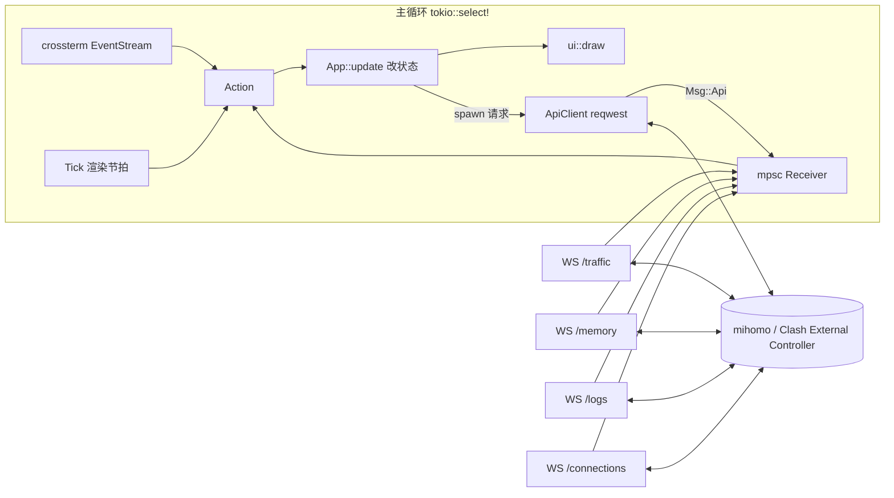
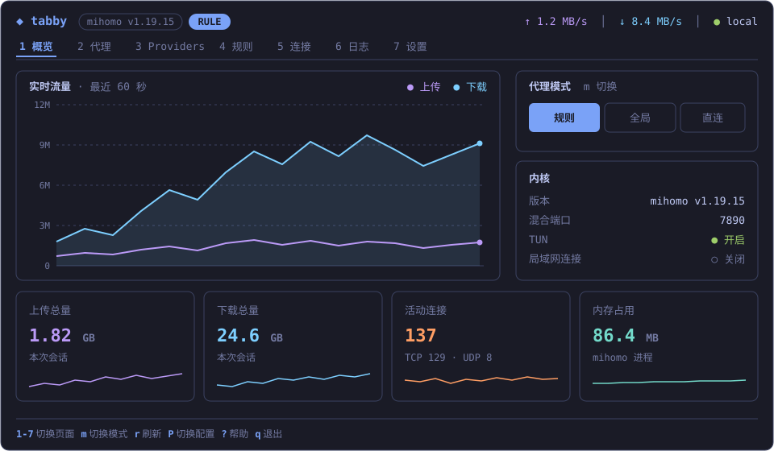
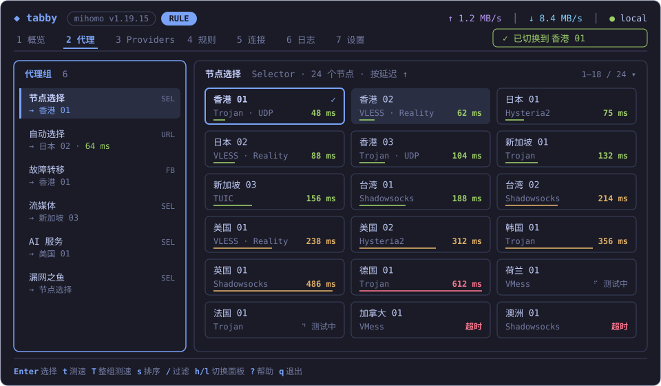

# tabby：Clash External Controller TUI 实施方案

- 日期：2026-11-05
- 状态：已确认，待实施
- 工具链：rustc / cargo 1.99.0，edition 2024

## 1. 目标与范围

tabby 是一个 Rust 编写的终端界面，通过 Clash 的 External Controller（RESTful API + WebSocket）查看和控制运行中的代理内核。

**目标**

- 以 mihomo（原 Clash.Meta）为主要内核，兼容原版 Clash 的 API 子集。
- 覆盖日常操作：模式切换、节点选择与测速、连接管理、日志查看、Provider 更新、配置维护。
- 视觉上做到信息层级清晰、配色统一、动效克制，默认跟随终端主题。
- Linux 上验证，代码保持跨平台。

**非目标**

- 不管理内核进程（不负责启动、安装、守护 mihomo）。
- 不编辑订阅或 YAML 配置文件本身，只通过 API 修改运行时配置。
- 不做 Web 面板。

## 2. 依赖选型

版本为 2026-11-05 在 crates.io 查到的最新稳定版，兼容性已核对。实施时用 `cargo add` 添加，届时再次确认最新版本。

```toml
[dependencies]
ratatui = "0.30.2"
crossterm = { version = "0.29.0", features = ["event-stream"] }
tokio = { version = "1.54.1", features = ["rt-multi-thread", "macros", "sync", "time"] }
reqwest = { version = "0.13.5", default-features = false, features = ["rustls", "json"] }
tokio-tungstenite = { version = "0.30.0", features = ["rustls-tls-webpki-roots"] }
futures-util = "0.3.34"
serde = { version = "1.0.229", features = ["derive"] }
serde_json = "1.0.154"
toml = "1.2.0"
directories = "6.0.0"
clap = { version = "4.6.7", features = ["derive", "env"] }
color-eyre = "0.6.5"
thiserror = "2.0.21"
percent-encoding = "2.3.2"
tui-input = "0.15.5"
unicode-width = "0.2.3"
tracing = "0.1.44"
tracing-subscriber = { version = "0.3.23", features = ["env-filter"] }
tracing-appender = "0.2.5"

[dev-dependencies]
wiremock = "0.6.5"
```

| crate | 选型理由 |
|---|---|
| `ratatui` | TUI 事实标准。0.30 拆分为 `ratatui-core` + 后端，默认后端为 crossterm 0.29 |
| `crossterm` | 直接依赖，只为开启 `event-stream` 拿到异步 `EventStream`；版本与 ratatui 内部一致，不会重复编译 |
| `tokio` | 异步运行时 |
| `reqwest` | HTTP 客户端。0.13 默认 TLS 为 rustls；关闭默认 feature，避免 `system-proxy`（见风险 R1） |
| `tokio-tungstenite` | WebSocket 订阅实时数据流；开启 rustls 以支持 `wss://` 远程控制器 |
| `futures-util` | `StreamExt` / `SinkExt` |
| `serde` / `serde_json` | API 数据模型 |
| `toml` + `directories` | 配置文件与 XDG 目录 |
| `clap` | 命令行参数，`env` feature 支持环境变量覆盖 |
| `color-eyre` | 应用层错误与 panic 报告 |
| `thiserror` | API 层类型化错误 |
| `percent-encoding` | 节点名、组名作为 URL 路径段时的编码 |
| `tui-input` | 过滤框、Secret 输入；原生适配 ratatui 0.30 / crossterm 0.29 |
| `unicode-width` | 按显示宽度截断中文与 emoji 名称 |
| `tracing` 系列 | 日志写入文件（TUI 占用 stdout） |
| `wiremock` | API 客户端测试 |

**未采用**

- `tui-logger`：日志来自 WS，自写环形缓冲 + List 更简单。
- `humansize`：字节格式化十几行即可。
- `insta`：UI 快照测试过于脆弱。
- `throbber-widgets-tui`：转圈动画用 10 帧盲文字符自实现。

**Lint 配置**

```toml
[lints.rust]
unsafe_code = "forbid"

[lints.clippy]
pedantic = { level = "warn", priority = -1 }
module_name_repetitions = "allow"
```

## 3. 架构

单 UI 循环 + 若干后台任务。后台任务只通过 `mpsc` channel 向 UI 发送消息，应用状态只在主循环里修改。



### 3.1 消息流

- `crossterm::event::Event` 先按当前焦点和页面映射为 `Action`（例如 `Action::SelectNode`）。
- `App::update(Action)` 修改状态。需要网络请求时 spawn 一个 tokio 任务，任务完成后发回 `Msg::Api(ApiResult)`。
- WS 任务把收到的帧解析成 `Msg::Traffic` / `Msg::Memory` / `Msg::Log` / `Msg::Connections` 发回。
- UI 不等待任何网络请求；进行中的请求在状态里记为 `Pending`，用来显示转圈。

### 3.2 渲染策略

- 有事件时重绘。
- 有动画（转圈、提示消息倒计时）时按 100ms 节拍重绘，空闲时不触发重绘。
- 实时流数据到达时标记脏，下一次节拍统一重绘，避免一秒多次全屏重绘。

### 3.3 内核识别

启动和每次重连时调用 `GET /version`：

- 返回 `meta: true` → `CoreKind::Mihomo`，开启内存、整组测速、DNS 查询、FakeIP 刷新、GeoData 更新、重启、升级等功能。
- 否则 → `CoreKind::Clash`，上述功能在界面中置灰并注明“需要 mihomo”。

### 3.4 WS 订阅与重连

- 四个流各一个任务，统一实现在 `api/stream.rs`。
- 鉴权：WS 无法自定义请求头，使用 `?token=<secret>`，token 做 URL 编码。
- 断线后指数退避重连：1s、2s、4s … 封顶 30s；重连成功后退避重置。
- 每个流的连接状态汇总到状态栏；全部断开时显示断线横幅。

## 4. 目录结构

```
tabby/
├── Cargo.toml
├── docs/plans/                 # 本方案与界面草图
├── src/
│   ├── main.rs                 # clap、tracing、color-eyre、终端初始化与恢复、启动 App
│   ├── config.rs               # config.toml 加载与覆盖优先级
│   ├── app.rs                  # App 状态、Action、Msg、update
│   ├── event.rs                # 主循环与 Tick
│   ├── format.rs               # 字节/速率/时长格式化、按显示宽度截断
│   ├── api/
│   │   ├── mod.rs
│   │   ├── client.rs           # ApiClient：REST 接口、鉴权、路径编码
│   │   ├── error.rs            # ApiError
│   │   ├── models.rs           # Version/Configs/Proxy/Provider/Rule/Connection/Log/Traffic/Memory
│   │   └── stream.rs           # WS 订阅与重连
│   └── ui/
│       ├── mod.rs              # 整体布局：顶栏、标签栏、内容区、底栏、浮层
│       ├── theme.rs            # 语义配色与内置主题
│       ├── components/         # header、tabs、footer、toast、popup、confirm、help、states
│       ├── overview.rs
│       ├── proxies.rs
│       ├── providers.rs
│       ├── rules.rs
│       ├── connections.rs
│       ├── logs.rs
│       └── settings.rs
└── tests/fixtures/             # 真实 mihomo 接口返回的 JSON 样本
```

单个 bin crate，不拆 lib；测试写在模块内的 `#[cfg(test)]` 中，fixtures 放在 `tests/fixtures/`。

## 5. 配置

路径：`~/.config/tabby/config.toml`（由 `directories` 决定）。

```toml
default = "local"
theme = "terminal"        # terminal | tokyo-night | catppuccin-mocha
icons = "unicode"         # unicode | nerd

[profiles.local]
url = "http://127.0.0.1:9090"
secret = "xxx"

[profiles.router]
url = "http://192.168.1.1:9090"

# 可选：覆盖主题中的单个语义颜色
[theme_overrides]
accent = "#7aa2f7"
```

**覆盖优先级**：命令行参数 > 环境变量 > 配置文件 > 默认值。

| 项 | 命令行 | 环境变量 | 默认值 |
|---|---|---|---|
| profile | `--profile` | `TABBY_PROFILE` | 配置中的 `default` |
| url | `--url` | `TABBY_URL` | `http://127.0.0.1:9090` |
| secret | `--secret` | `TABBY_SECRET` | 无 |
| theme | `--theme` | `TABBY_THEME` | `terminal` |

配置文件不存在时直接使用默认值启动，不报错。日志写入 `~/.local/state/tabby/tabby.log`。

## 6. API 覆盖

标注 (M) 的接口仅 mihomo 提供。

| 页面 | 接口 |
|---|---|
| 全局 | `GET /version`、`GET /configs` |
| 概览 | WS `/traffic`、WS `/memory` (M)、WS `/connections`（取总量和连接数）、`PATCH /configs`（切换模式） |
| 代理 | `GET /proxies`、`PUT /proxies/{group}`、`GET /proxies/{name}/delay`、`GET /group/{name}/delay` (M) |
| Providers | `GET /providers/proxies`、`PUT /providers/proxies/{name}`、`GET /providers/proxies/{name}/healthcheck`、`GET /providers/rules`、`PUT /providers/rules/{name}` |
| 规则 | `GET /rules` |
| 连接 | WS `/connections`、`DELETE /connections`、`DELETE /connections/{id}` |
| 日志 | WS `/logs?level=` |
| 设置 | `PATCH /configs`、`PUT /configs?force=true`、`POST /cache/fakeip/flush` (M)、`POST /configs/geo` (M)、`POST /restart` (M)、`POST /upgrade` (M) |

**约定**

- 所有路径参数用 `percent-encoding` 的路径段规则编码，覆盖 `/`、`#`、`%`、`?`、空格、中文、emoji。
- 延迟测试参数：`url` 默认 `https://www.gstatic.com/generate_204`，`timeout` 默认 5000ms，二者都可在配置中修改。
- 模型字段统一使用 `#[serde(default)]` 或 `Option`，以兼容两种内核的字段差异。

## 7. 界面设计

### 7.1 配色

所有界面代码只引用语义颜色，不写死具体颜色。

| 语义 | 用途 | `terminal` 主题映射 |
|---|---|---|
| fg | 正文 | Reset |
| muted | 次要信息、边框、单位 | DarkGray |
| surface | 光标高亮背景 | 由主题决定；`terminal` 下用反色 |
| accent | 焦点、选中、当前标签、按键提示中的按键 | Blue |
| success | 延迟 < 200ms、已连接、开关为开 | Green |
| warning | 延迟 200–500ms | Yellow |
| error | 延迟 > 500ms、超时、错误 | Red |
| c1 / c2 | 上传 / 下载，全应用统一 | Magenta / Cyan |
| c3 / c4 | 连接数、内存 | LightRed / LightCyan |

- `terminal`：只用 16 色 ANSI，自动跟随终端主题（Omarchy 切换主题时同步变化）。
- `tokyo-night`、`catppuccin-mocha`：内置真彩色主题。
- `[theme_overrides]` 可覆盖单个语义颜色。

### 7.2 组件规范

- **面板**：圆角边框；有焦点的面板边框为 accent，否则为 muted。
- **顶栏**：logo、内核版本标签、模式标签（RULE / GLOBAL / DIRECT），右侧为实时上下行速率和连接状态点。
- **标签栏**：`1`–`7` 编号，当前标签为 accent 色加下划线。
- **底栏**：按当前页面和焦点显示可用按键，按键为 accent 色，说明为 muted 色。
- **提示消息**：右上角弹出，3 秒后消失；类型分 success / error；同时最多显示 3 条。
- **弹窗**：居中，先清除底层内容；危险操作要求按 `y` 确认，`n` / `Esc` 取消。
- **数字**：右对齐；单位自动换算 B / KB / MB / GB，保留 1 位小数；速率带 `/s`。
- **文本截断**：按显示宽度截断并补 `…`，不会把宽字符切成两半。
- **三种状态**：每个页面都要实现加载中（转圈）、空列表（说明原因和可按的键）、出错（显示错误，按 `r` 重试）。
- **断线横幅**：控制器不可达时在内容区顶部显示“正在重连（第 N 次，Xs 后）”，并提示 `P` 切换配置。
- **图标**：默认通用 Unicode 符号；`icons = "nerd"` 时改用 Nerd Font 图标。

### 7.3 响应式布局

| 条件 | 调整 |
|---|---|
| 宽度 < 100 列 | 代理页分组栏折叠为顶部下拉选择；节点卡片变为 2 列；标签只显示数字 |
| 宽度 < 70 列 | 节点卡片变为 1 列；连接表隐藏“进程”和“总量”列 |
| 高度 < 28 行 | 概览页隐藏统计卡片 |
| 宽度 < 50 列或高度 < 15 行 | 显示“终端尺寸过小”提示，不渲染页面 |

### 7.4 页面草图

草图使用 tokyo-night 配色，仅表示布局与信息层级；终端实际效果以字符格为单位。

**概览**



- 流量图用 ratatui `Chart` 加盲文点绘制，保留最近 60 秒，Y 轴自动缩放到最大值的整数刻度。
- 统计卡片中的迷你折线用 `Sparkline`。
- 内存卡片在原版 Clash 下显示“需要 mihomo”。

**代理**



- 左栏：代理组列表，每项显示组名、类型缩写（SEL / URL / FB / LB）、当前节点；URLTest 组额外显示当前延迟。
- 右栏：节点卡片网格。
  - 当前使用的节点：accent 边框 + ✓。
  - 光标所在卡片：背景高亮。
  - 底部细条表示延迟，500ms 封顶，颜色与延迟分档一致。
  - 测速中显示盲文转圈动画；超时显示“超时”。
- 只有 Selector 组可以切换节点；对其他类型的组按 `Enter` 时提示“该组为自动选择”。
- 排序方式：默认顺序 / 延迟 / 名称，`s` 循环切换。

**其他页面**

| 页面 | 设计要点 |
|---|---|
| 3 Providers | 分为“代理集合”“规则集合”两个区块。行内显示名称、类型（HTTP / File / Inline）、数量、更新时间（相对时间，如“3 小时前”）。代理集合显示健康度条（可用节点比例）。更新中该行显示转圈 |
| 4 规则 | 表格列：序号、类型、匹配内容、目标。类型用彩色标签区分（DOMAIN、DOMAIN-SUFFIX、GEOIP、RULE-SET、MATCH……）。`/` 过滤时高亮匹配文字 |
| 5 连接 | 表格列：主机、进程、规则 → 链路、上行速率、下行速率、总量、持续时间。行背景交替；当前排序列表头标 ▲ / ▼；新连接短暂高亮。`Enter` 打开详情弹窗（源/目标地址、网络类型、链路、规则、开始时间） |
| 6 日志 | 每行：时间（muted）、级别标签（DEBUG / INFO / WARN / ERROR 各一色）、内容。右上角显示“● 实时”或“⏸ 已暂停”。离开底部时停止自动滚动，`G` 回到最新。缓冲上限 2000 条 |
| 7 设置 | 分组表单：基础（模式、局域网连接、日志级别、IPv6）、端口、TUN、维护（重载配置、刷新 FakeIP、更新 GeoData、重启、升级）。开关显示 `● 开 / ○ 关`；mihomo 独有项在原版 Clash 下置灰 |
| `?` 帮助 | 居中弹窗，左列为全局按键，右列为当前页面按键 |
| `P` 切换配置 | 弹窗列出所有 profile，标出当前项，回车切换并重连 |

### 7.5 按键

**全局**

| 按键 | 作用 |
|---|---|
| `q` / `Ctrl+C` | 退出 |
| `1`–`7` / `Tab` / `Shift+Tab` | 切换页面 |
| `j` / `k` / `↓` / `↑` | 上下移动 |
| `g` / `G` | 跳到顶部 / 底部 |
| `Ctrl+d` / `Ctrl+u` | 翻半页 |
| `/` | 过滤（`Esc` 清除） |
| `r` | 刷新当前页 |
| `m` | 循环切换代理模式 |
| `P` | 切换 profile |
| `?` | 帮助 |

**页面专属**

| 页面 | 按键 |
|---|---|
| 代理 | `h` / `l` 切换左右面板；`Enter` 选择节点；`t` 测当前节点；`T` 测整组；`s` 切换排序 |
| Providers | `u` 更新；`U` 全部更新；`h` 健康检查 |
| 连接 | `Enter` 详情；`s` 切换排序列；`S` 反转排序；`x` 关闭选中连接；`X` 全部关闭（需确认）；`p` 暂停刷新 |
| 日志 | `l` 循环切换级别；`p` 暂停；`c` 清空 |
| 设置 | `Enter` / `Space` 切换开关或执行操作；危险操作需确认 |

## 8. 错误处理

- `ApiError`（thiserror）：`Unauthorized`、`NotFound`、`Http { status, message }`、`Timeout`、`Connect`、`Decode`。
- 401 时显示“Secret 错误”，并提示用 `--secret` 或修改配置。
- 单个请求失败时弹出 error 提示，不影响其他功能。
- 启动时控制器不可达也照常进入界面，显示断线横幅并后台重连。
- panic：`ratatui::init()` 自带的 hook 负责恢复终端，color-eyre 输出报告，同时写入日志文件。

## 9. 测试策略

只写能抓住真实缺陷的测试，不测连线和默认值。

| 范围 | 方式 |
|---|---|
| 模型解析 | `tests/fixtures/` 中放真实 mihomo 和原版 Clash 的返回样本，验证字段缺失时能正确解析 |
| ApiClient | wiremock：鉴权头、带特殊字符的路径编码、401/404/5xx 映射、`no_proxy` 生效 |
| 格式化与截断 | 单位边界（1023B / 1KB）、CJK 与 emoji 截断不越界 |
| 配置覆盖 | 命令行 > 环境变量 > 文件 > 默认值 |
| 连接速率 | 两次快照做差，覆盖连接消失、新增的情况 |

## 10. 风险

| 编号 | 风险 | 处理 |
|---|---|---|
| R1 | shell 设置了 `HTTP_PROXY` 时，控制器请求被绕回 Clash 本身 | reqwest 关闭 `system-proxy` 并显式调用 `.no_proxy()` |
| R2 | WS 无法携带 Authorization 头 | 使用 `?token=`，并做 URL 编码 |
| R3 | 节点名包含 `/`、`#`、`%`、空格、emoji | 路径段编码，测试覆盖 |
| R4 | 两种内核 JSON 字段不一致 | `#[serde(default)]` + `Option`，用真实样本测试 |
| R5 | 崩溃后终端状态损坏 | `ratatui::init` / `restore` 自带 panic hook |
| R6 | `/connections` 每秒推送全量快照，连接多时开销大 | 只构建可见行；速率由相邻快照做差得到 |
| R7 | 原版 Clash 与 mihomo 的部分接口方法不同 | 按 `CoreKind` 分派，不支持的功能在界面置灰 |

## 11. 提交计划

使用 Conventional Commits。每个提交都要求 `cargo build`、`cargo clippy --all-targets -- -D warnings`、`cargo test` 通过。

**M0 骨架**

1. `chore: init cargo project with gitignore`
2. `chore: set edition 2024 and workspace lints`
3. `chore: add core dependencies`
4. `feat(tui): init and restore terminal with panic hook`
5. `feat(app): add event loop with tokio select and tick`
6. `feat(app): add Action/Msg dispatch and quit handling`

**M1 配置与 API 基础**

7. `feat(config): load profiles from config.toml`
8. `feat(cli): add clap args with env/config override precedence`
9. `feat(log): write tracing logs to state dir`
10. `feat(api): add ApiClient with auth and no_proxy`
11. `feat(api): add error type and HTTP status mapping`
12. `feat(api): add version and configs endpoints`
13. `test(api): cover auth header and path encoding with wiremock`

**M2 界面基础设施**

14. `feat(ui): add semantic theme with terminal palette`
15. `feat(ui): add tokyo-night and catppuccin-mocha themes`
16. `feat(ui): add header with core badge, mode pill and status`
17. `feat(ui): add tab bar and page routing`
18. `feat(ui): add contextual key hints footer`
19. `feat(ui): add toast notifications`
20. `feat(ui): add popup and confirm dialog`
21. `feat(ui): add help overlay`
22. `feat(ui): add loading, empty and error states`
23. `feat(ui): add disconnected banner`

**M3 代理页**

24. `feat(api): add proxies models and endpoints`
25. `test(api): parse proxies fixtures from mihomo`
26. `feat(proxies): render group list panel`
27. `feat(proxies): render node card grid with delay colors`
28. `feat(proxies): select node in selector group`
29. `feat(proxies): test delay for node and group with spinner`
30. `feat(proxies): sort and filter nodes`

**M4 实时流**

31. `feat(api): add websocket subscriber with backoff reconnect`
32. `feat(overview): add traffic chart and mode switcher`
33. `feat(overview): add stat cards and core info`
34. `feat(connections): render live table with speed diff`
35. `feat(connections): sort, filter and detail popup`
36. `feat(connections): close one or all connections`
37. `feat(logs): stream logs with level filter and pause`

**M5 其余页面**

38. `feat(rules): list and filter rules`
39. `feat(providers): update and health check providers`
40. `feat(settings): patch configs and run maintenance actions`

**M6 收尾**

41. `feat(app): switch profiles at runtime`
42. `feat(ui): responsive layout for narrow terminals`
43. `feat(ui): optional nerd font icons`
44. `docs: add README`

## 12. 验证

- 每个里程碑完成后，实际启动 tabby 连接本机 mihomo，把该阶段新增的页面与操作走一遍。
- 本机没有运行中的 mihomo 时，临时启动一个测试实例：只监听 127.0.0.1，出口只有 DIRECT，加若干本地假节点，用于测试节点切换与测速。
- 窄屏布局在 80×24 与 60×20 两种终端尺寸下实际检查。
- 用一个原版 Clash API 兼容的实例（或 wiremock 模拟）检查 mihomo 独有功能的置灰逻辑。
