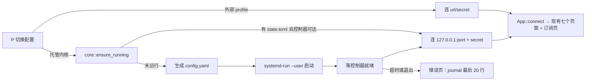

# tabby：托管内核实施方案

- 日期：2026-11-06
- 状态：待实施
- 前置：主方案 `2026-11-05-tabby-tui.md`（M0–M6）。本方案取代其 §1 中“不管理内核进程”“不编辑订阅或 YAML 配置文件”两条非目标。
- 参照：FlClash（`chen08209/FlClash`，2026-11-06 的 main 分支），下文引用的路径都相对于它的仓库根目录。

FlClash 源码还留在 /tmp/flclash-src，实现时可以直接对照

## 1. 目标与范围

在“连接外部控制器”之外，tabby 可以自己管理一个 mihomo 内核：下载内核、导入订阅、生成运行配置、在后台常驻、开 TUN。体验向 FlClash 看齐；连上内核之后的七个页面、`ApiClient`、`Streams`、重连逻辑全部沿用。

**目标**

- 内核在后台常驻：退出 tabby 后内核继续运行，下次启动 tabby 直接接上。
- TUN：授权一次（`setcap`），之后开关不再要求密码。
- 订阅：URL 和本地文件两种；YAML 配置和分享链接列表（纯文本或 base64）都能导入；显示用量和到期时间；可自动更新。
- 内核：tabby 从 MetaCubeX/mihomo 的 release 下载并校验，在界面里更新；也可以指定自己的二进制。
- 可选：登录时自动启动内核、设置 GNOME / KDE 系统代理、导入 age 加密的订阅。

**非目标**

- 不内嵌 Go 内核（FlClash 的 FlClashCore 做法），只用官方 mihomo 二进制，通过 external-controller 控制。
- 不支持 JS 脚本覆写（需要嵌入 JS 引擎）。
- 不常驻 root 进程，不做 FlClash 的 helper 服务（理由见 §2、§8）。
- tabby 退出期间不更新订阅（FlClash 同样只在 App 运行时更新）。
- 不做 macOS / Windows 的授权和自启；进程管理的后备方案（§5.3）保持可移植，其余只在 Linux 上验证。

## 2. FlClash 调研结论

| 项               | FlClash 的做法                                                                                                                                                                                                                                                            | 源码                                                                                      |
| ---------------- | ------------------------------------------------------------------------------------------------------------------------------------------------------------------------------------------------------------------------------------------------------------------------- | ----------------------------------------------------------------------------------------- |
| 内核             | 自有 Go 程序 FlClashCore，基于作者 fork 的 Clash.Meta（`FlClash` 分支），随 App 打包、随 App 更新；与界面经 unix socket（`/tmp/FlClashSocket_<id>.sock`）通信，external-controller 默认关闭                                                                               | `core/`、`.gitmodules`、`services/helper/src/service/hub.rs`                              |
| TUN 授权（首选） | 有 systemd 且不是 AppImage 时，经 pkexec 安装 root 系统服务 `flclash-helper`（`/etc/systemd/system/flclash-helper.service`），监听 `/run/flclash/helper.sock`（0660，按 peer uid 只放行安装者）；helper 核对内核 sha256（编译时写死）后以 `setresuid(uid, 0, 0)` 启动内核 | `lib/common/system.dart::authorizeCore`、`services/helper/src/service/linux.rs`、`hub.rs` |
| TUN 授权（后备） | 无 systemd：`chown root:<gid> && chmod 4750`，内核变成 setuid root；AppImage 直接报错（只读 nosuid 挂载）                                                                                                                                                                 | `system.dart::linuxElevationShell`                                                        |
| 提权方式         | 先 `pkexec`；退出码 127（没有 polkit agent，平铺窗口管理器常见）时改用 `sudo`；126 是用户取消，不再重试                                                                                                                                                                   | `lib/common/linux_elevation.dart`                                                         |
| 后台             | 关窗口默认最小化到托盘（`minimizeOnExit = true`）；真正退出时内核一起停                                                                                                                                                                                                   | `lib/models/config.dart`、`lib/manager/window_manager.dart`                               |
| 自启             | `autoLaunch` 登录时启动 App，`silentLaunch` 启动后隐藏窗口，`autoRun` 打开 App 即启动代理                                                                                                                                                                                 | `lib/common/launch.dart`、`lib/bootstrap.dart`                                            |
| 订阅类型         | `ProfileType { file, url, custom }`                                                                                                                                                                                                                                       | `lib/enum/enum.dart`                                                                      |
| 订阅下载         | UA `FlClash/v<版本> clash-verge Platform/<os>`；名字取 `content-disposition`，用量取 `subscription-userinfo`；默认每 1 天自动更新                                                                                                                                         | `lib/common/package.dart`、`lib/models/profile.dart`、`lib/common/constant.dart`          |
| 非 YAML 订阅     | 先校验配置；不通过就按分享链接列表（纯文本或 base64）用 mihomo 的 `convert.ConvertsV2Ray` 转换，写成 `{proxies: [...]}` 再校验                                                                                                                                            | `lib/core/controller.dart::validateProfile`、`core/proxy.go::handleConvertProxies`        |
| 加密订阅         | age 加密的配置要求输入密钥，解密后原地写回明文                                                                                                                                                                                                                            | `controller.dart::validateProfile`                                                        |
| 覆写             | 订阅只允许覆盖 DNS 相关的键（`normalProfileKeys`：listen、ipv6、enhanced-mode、fake-ip-filter、nameserver 等），另有 JS 脚本覆写                                                                                                                                          | `lib/enum/enum.dart`                                                                      |
| 系统代理         | Linux 上按桌面调 `gsettings`（GNOME / MATE）或 `kwriteconfig6/5`（KDE）                                                                                                                                                                                                   | `plugins/proxy/lib/src/linux_proxy.dart`                                                  |
| 默认值           | mixed-port 7890；TUN stack `mips`（fork 专有，官方 mihomo 没有），MTU 9000                                                                                                                                                                                                | `lib/models/clash_config.dart`                                                            |

**与 FlClash 不同之处及原因**

- **内核**：Rust 程序嵌不进 Go 内核，只能用官方二进制，走 external-controller。
- **TUN 授权**：不照搬 helper。helper 靠固定的 sha256 防止被替换成任意 root 程序，而 FlClash 的内核只随 App 更新；tabby 要自己下载、升级内核，每次升级都得重新授权、更新这个值。改用 `setcap cap_net_admin,cap_net_bind_service=+ep` 加 `systemd --user`，这是 mihomo 官方文档推荐的非 root 运行方式：没有 root 常驻进程，权限只到网络管理这一层。代价是替换二进制会丢掉文件能力，升级后要重新授权一次（§8）。
- **后台常驻**：TUI 没有托盘，“后台”就是内核作为独立进程活过 tabby。
- **分享链接订阅**：不在 Rust 里重写转换器，把链接列表写成 file 类型的 `proxy-providers`，让 mihomo 自己解析（provider 本来就接受这种格式，FlClash `core/proxy.go` 的注释也提到）。区别是节点出现在 provider 里，代理页已经能显示和测速 provider 节点（主方案 第 41 项后续修复）。
- **加密订阅**：mihomo 有 `-age-secret-key` 参数，但生成运行配置需要明文（§7），所以和 FlClash 一样由 tabby 解密。
- **TUN stack**：默认 `mixed`（官方 mihomo 没有 `mips`）。

## 3. 方案总览



- 新模块 `src/core/`：`mod.rs`（`ManagedCore`：路径、状态、`ensure_running` / `stop` / `restart`）、`supervisor.rs`（§5）、`install.rs`（§6）、`subscription.rs`（§7.1）、`runtime.rs`（运行配置生成，§7.2）、`privilege.rs`（§8）、`sysproxy.rs`（§9.2）。
- 所有外部命令（`systemd-run`、`systemctl`、`journalctl`、`getcap`、`pkexec`、`sudo`、`mihomo -t`）经同一个 `Runner` 接口执行：生产实现用 `tokio::process`，测试实现记录参数、返回预设结果。
- 后台工作照旧：`App::spawn` 里跑，结果以 `Msg` 发回，只有主循环改状态。新增 `Msg::Core(CoreEvent)`（启动进度、失败原因、下载进度、授权结果）和 `Msg::Subscription(...)`。
- 托管内核在 `P` 弹窗里是固定的一行 `托管内核`，内部 profile 名为 `core`：`default = "core"` 或 `--profile core` 选中它。用户 profile 不能叫 `core`（读取配置时报错，写明是哪一行）。没有 `[core]` 段时不显示这一行。
- 切到托管内核时，`App::connect` 之前先 `ensure_running`。期间画面是转圈和当前步骤（`正在下载内核…`、`正在启动内核…`、`等待控制器…`）；失败显示错误页，`r` 重试，`P` 可以切走。

## 4. 文件布局

数据目录取 `ProjectDirs::data_local_dir()`（Linux 上是 `$XDG_DATA_HOME/tabby`，即 `~/.local/share/tabby`）：

```
<data>/core/
├── bin/mihomo                # tabby 下载的内核（[core].binary 未设置时）
├── home/                     # mihomo -d；geo 数据、cache.db 也在这里
│   ├── config.yaml           # 生成的运行配置，0600（含 secret）
│   └── providers/<id>.txt    # 分享链接订阅包装成的 provider 文件
├── profiles/<id>.yaml        # 订阅原文（下载或导入的原样内容）
├── subscriptions.toml        # 订阅列表与元数据，0600（含 URL token 与 age 密钥）
├── settings.toml             # 托管内核的设置（§7.3）
├── state.toml                # 控制器地址、secret、unit 名、后备模式下的 pid，0600
└── core.log                  # 仅后备模式（§5.3）：内核的 stdout/stderr
```

- `state.toml` 第一次使用时生成：控制器端口取 `bind 127.0.0.1:0` 拿到的空闲端口；secret 是从 `/dev/urandom` 读的 32 字节，转成十六进制（不引入随机数 crate）；unit 名 `tabby-mihomo-<8 位十六进制随机后缀>`，因此不同数据目录（例如测试时的临时目录）互不冲突。
- secret 只写进 `config.yaml`，不出现在命令行（`/proc/<pid>/cmdline` 对所有用户可见）和 unit 属性里。
- 这些文件都是 tabby 自己写的，不放进 `config.toml`。

## 5. 进程管理

### 5.1 systemd 用户单元（首选）

- 判定：`$XDG_RUNTIME_DIR/systemd/private` 存在，或 `systemctl --user is-system-running` 输出 `running` / `degraded`。
- 启动：没有单元文件时用临时单元（transient unit），不在 `~/.config/systemd/user` 落文件：

  ```
  systemd-run --user --unit=<unit> --collect \
    -p Restart=on-failure -p RestartSec=2 \
    -- <bin> -d <data>/core/home -f <data>/core/home/config.yaml
  ```

  有单元文件（开了自启，§9.1）时改用 `systemctl --user start <unit>`。

- 停止：`systemctl --user stop <unit>`。内核收到 SIGTERM，自己清理 TUN 的路由（与 FlClash helper 的 `request_exit` 同理）。
- 重启：`systemctl --user restart <unit>`，不用 `POST /restart`。文件能力在 execve 时生效，两种方式都会重新 exec，但走 systemd 能把内核的退出码和日志都留在 journal 里。
- 日志：内核起不来时读 `journalctl --user -u <unit> -n 20 -o cat --no-pager`，放进错误页。控制器起来之后的日志照旧走 `/logs` WS。
- 局限：临时单元随用户会话结束而停止（没开 linger 时注销即停）。登录后自动运行要靠 §9.1 的单元文件。

### 5.2 接上已在运行的内核

`ensure_running` 的顺序：

1. 读 `state.toml`，用里面的 secret 请求 `GET /version`。成功就直接用，不动进程。
2. 失败：查单元状态。`active` / `activating` 时等控制器就绪（每 200 ms 探测一次，最多 10 s）；否则重新生成 `config.yaml` 并启动（§5.1）。
3. 超时，或单元进入 `failed`：错误页显示 `内核启动失败` 和 journal 最后 20 行。
4. 控制器端口被别的进程占用（`/version` 返回 401，或返回的不是 mihomo）：报 `端口 <port> 已被其他程序占用`，不去碰那个程序。

### 5.3 后备：独立进程组

没有 systemd 用户实例时使用：

- `std::process::Command` 设 `process_group(0)`，stdin 接 null，stdout / stderr 写入 `core.log`（启动前把旧日志改名为 `core.log.1`），pid 记进 `state.toml`。
- 存活检查：Linux 读 `/proc/<pid>/cmdline`，确认进程存在而且确实是这个内核；其他平台执行 `kill -0 <pid>`。
- 停止：`kill -TERM`，5 s 后进程还在就 `kill -KILL`。
- 不会自动拉起崩溃的内核。tabby 在运行时发现内核退出，会在横幅里写 `内核已退出`，按 `r` 重新拉起。

### 5.4 tabby 退出

`q` 只退出界面，内核继续运行。停止内核放在设置页的“维护”组：`停止内核`，需要确认；停掉后 tabby 仍在托管内核这一项上，显示 `内核未运行` 和 `r 启动`。

## 6. 内核安装与更新

- `[core].binary` 已设置：直接用这个路径，不下载也不更新；设置页的 `升级内核` 显示 `由你自己管理`，并且置灰。
- 未设置：用 `<data>/core/bin/mihomo`。文件不存在时，确认框询问 `下载 mihomo <tag>？`，确认后下载：
  1. 请求 `GET https://api.github.com/repos/MetaCubeX/mihomo/releases/latest`，读 `tag_name` 和 `assets[].{name, browser_download_url, digest}`（2026-11-06 实测 v1.19.33，每个资产都带 `sha256:<hex>` 格式的 `digest`）。
  2. 选择资产：
     - amd64：从 `/proc/cpuinfo` 的 flags 判断 x86-64 指令集等级。v3 需要 `avx2 bmi1 bmi2 fma movbe abm f16c xsave`，v2 需要 `sse4_2 popcnt ssse3 cx16`，依次选 `mihomo-linux-amd64-v3-<tag>.gz`、`-amd64-v2-`、`-amd64-v1-`。不选 `amd64-compatible`，构建脚本注释说这种旧式文件名会被移除。
     - arm64：选 `mihomo-linux-arm64-<tag>.gz`，实施时核对 release 上的实际文件名。
     - 其他架构：报 `没有适合 <arch> 的内核，请在 [core].binary 指定`。
  3. 下载过程中计算 sha256，与 `digest` 不一致就丢弃，报 `内核校验失败`。
  4. 用 `flate2` 解压到 `bin/mihomo.new`，设 0755，执行 `mihomo.new -v` 做健全检查，然后 `rename` 替换旧文件（原子操作）。
- 更新：设置页 `升级内核`（托管模式下替代 `POST /upgrade`；`/upgrade` 会原地替换二进制，绕过校验，也绕过这里的版本记录）。`-v` 显示的版本与 `tag_name` 相同时提示 `已是最新`；否则下载、替换，再重启单元。替换后文件能力丢失，TUN 授权状态重新判定（§8）。
- 网络：GitHub 请求不走控制器客户端的 `no_proxy`（那条规则是为了防止控制器请求被绕回内核，主方案 R1）。托管内核正在运行时，经它的 mixed-port 下载；没有运行时直连。`reqwest` 没有开 `system-proxy`，实施时显式构造 `Proxy`。

## 7. 订阅与运行配置

### 7.1 订阅

- 模型（`subscriptions.toml`）：`id`、`name`、`kind`（`url` / `file`）、`url` 或原始文件路径、`auto_update`（默认开）、`interval_hours`（默认 24，与 FlClash 一致）、`updated_at`、`usage`（upload / download / total / expire）、`age_key`（可选），以及 `active`（当前订阅的 id）。
- 导入 URL：
  - UA 用 `tabby/v<版本> clash-verge Platform/<os>`。服务端多半按 UA 里是否有 `clash` 字样决定返回 clash-meta 格式；带上 `clash-verge` 是照 FlClash 的做法。
  - 名字：先取 `content-disposition` 的 `filename*=UTF-8''…`（按百分号解码），再取 `filename=`，都没有就用 URL 的 host。
  - 用量：解析 `subscription-userinfo`，复用 Providers 页解析订阅用量的规则（全零读成 `None`）。
- 导入文件：复制到 `profiles/<id>.yaml`。之后手动更新时重新读原路径；原文件不在了就保留副本并提示。
- 校验（对应 FlClash 的 `validateProfile`）：
  1. 开头是 `age-encryption.org/v1`：要求输入 age 密钥（第 9 项），解密后进入第 2 步。
  2. 执行 `<bin> -t -d <home> -f <文件>`，退出码 0 即通过。
  3. 不通过：当作分享链接列表，写入 `home/providers/<id>.txt`，再生成一个包装配置（provider 名就是订阅名）：

     ```yaml
     proxy-providers:
       <订阅名>:
         {
           type: file,
           path: ./providers/<id>.txt,
           health-check: { enable: true, url: <delay.url>, interval: 600 },
         }
     proxy-groups:
       - { name: 节点选择, type: select, use: [<订阅名>] }
     rules:
       - MATCH,节点选择
     ```

     再执行一次 `-t`。provider 文件必须放在 home 下，因为 mihomo 只接受 `SAFE_PATHS` 以内的路径。

  4. 两次都不通过：拒绝导入，错误信息取 mihomo 输出的第一条 error。
- 写入都先写临时文件再 `rename`，所以更新失败时旧文件不受影响。
- 切换：在订阅页按 `Enter` → 用新订阅重新生成 `config.yaml` → `PUT /configs?force=true`（body 的 `path` 为空，即重新加载 `-f` 指定的文件）→ 复用主方案第 41 项的 `reload_visited`。
- 自动更新：tabby 运行期间每分钟检查一次，到期的订阅在后台更新。当前订阅更新后重新生成配置并重载；失败时保留旧内容，弹 error。
- 删除：需要确认。当前订阅不能删，提示 `先切换到其他订阅`。

### 7.2 运行配置生成

`config.yaml` = 订阅原文去掉 tabby 接管的顶层键，再追加 tabby 的覆盖块。

- **不重新序列化订阅内容**。YAML 解析器只用来定位顶层键的字节范围（`saphyr-parser` 的事件带位置标记），删除范围以外的字节原样保留。如果解析后再输出，未加引号的 REALITY `short-id: 0123` 会被读成数字 83（FlClash 在 `core/short_id.go` 里专门处理过这个问题），锚点、注释、数字写法也会变。
- 追加的覆盖块由 tabby 自己的值生成，用 JSON 写法（flow 风格就是合法的 YAML），所以不需要 YAML 输出库。
- 接管的键：
  - 始终：`external-controller`（`127.0.0.1:<port>`）、`secret`、`profile.store-selected: true`（重启后保留节点选择）。删除 `external-controller-tls` / `-unix` / `-pipe`，防止订阅额外开放控制入口。
  - 来自 `settings.toml`（§7.3）：`mixed-port`、`allow-lan`、`ipv6`、`log-level`、`mode`、`tun`。`port`、`socks-port`、`redir-port`、`tproxy-port` 一律删除；与 FlClash 一样只开一个 mixed 端口，设置页的这几项在托管模式下显示 `托管内核只用 Mixed 端口`。
  - 可选的 DNS 覆盖：`settings.toml` 的 `[dns]`，可覆盖的键照 FlClash 的 `normalProfileKeys`。
- 订阅的顶层不是块状映射（整份是 `{…}`、有多个文档、或者为空）：报 `订阅格式不支持`，不做猜测。

### 7.3 托管内核的设置

- `settings.toml` 的默认值：`mixed-port = 7890`、`allow-lan = false`、`ipv6 = false`、`log-level = "info"`、`mode = "rule"`；`[tun]` 为 `enable = false`、`stack = "mixed"`、`auto-route = true`、`auto-detect-interface = true`、`dns-hijack = ["any:53"]`、`mtu = 9000`。
- 设置页和 `m` 在托管模式下的修改：照旧 `PATCH /configs`，成功后再写进 `settings.toml`，所以重启后仍然生效（外部控制器模式下仍然只改运行时）。在途保护和乱序处理照旧（主方案第 42 项）。
- 托管模式下的 `重载配置` = 用当前订阅重新生成配置再重载；确认框正文改为 `用当前订阅重新生成配置？`。

## 8. TUN 授权

- 状态：`getcap <bin>` 的输出含 `cap_net_admin` 即为已授权；每次连上托管内核、每次替换二进制后重新判定。
- 先查挂载：读 `/proc/self/mountinfo`，二进制所在的挂载点带 `nosuid` 时文件能力不生效，直接报 `内核所在分区以 nosuid 挂载，无法授权，请在 [core].binary 指定其他位置`（相当于 FlClash 对 AppImage 的处理）。
- 流程（在设置页打开 TUN，或在概览页按 TUN 开关，且尚未授权）：
  1. 确认框 `开启 TUN 需要授权：tabby 会用 setcap 给内核加上 CAP_NET_ADMIN 和 CAP_NET_BIND_SERVICE。`
  2. 执行 `pkexec /usr/bin/setcap cap_net_admin,cap_net_bind_service=+ep <bin>`。退出码 0 继续；126 视为用户取消，弹提示后结束；127 或者没有 pkexec，进入第 3 步。
  3. 挂起 TUI：停掉 `EventStream`（否则它会和 sudo 抢终端输入），`ratatui::restore()`，在终端里执行 `sudo setcap …`，结束后重新初始化终端和事件流并全屏重绘。
  4. 授权成功：重启单元，等控制器就绪后 `PATCH {"tun": {"enable": true}}`，写入 `settings.toml`。
- 内核更新或用户替换二进制后能力会丢失：判定为未授权时，如果 `settings.toml` 里 TUN 是开的，生成配置时先关掉 TUN，并弹提示 `内核已更新，TUN 需要重新授权`（对应 FlClash 的 `tunAuthorizationFailed`）。
- `[core].binary` 指向系统路径（例如 pacman 安装的 `/usr/bin/mihomo`）时同样可以授权；包管理器升级后能力丢失，处理同上。

## 9. 自启与系统代理

### 9.1 登录时启动内核

- 设置页“托管内核”组的开关 `登录时启动`：写入 `$XDG_CONFIG_HOME/systemd/user/<unit>.service`（`ExecStart` 与 §5.1 相同，加 `Restart=on-failure`、`[Install] WantedBy=default.target`），然后 `systemctl --user daemon-reload && systemctl --user enable <unit>`。
- 关闭：`disable`，删除单元文件，再 `daemon-reload`。
- 打开开关时临时单元可能正在运行：先 `stop` 临时单元，再 `start` 正式单元，中间会有约 1 s 的中断。
- 这是登录时启动，不是开机启动；tabby 不会执行 `loginctl enable-linger`。
- 后备模式（§5.3）下开关置灰，提示 `需要 systemd`。

### 9.2 系统代理

- 照 FlClash 的 `linux_proxy.dart`：按 `XDG_CURRENT_DESKTOP` 选后端。GNOME / MATE / Cinnamon 用 `gsettings set org.gnome.system.proxy …`（mode manual，http、https、socks 指向 `127.0.0.1:<mixed-port>`，再设 ignore-hosts）；KDE 用 `kwriteconfig6`（没有就用 `kwriteconfig5`）写 `kioslaverc` 的 `ProxyType` 等键；其他桌面（包括 Hyprland）开关置灰，提示 `当前桌面不支持系统代理`。
- 在 tabby 里停止内核时恢复系统代理。内核在 tabby 未运行时退出的话，系统代理会指向一个已经关掉的端口：tabby 下次启动时检测到这种情况会弹提示，这是已知局限（R6）。

## 10. 界面变更

- **订阅页**：新增第 8 页（`8`），不打乱现有 1–7 的编号。列表每行：当前标记、名称、类型标签、更新时间（`format::ago`）、用量（与 Providers 页相同的写法）。按键：`a` 添加（输入 URL 或路径）、`Enter` 切换、`u` 更新、`U` 全部更新（有过滤时是匹配的，需确认）、`d` 删除（需确认）、`/` 过滤。外部控制器模式下显示 `states::empty`：`连接的是外部控制器，订阅由它自己管理`，提示 `P 切换到托管内核`。
- **设置页**：新增“托管内核”组（只在托管模式下显示）：内核路径与版本、`升级内核`、`停止内核`、`登录时启动`、`系统代理`。TUN 开关接入 §8 的授权流程。
- **顶栏**：托管模式下内核标签写成 `mihomo v1.19.33 · 托管`。
- **启动与错误**：转圈画面显示当前步骤；错误页标题写出原因（`内核启动失败`、`内核校验失败`、`端口已被占用` 等），正文是 journal 或 `core.log` 的最后几行，按显示宽度截断。
- **帮助浮层、底栏、README**：随各项一起更新。

## 11. 配置

`config.toml` 只新增一个开关段，其余设置在数据目录里，由 tabby 维护：

```toml
default = "core"            # 可选：启动时直接用托管内核

[core]                      # 有这一段才在 P 弹窗里显示“托管内核”
binary = "/usr/bin/mihomo"  # 可选；不写则由 tabby 下载到数据目录并负责更新
```

覆盖优先级照旧（主方案 §5）。`--profile core` / `TABBY_PROFILE=core` 选中托管内核；`--url` 与 `core` 同时给出时以 `--url` 为准，与现在相同：命令行指定的地址优先于 profile。

## 12. 依赖

在主方案 §2 的基础上新增（版本为 2026-11-06 在 crates.io 查到的版本，实施时用 `cargo add` 再确认）：

| crate           | 版本   | 用途                                                        |
| --------------- | ------ | ----------------------------------------------------------- |
| `flate2`        | 1.1.10 | 解压 release 的 `.gz`（默认的 `miniz_oxide` 后端，纯 Rust） |
| `sha2`          | 0.11.1 | 校验下载的内核                                              |
| `saphyr-parser` | 0.3.3  | 定位订阅 YAML 的顶层键（只解析，不输出）                    |
| `age`           | 0.12.1 | 第 9 项：解密订阅                                           |

不引入 OpenSSL；HTTP 下载继续用 `reqwest` + rustls。

## 13. 风险

| 编号 | 风险                                                         | 处理                                                                                                      |
| ---- | ------------------------------------------------------------ | --------------------------------------------------------------------------------------------------------- |
| R1   | 二进制所在分区以 nosuid 挂载时，文件能力不生效               | 授权前查 `/proc/self/mountinfo`，提前报错（§8）                                                           |
| R2   | 升级或替换二进制会丢掉文件能力，TUN 开不起来                 | 每次连上内核、每次替换后用 `getcap` 判定；需要时关掉 TUN 并提示重新授权                                   |
| R3   | 重新序列化 YAML 会改变订阅内容（`short-id`、锚点、数字写法） | 只删除和追加字节，不重新输出（§7.2）                                                                      |
| R4   | secret 泄露                                                  | 不放命令行和 unit 属性；`config.yaml`、`state.toml`、`subscriptions.toml` 设 0600                         |
| R5   | sudo 和 crossterm 的事件读取抢终端输入                       | 执行 sudo 前停掉 `EventStream`，恢复终端；结束后重建（§8）                                                |
| R6   | 内核在 tabby 之外退出，系统代理指向已关闭的端口              | 下次启动 tabby 时检测并提示；文档写明                                                                     |
| R7   | 托管内核与外部内核端口冲突（例如两者都用 7890）              | 启动失败时 journal 里有 `address already in use`，错误页照实显示；设置页可以改 mixed-port                 |
| R8   | 两个内核同时开 TUN 并 auto-route，会互相抢路由               | 文档写明；手动验证时必须先征得用户同意（§14）                                                             |
| R9   | 在 systemd 用户单元里文件能力是否生效                        | `[INFERENCE]` 用户管理器默认没有 `NoNewPrivileges`，能力上限集合是完整的，理论上会生效；第 5 项验收时实测 |
| R10  | GitHub 在部分网络下无法直连                                  | 托管内核运行时经它的 mixed-port 下载；第一次安装失败时提示可以设 `[core].binary`                          |

## 14. 测试与验证

- **单元测试**（沿用主方案 §9：只测真实缺陷）：
  - 运行配置：覆盖后订阅的其余字节完全不变（含 `short-id: 0123`、锚点与别名、注释、CRLF、`---` 开头）；接管的键被删掉，覆盖块只出现一次；flow 风格的顶层和多文档报错。
  - 订阅：各种写法的 `content-disposition`（RFC 5987、带引号、缺失）；`subscription-userinfo` 的缺字段和全零；第 1 次校验失败、包装后通过的路径。
  - 安装：wiremock 模拟 GitHub API 和 `.gz` 资产：`digest` 不一致时拒绝，替换是原子的；按 cpu flags 选资产。
  - 进程管理与授权：用记录参数的 `Runner` 核对 `systemd-run`、`systemctl`、`pkexec`、`sudo` 的参数，以及 126 / 127 等退出码的分支；后备模式用临时目录里的 `#!/bin/sh` 假内核（Unix 下才编译）测启动、存活检查和停止。
  - 接上已运行的内核：wiremock 控制器分别返回 200 / 401 / 连接拒绝。
- **不用单元测试覆盖**：真实的 systemd、setcap、pkexec、gsettings 这些都只做手动验证。
- **手动验证**（每项都做，遵守 AGENTS.md）：
  - 用临时的 `XDG_CONFIG_HOME`、`XDG_DATA_HOME`、`XDG_STATE_HOME`；unit 名带随机后缀，不会和真实环境冲突。
  - 控制器端口用随机分配的；mixed-port 改成 17890 一类不冲突的端口，不碰 FlClash 的 9090 和 7890。
  - 订阅用本地 `http.server` 提供的 DIRECT-only 配置和分享链接列表，不用真实机场。
  - TUN 的实测会改动本机路由：先征得用户同意（FlClash 也开着 TUN，R8）。
  - 结束时：停掉单元，删除单元文件并 `daemon-reload`，删除带能力的临时二进制和临时目录，`systemctl --user list-units 'tabby-mihomo-*'` 为空，`~/.config/tabby` 和 `~/.config/systemd/user` 没有残留。

## 15. 提交计划

照主方案 §11 的规则：每项一个提交（Conventional Commits），提交前 build、`clippy -D warnings`、test 都要通过；实现记录写回本节对应的条目下；每一项都要有调用者（bin crate 不允许没用到的代码），做不到时与下一项合并，并在实现记录里说明。

**M7 托管内核**

1. `feat(core): run a managed mihomo in the background`
   - 范围：`[core]` 段与 `core` profile（保留名）、`P` 弹窗的 `托管内核` 行、`state.toml` 初始化、§5 的进程管理（systemd 临时单元 + 后备模式）、§5.2 的接上逻辑、`停止内核`、启动与失败画面。二进制取 `[core].binary`，没设置就在 `PATH` 里找 `mihomo`（第 2 项再加下载）。还没有订阅时，用内置的最小配置（只有 DIRECT，`mixed-port` 取 `settings.toml` 的默认值）。
   - 验收：选中托管内核后自动启动，七个页面都可用；`q` 后 `systemctl --user is-active <unit>` 仍为 `active`；再启动 tabby 不会起第二个进程（pid 不变）；`停止内核` 后单元不存在，页面显示 `内核未运行` 和 `r 启动`；故意写坏配置时错误页显示 journal 里的 mihomo 报错。
   - 实现记录（2026-11-06）：
     - 模块：`src/core/{mod,runner,supervisor,state,runtime,settings,files}.rs`；界面侧在 `src/app/managed.rs`（`CorePhase`、`CoreEvent`、`App::begin_core` 等）。`Runner` 是同步接口，`ManagedCore` 用 `spawn_blocking` 调用；`ensure_running` 的进度回调是同步闭包（`AsyncFn` 的 future 不满足 `Send`，spawn 不了），经 `Outbox::try_send` 发出，满了只丢一条提示。
     - `Config::open_core(data_dir)` 在有 `[core]` 段时创建 `ManagedCore`（创建 `state.toml`），`Config::profiles` 把它放进 `Profiles.core`。`P` 弹窗的顺序是：启动参数/默认地址、`托管内核`、各 profile。`--url` 与 `core` 同时给出时 `--url` 优先，且不带上托管内核的 secret。
     - `[profiles.core]` 在 `Config::load` 里报错并写出行号（按 `[profiles.core]` / `[profiles."core"]` 表头查找）；没有 `[core]` 时 `default = "core"` 报 `needs a [core] table`。
     - `App.core_phase: Option<CorePhase>`：`None` 是外部控制器；`Idle → Starting(step) → Running | Failed(err)`，设置页停止后是 `Stopped`。`start()` 在 `Idle` 时先启动内核，`Running` 后才发起 `/version` 等请求；`set_page` 在内核未就绪时不发请求，就绪后用 `load_page` 补上。`r` 在 `Failed` / `Stopped` / 内核已退出时重新拉起。
     - 内核在 tabby 之外退出：第一次 `/version` 失败后问一次 `ManagedCore::alive`，否定则 `Reconnect.exited = true`，横幅写 `内核已退出`，不再按退避重试。
     - 设置页的行改为 `App::settings()`（托管模式多一个“托管内核”组）；`Setting::ALL` 末尾是只属于托管模式的行。托管模式下 `重启内核` 走 `ManagedCore::restart`（`systemctl --user restart`，重新写配置），不再用 `POST /restart`。`升级内核`（`POST /upgrade`）暂时保留，第 2 项替换。
     - 后备模式的 `kill` 经 `Runner` 调用外部的 `kill` 程序（`unsafe_code = "forbid"`，不能直接发信号），所以 `PATH` 里要有它。判定“这个 pid 就是内核”时，`/proc/<pid>/cmdline` 的前两项里有内核路径即可（前两项是为了兼容解释器脚本包装的内核）。
     - 失败的启动会在收集完 journal 后停掉单元（`Restart=on-failure` 会一直重启，错误页看着的时候它还在后台反复失败）。
     - 手动验证（临时 `XDG_*`，内核是 MetaCubeX/mihomo v1.19.33，`[core].binary` 指向它）：systemd 模式下选中后自动启动，七个页面可用，顶栏 `mihomo v1.19.33 · 托管`；`q` 后单元仍 `active`，再启动 tabby 的 MainPID 不变；`停止内核` 后 `systemctl --user list-units 'tabby-mihomo-*' --all` 为空，页面显示 `内核未运行` / `r 启动`，`r` 重新拉起；把内核换成用坏配置启动 mihomo 的脚本，错误页显示 journal 里的 `Parse config error`。后备模式（去掉 `XDG_RUNTIME_DIR` 并让 `PATH` 里没有 `systemctl`）：进程独立成组，`q` 后仍在运行，`core.log` 有输出，设置页停止后进程消失、`state.toml` 里的 pid 清掉。
     - 本机 7890 已被别的内核占用：托管内核的默认 mixed-port 也是 7890，mihomo 只记录监听失败，控制器照常工作，页面里 Mixed 端口显示 `未启用`。端口可配置要等第 4 项。
2. `feat(core): download and update mihomo releases`
   - 范围：§6 的全部内容；设置页“托管内核”组里的路径、版本和 `升级内核`。
   - 验收：干净的数据目录里确认下载后能启动；篡改 `digest` 时拒绝并保留旧文件；已是最新时提示 `已是最新`；`[core].binary` 已设置时 `升级内核` 置灰。
   - 实现记录（2026-11-06）：
     - `src/core/install.rs`：`latest`（读 release）、`choose`（按 `/proc/cpuinfo` 的 x86-64 等级与架构选资产，只认 `mihomo-linux-amd64-v{3,2,1}-<tag>.gz` 与 `mihomo-linux-arm64-<tag>.gz`，不会误选 `-go123-` 之类的变体）、`download`（边下载边算 sha256，不符就删文件）、`unpack`、`version_of`；`ManagedCore::{latest_release, install, check_upgrade, installed_version}`。核对过 v1.19.33 的资产清单：arm64 的文件名确实是 `mihomo-linux-arm64-<tag>.gz`。
     - 没有 `digest` 的资产一律拒绝（`内核校验失败`），不退而求其次。解压出的 `mihomo.new` 要运行 `-v` 并且版本等于 release 的 `tag_name` 才会 `rename` 替换；任何一步失败，旧文件原样保留，`mihomo.gz.part` 和 `mihomo.new` 都清掉。
     - 网络：托管内核在运行时先经它的 mixed-port 访问，失败再直连；没运行时直连。reqwest 没开 `system-proxy`，`http()` 里 `no_proxy()` 后按需加 `Proxy`。校验失败不会换路再试（文件到了但不对，换路没用）。
     - `ManagedCore::binary()` 不再在 `PATH` 里找 `mihomo`：`[core].binary` 或 `<data>/core/bin/mihomo`。用系统里的 mihomo 要写 `[core].binary = "/usr/bin/mihomo"`。
     - 界面：没有内核时 `Started(Err(NoBinary { path: None }))` → 查最新 release → 错误页（`没有找到 mihomo`）上弹 `下载 mihomo <tag>？`；`y` 下载、安装并启动，`n` 留在错误页，`r` 再问。下载中转圈写 `正在下载内核… 45%`，解压和自检时写 `正在安装内核…`。release 查不到时错误页写出 GitHub 的原话（比如限流）并提示可以设 `[core].binary`。
     - 设置页的“托管内核”组现在是 `内核`（版本与路径，只读）、`升级内核`、`停止内核`；托管模式下不再列内核自己的 `升级内核`（`POST /upgrade`），外部控制器模式不变。`升级内核` 先问 GitHub：已是最新 → toast `已是最新（<tag>）`；否则问 `升级内核到 <tag>？内核会重启。`，确认后下载、替换，再 `ManagedCore::restart`。`[core].binary` 已设置时这一行的值是 `由你自己管理`，按 `Enter` 只给提示。
     - 手动验证（临时 `XDG_*`，真实的 api.github.com，直连）：数据目录里没有内核时弹出 `下载 mihomo v1.19.33？`，确认后下载 22 MB 的 `.gz`、解出 62 MB 的二进制，启动后顶栏是 `mihomo v1.19.33 · 托管`；设置页 `升级内核` 给出 `已是最新（v1.19.33）`；`[core].binary` 指向自己的二进制时这一行显示 `由你自己管理`。篡改 `digest`、`-v` 版本不符、没有摘要、限流这几种失败只在 wiremock 测试里覆盖（真实的 GitHub 不会给出篡改的摘要）。
     - 未认证的 GitHub API 每小时 60 次，开发时反复查询会被限流（本次开发中遇到一次），生产里一次安装只查一次。
3. `feat(subscriptions): import, switch and update subscriptions`
   - 范围：§7.1（自动更新除外）、§7.2 的运行配置生成（覆盖块先只含必需的键）、订阅页。
   - 验收：导入 URL（名字取自 `content-disposition`，用量与到期时间显示正确）、导入文件、导入 base64 分享链接列表（节点在代理页的 provider 里，可以测速和选择）；切换后代理页和规则页变成新订阅的内容；更新失败时旧内容保留；当前订阅不能删除。
   - 实现记录（2026-11-06）：
     - 模块：`src/core/subscription.rs`（`subscriptions.toml` 的模型、`subscription-userinfo` / `content-disposition` 解析、分享链接计数、`mihomo -t` 输出里第一条错误）、`src/core/profiles.rs`（`ManagedCore::{import_url, import_file, update, switch, remove, subscriptions}`，一把 `tokio::sync::Mutex` 串行化所有改列表的操作）、`src/core/runtime.rs::strip`（`saphyr-parser` 只定位顶层键所在的行，按行删除，其余字节原样保留；覆盖 CRLF、`---`、锚点别名、`short-id: 0123`、注释）；界面在 `src/app/subscriptions.rs`、`src/ui/subscriptions.rs`。
     - **偏离方案 §7.1 第 3 步**：实测 `mihomo -t` 不会打开 provider 文件——空文件、缺失文件、垃圾文本的包装配置都能通过。所以“是不是分享链接列表”由 tabby 自己判断：`link_count` 要求（整体 base64 解码后）至少有一行以已知协议（ss、ssr、vmess、vless、trojan、hysteria、hysteria2、hy2、tuic、anytls、socks、socks5）开头的链接；否则拒绝，并报第一次 `-t` 的错误。为此新增依赖 `base64`（0.22，本来就在 lockfile 里）。
     - 导入顺序：下载 → `-t` 检查 → （失败且是链接列表则）生成包装并再 `-t` → 确认 `strip` 能处理（否则 `订阅格式不支持`）→ 写文件（先写 provider 文件，再写 profile，均为 0600 的临时文件加 `rename`）→ 写列表。任何一步失败都不留下半成品。第一个导入的订阅自动成为当前订阅并写出 `config.yaml`；之后的不会抢占。
     - 切换：先生成新的 `config.yaml` 再写列表，随后 `PUT /configs?force=true`（`SubEvent::Reloaded`），成功后重新取 `/configs`、`/proxies` 并 `reload_visited`；没有复用 `Change::Reload`，免得弹出两条 toast。`重载配置` 在托管模式下的含义留给第 4 项。
     - 下载订阅用的 reqwest 客户端 `no_proxy()`，UA `tabby/v<版本> clash-verge Platform/linux`；错误信息用 `without_url()`，订阅地址里的 token 不会出现在 toast 或日志里。文件订阅的原文件不见了：保留旧副本，报 `原文件已不存在：<路径>`。
     - 已知局限：`mihomo -t` 会按配置里的 GEOIP / GEOSITE 规则下载 geo 数据，第一次导入这类订阅可能很慢，GitHub 不通时导入会失败（FlClash 的校验同理）。
     - 订阅页是第 8 页（`8`）。`a` 打开页脚的输入框（与过滤框共用，提示符 `+`），地址以 `http(s)://` 开头按 URL，否则按文件路径（支持 `~/`）。外部控制器模式下页面显示 `连接的是外部控制器，订阅由它自己管理` 与 `P 切换到托管内核`。
     - 顺带修了第 1 项留下的竞态：`execve` 进行中 `/proc/<pid>/cmdline` 可能是空的，刚启动的后备内核会被当成“不是内核”，启动被误报失败（并发测试时偶发）。现在 `state.toml` 记录 pid 与进程启动时间（`/proc/<pid>/stat` 第 22 项），以此识别内核，同时也能防 pid 复用。
     - 手动验证（临时 `XDG_*`，MetaCubeX/mihomo v1.19.33，本地 `http.server` 提供订阅）：导入 URL，名字取自 `filename*=UTF-8''…`（`测试`），用量 `3.0 GB / 10.0 GB · 2030-01-01 到期`，请求的 UA 为 `tabby/v0.1.0 clash-verge Platform/linux`；导入 base64 链接列表，名字取 host，代理页出现 `node-a`、`node-b`（provider 节点），可测速、可选择；垃圾 HTML 被拒绝且不留文件；切换后规则页变成另一份订阅的规则；服务端改成 500 后按 `u`，toast `更新「测试」失败：HTTP 500 …`，文件的 md5 不变；当前订阅按 `d` 提示 `先切换到其他订阅`，其他订阅按 `d` 弹出确认。结束时停掉单元，`systemctl --user list-units 'tabby-mihomo-*'` 为空。没有验证：导入文件订阅的界面操作（单元测试覆盖）、真实机场。
4. `feat(settings): persist managed core settings`
   - 范围：§7.3；§7.2 里来自 `settings.toml` 的覆盖键和 DNS 覆盖；端口项在托管模式下的提示；`重载配置` 在托管模式下的含义。
   - 验收：改 mixed-port、allow-lan、模式后停掉再启动内核，设置仍然生效；外部控制器模式下的行为不变（现有测试全部通过）。
5. `feat(core): authorize tun with setcap`
   - 范围：§8。
   - 验收（实测前征得用户同意）：没有 polkit agent 时走到 sudo，输入密码后 TUN 开启，`ip link` 能看到 TUN 设备，经它访问正常；取消（126）时 TUN 保持关闭；替换二进制后自动关掉 TUN 并提示；nosuid 分区上提前报错。同时确认 R9。
6. `feat(subscriptions): auto-update subscriptions`
   - 范围：§7.1 的自动更新，订阅页的开关和间隔显示。
   - 验收：用 `start_paused` 的时钟测到期判断；实测把间隔改成 1 分钟，本地 http server 收到请求，当前订阅更新后配置被重载。
7. `feat(core): start the managed core at login`
   - 范围：§9.1。
   - 验收：开启后单元文件存在并已 enable，`systemctl --user restart default.target` 之后内核在运行；关闭后单元文件不存在；后备模式下开关置灰。
8. `feat(core): set system proxy on gnome and kde`
   - 范围：§9.2。
   - 验收：用记录参数的 `Runner` 测 gsettings 和 kwriteconfig 的参数，以及关闭时的恢复；在 Hyprland 上开关置灰。没有 GNOME / KDE 环境时不做实机验证，在实现记录里写明。
9. `feat(subscriptions): decrypt age-encrypted subscriptions`
   - 范围：§7.1 第 1 步；订阅页导入时输入密钥，密钥存进 `subscriptions.toml`（0600）。
   - 验收：用 `age-keygen` 生成的密钥加密的测试订阅可以导入和更新；密钥错误时报错且不留下半成品文件。
10. `docs: record M7 managed core decisions`
    - README 增加托管内核一节（启用方式、数据目录、TUN 授权、自启、局限）；AGENTS.md 更新项目概述、目录表和数据目录约定；本文件状态改为已完成。
