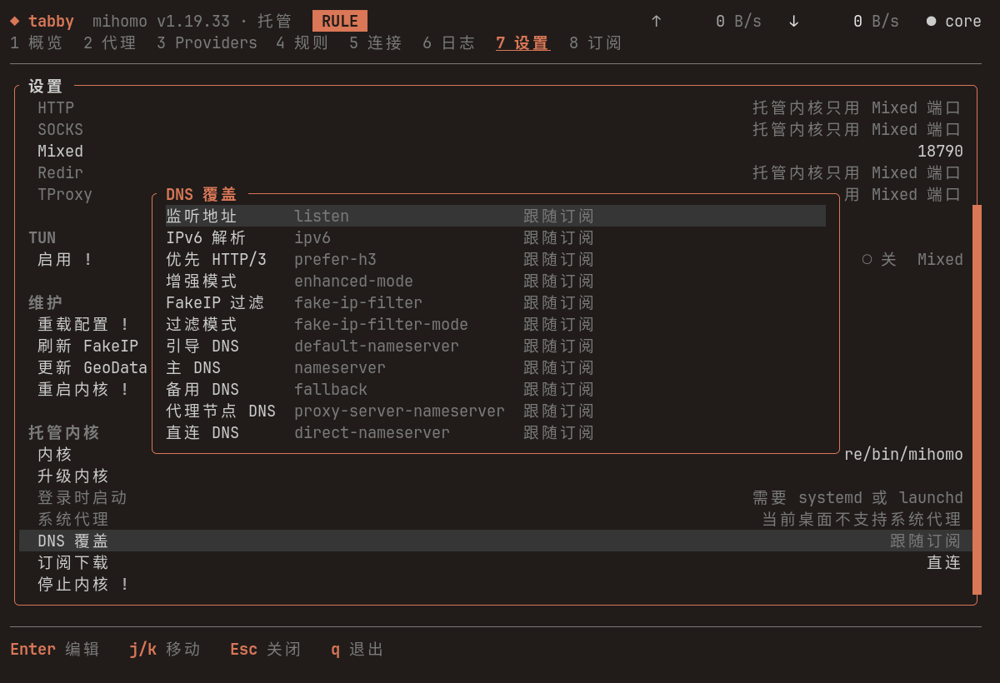

在「设置 → 托管内核 → DNS 覆盖」打开编辑项。覆盖值按键合并到当前订阅的 `dns` 段。未设置的键继续采用订阅自身的值。

## 可以编辑的字段

| 类型 | 字段 |
| --- | --- |
| 开关 | `ipv6`、`prefer-h3` |
| 选项 | `enhanced-mode`、`fake-ip-filter-mode` |
| 文本 | `listen` |
| 列表 | `fake-ip-filter`、`default-nameserver`、`nameserver`、`fallback`、`proxy-server-nameserver`、`direct-nameserver` |

`enhanced-mode` 可选 `fake-ip` 和 `redir-host`。`fake-ip-filter-mode` 可选 `blacklist`、`whitelist` 和 `rule`。修改模式或名称服务器前，先确认当前订阅的规则与 DNS 用法。

## 修改和恢复

- **开关和选项**。选中字段后按 `Enter` 切换。轮到「跟随订阅」时，该字段恢复为订阅值。
- **文本和列表**。按 `Enter` 打开输入框，修改后按 `Enter` 提交，或按 `Esc` 取消编辑。列表项可用空格、中文逗号或英文逗号分隔。清空输入再提交可移除该字段的覆盖。

改动提交后，Tabby 用 `mihomo -t` 校验新配置。内核拒绝时，Tabby 会显示原因并保留原值。编辑完成后，按 `Esc` 关闭弹窗，内核会重载已通过校验的改动。重新访问一个域名后，可在[日志页](../../use/logs/)检查 DNS 报错。
