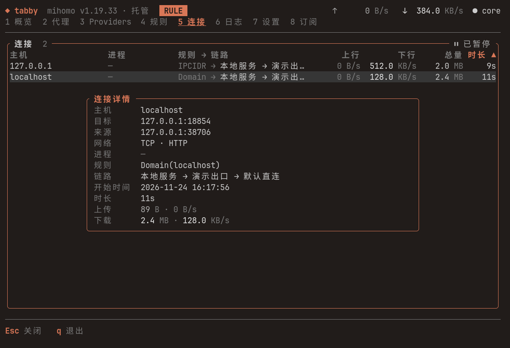

按 `5` 查看活动连接。选中一行后按 `Enter` 可查看来源、目标、进程、规则和代理链路。进程等字段取决于系统和内核上报能力。

## 找到异常连接

1. 按 `/` 输入域名、目标 IP、进程名、规则或链路的片段，然后按 `Enter` 保留过滤条件。
2. 按 `s` 切换排序列，按 `S` 反转顺序。也可以单击列标题排序。列表跳动时，可按 `p` 暂停刷新，再按一次恢复。
3. 按 `Enter` 打开详情，核对命中规则和实际经过的代理链路。

## 关闭连接

`x` 关闭选中的连接。用 `X` 打开批量关闭弹窗，核对范围后按 `y` 确认。已应用过滤时，批量关闭只作用于匹配项。关闭后应用仍可能重新建立连接。按 `Esc` 关闭当前弹窗，回到列表后可清除过滤。
