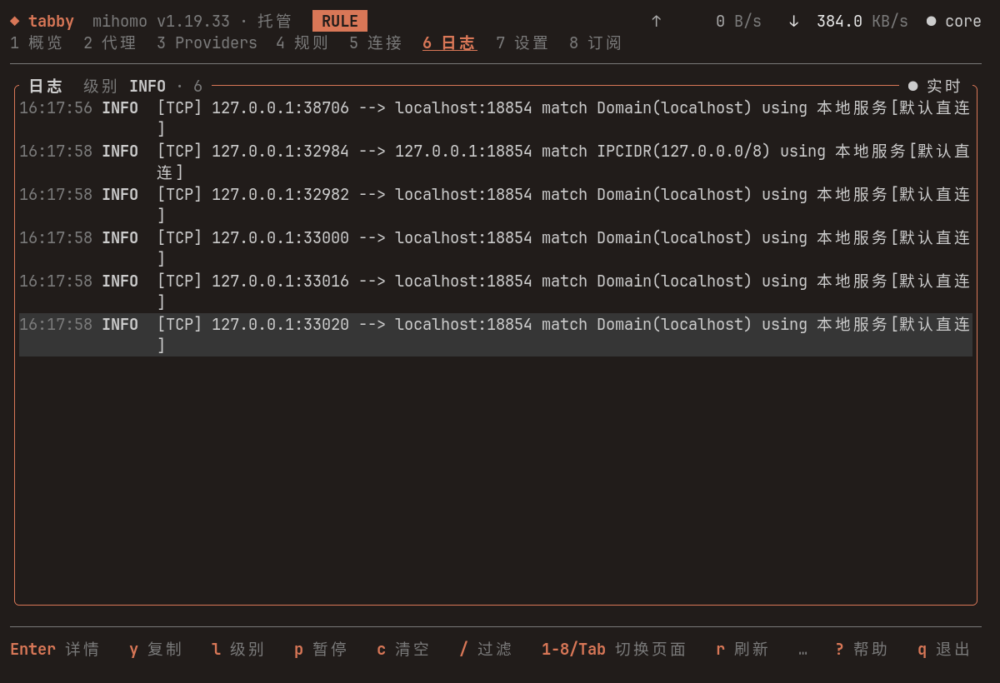

按 `6` 查看内核推送的日志。页面用于定位控制器操作、规则或代理错误。Tabby 自身的错误另写在 `tabby.log`，文件位置见[配置参考](../../reference/configuration/#文件位置)。

- `l` 循环切换日志订阅级别。要改变内核的日志级别，使用[设置页](../settings/)的「内核日志级别」。
- `/` 按文本过滤，`Esc` 清除。`Enter` 查看整条日志。终端支持并允许 OSC 52 时，按 `y` 可将当前条目复制到剪贴板。
- `p` 暂停或恢复，`gg` 跳到最早一条，`G` 跳到最新并继续跟随。
- `c` 清空当前 TUI 的日志列表。

日志中可能有域名、内网地址或订阅相关信息。对外反馈时，先删去敏感内容并附上 Tabby 与内核的版本。
