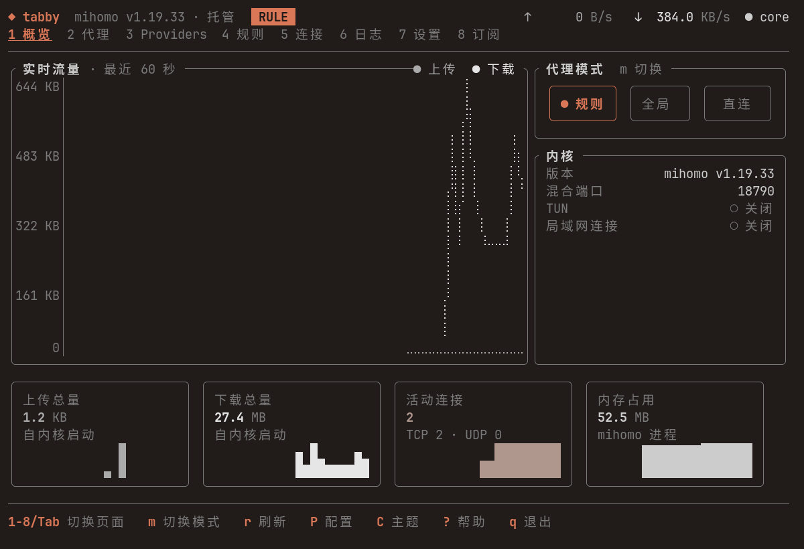

按 `1` 返回概览。顶栏显示当前配置和连接状态，折线图显示最近 60 秒的上传和下载速率。终端至少有 28 行时，底部还会显示累计流量、活动连接数和内存用量。

## 核对内核与流量

- **内核**区域显示版本、混合端口（Mixed）、TUN 和局域网连接状态。控制器未返回的值会以占位符或提示显示。
- **活动连接**统计来自连接快照。空闲时连接数为零，发起请求后可到[连接页](../connections/)查看规则和代理链路。
- **内存**统计取决于内核支持。原版 Clash 与 mihomo 的差异见[兼容性](../../reference/compatibility/)。

## 切换代理模式

按 `m` 依次切换「规则」「全局」「直连」，也可以单击概览里的模式按钮。规则模式按配置规则选择出口。全局模式使用[代理页](../proxies/)里的 `GLOBAL` 组。直连模式下，使用本地代理端口的应用仍会把流量交给内核，由内核直连目标。

断线后 Tabby 会尝试自动重连。也可以按 `r` 立即重试，或按 `P` 切换控制器。参见[故障排查](../../troubleshooting/)。
