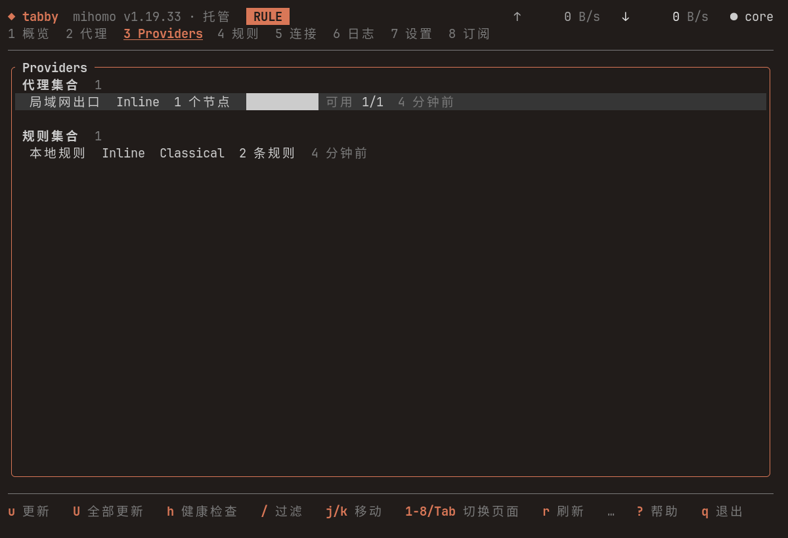

按 `3` 查看当前内核的代理集合和规则集合。管理托管内核使用的整份配置时，请前往[订阅页](../subscriptions/)。

| 按键 | 操作 |
| --- | --- |
| `u` | 更新当前 Provider |
| `U` | 批量更新。弹窗显示范围，按 `y` 确认 |
| `h` | 为选中的代理集合发起健康检查 |
| `/` / `Esc` | 按名称过滤 / 清除过滤 |

批量更新会处理全部 Providers。设置了名称过滤时，只处理匹配项。更新失败时可在[日志页](../logs/)查看报错，并检查集合地址能否从内核访问。规则集合的查看与更新需要 mihomo。
