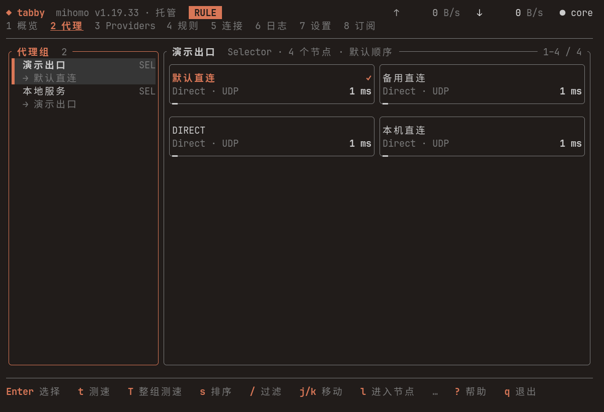

按 `2` 打开代理。宽窗口左侧是代理组，右侧是当前组的节点。窄窗口把组选择行移到节点列表上方，选中该行后按 `Enter` 展开组列表。

## 切换节点

1. 选中要操作的代理组。规则模式下可到[规则页](../rules/)查看目标组。切到全局模式时，`GLOBAL` 会出现在组列表顶部。
2. 宽窗口可按 `Enter` 或 `l` 进入节点区，窄窗口可在组选择行按 `l` 或 `↓` 进入。选中节点后按 `Enter` 应用。支持手动选择的组才会切换节点。
3. 确认当前节点标记已经变化。已建立的连接可以仍走原链路，新连接的去向可在[连接页](../connections/)核对。

## 测试与筛选

- `t` 测当前选中的节点，`T` 测整个组。整组测速需要 mihomo。
- `s` 在默认顺序、延迟和名称排序之间切换。测速超时后可以换用实际可访问的测速地址，配置见[测速参数](../../reference/configuration/#测速参数)。
- `/` 按名称过滤节点，`Enter` 保留过滤条件，`Esc` 清除。
- 左右移动可用 `h`、`l` 或方向键。节点区最左列再向左可返回组列表或组选择行。
