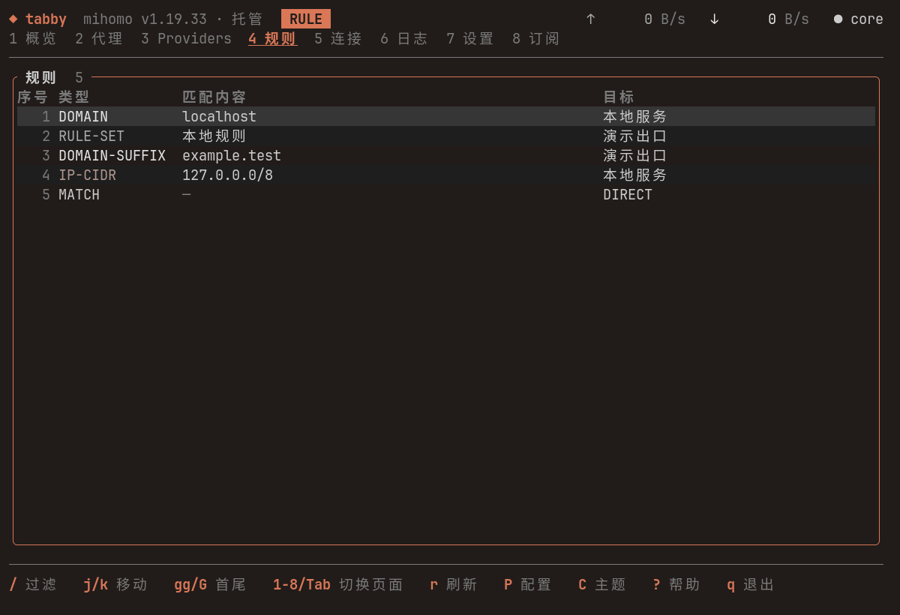

按 `4` 查看当前已加载的规则。列表按内核返回的顺序显示，可以核对规则类型、匹配内容和目标。规则模式中，内核按配置顺序决定匹配结果。

按 `/` 输入规则类型、匹配内容或目标策略的片段，按 `Enter` 保留过滤结果。过滤结果沿用内核顺序和原有行号。按 `Esc` 清除过滤，用 `gg` 和 `G` 跳转到列表首尾。

排查某次访问时，先到[连接页](../connections/)打开详情，查看命中的规则和链路。回到规则页查找目标策略，再到[代理页](../proxies/)核对目标组所选节点。若命中 `RULE-SET`，可在 [Providers](../providers/) 页查看对应集合。
