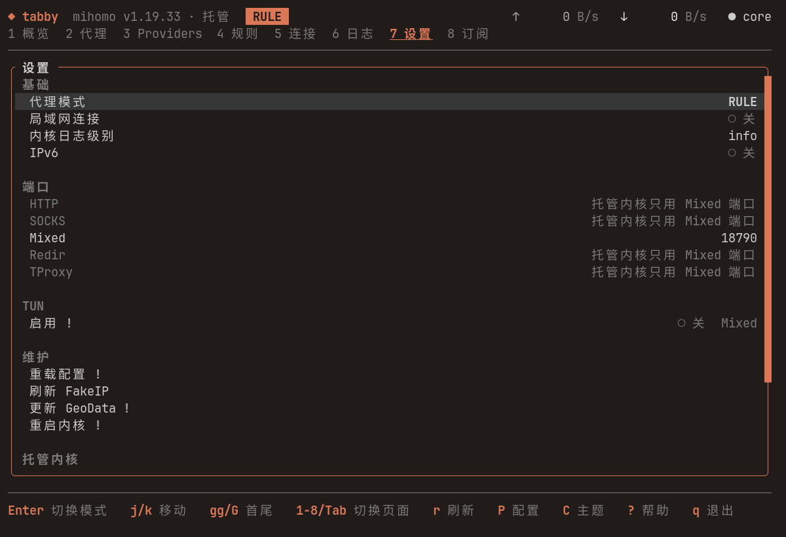

按 `7` 进入设置。用 `j`、`k` 或方向键移动，按 `Enter` 或空格切换开关或执行操作。选中端口后按 `Enter` 编辑，再按 `Enter` 提交或按 `Esc` 取消。出现确认弹窗时，按 `y` 确认，按 `n` 或 `Esc` 取消。

## 基础、端口和维护

- **基础**包括代理模式、局域网连接、内核日志级别和 IPv6。修改的是当前控制器。
- **端口**显示内核的代理入口。托管模式只开放 Mixed 端口供编辑。改端口前确认新端口可用，修改后同步更新应用里的代理地址。
- **维护**包括重载配置、刷新 FakeIP、更新 GeoData 和重启。连接外部控制器时，mihomo 的「升级内核」也在此处。重载或重启可能中断现有连接。

## 托管内核

托管模式会多出「内核」「升级内核」「登录时启动」「系统代理」「DNS 覆盖」「订阅下载」「停止内核」等选项。当前平台或内核不支持的操作会禁用或提示原因。

详细步骤见[内核生命周期](../../manage/kernel/)、[DNS 覆盖](../../manage/dns/)和[系统集成](../../manage/system-integration/)。
