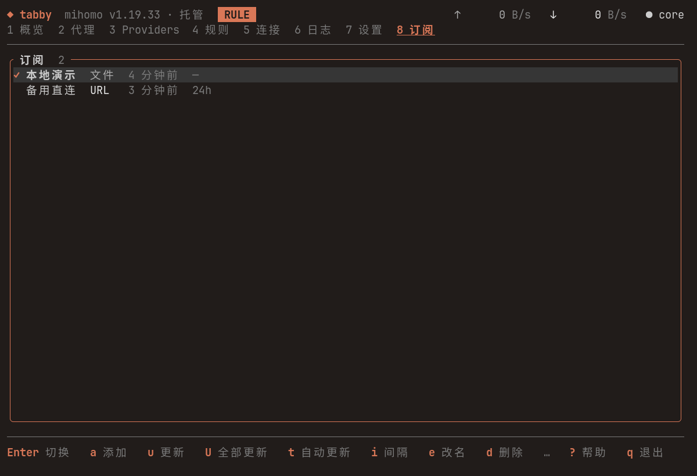

按 `8` 进入订阅页。此页需要[启用托管模式](../../quick-start/managed/)。列表中的使用项决定当前托管内核加载的配置。

| 按键 | 操作 |
| --- | --- |
| `a` | 输入 URL 或本地文件路径，导入一份订阅 |
| `Enter` | 应用选中的订阅 |
| `u` / `U` | 更新当前订阅 / 打开批量更新确认，更新全部或匹配项 |
| `t` / `i` | 切换 URL 订阅的自动更新 / 设置间隔（小时） |
| `e` / `K` | 改名 / 更换 age 私钥 |
| `d` | 打开删除确认。使用中的订阅须先切换再删除 |
| `/` / `Esc` | 按名称过滤 / 清除过滤 |

导入第一份订阅时，Tabby 会自动启用它。之后新增的订阅会出现在列表中，选中并按 `Enter` 才会切换。下载方式、自动更新和失败处理见[订阅管理](../../manage/subscriptions/)。
